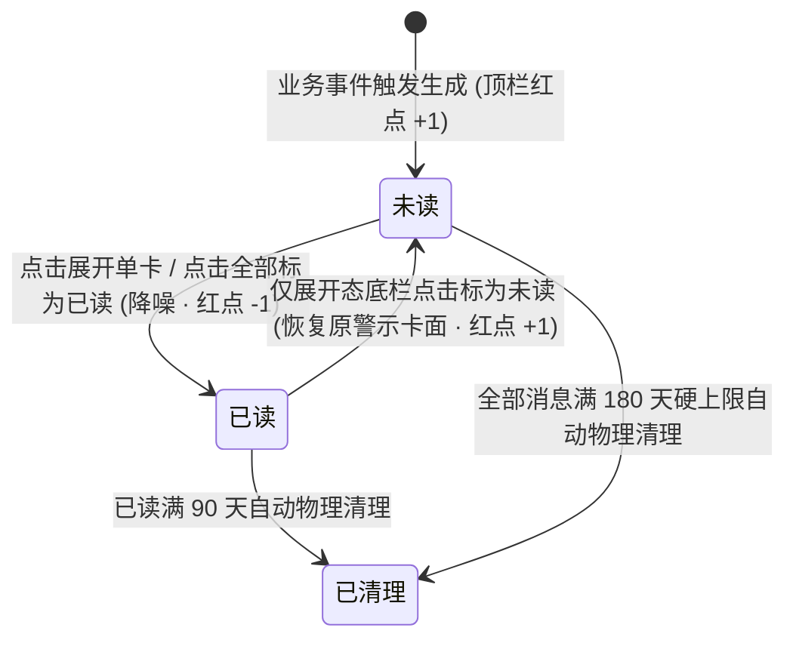
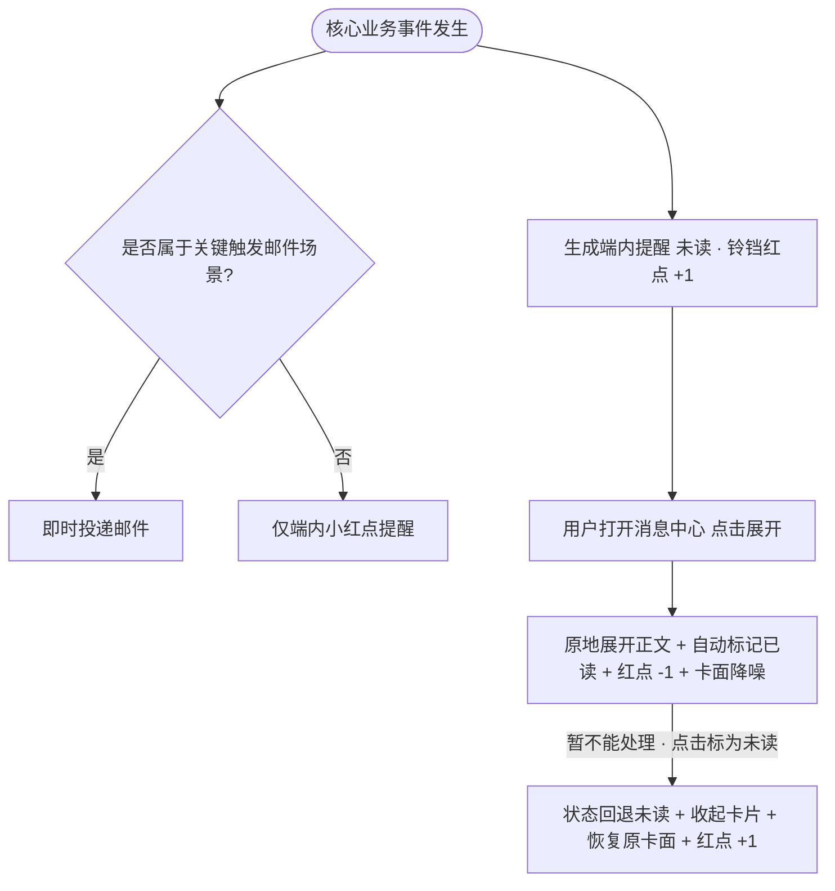

/** (c) 2024-2026 Topee (https://topee.top). All rights reserved. Proprietary and confidential. */

# 产品需求文档 (PRD) — 模块四：极简消息提醒与关键邮件通知 (Notification & Key Emails)

| **文档属性** | 内容 |
| :--- | :--- |
| **文档版本** | v2.1（Red-Team 收口与 SSOT 归口版） |
| **所属模块** | 模块四：消息提醒与邮件通知 |
| **关联子模块** | [m0_workspace_and_home.md](./m0_workspace_and_home.md)（顶栏小红点与首页通知卡）｜ [m1b](./m1b_teacher_profile.md)/[m1c](./m1c_classes.md)/[m1e](./m1e_courseware.md)（师资/小班/课件）｜ [m2a](./m2a_course_orders.md)（续费与划转）｜ [m3b](./m3b_attendance_substitution.md)/[m3d](./m3d_course_scheduling.md)（考勤代课与排课）｜ [m5a](./m5a_transfer_collection.md)/[m5b](./m5b_weekly_settlement.md)（周转与课酬） |
| **创建与更新日期** | 2026-11-05（创建） / 2026-11-13（收敛为「关键触发邮件 + 极简端内小红点列表」，取消多级通知矩阵与 30 分钟未读扫邮） / 2026-11-14（引入 `DESIGN.md §2.2.1` 三种语义卡面区分轻重缓急与已读自动降噪规则） / 2026-11-21（补充同家庭 1v1 待排课次划转、在学课件变更与自动续费托管班长路由） / 2026-11-22（**Red-Team 收口与 SSOT 对齐**：落地 D1=A 周课酬单草稿生成提醒、D2=A 老师请假待代课按三档时间窗分级并收紧邮件触发条件、L1–L4 文档对齐、补全跨模块入边索引与站内提醒四支柱 SSOT，全面去技术化与纯积分清洗；收口 `1v1 续费 < 24h` 释放警示及 `>3h` 代课指派降噪音级，并新增跨组 `<3h` 紧急已代处理协同知会） |

---

## 1. 概述与执行摘要 (Executive Summary)
消息提醒与关键邮件通知模块（`m4`）采用**“关键触发邮件 + 极简端内小红点列表”**的轻量通知体系。遵循少儿教务“老师看日历与邮件、家长看微信与核心续费账单”的真实习惯，本模块彻底砍掉复杂的多级分发矩阵与 30 分钟未读定时扫描兜底机制，仅保留最关键业务节点的即时邮件触达与单页面就地展开的端内**消息中心**。当前阶段：MVP 正式功能迭代。

---

## 2. 问题定义与背景 (Problem Statement)
- **过度设计带来的维护成本**：多级通知路由、30 分钟未读扫描定时轮询与防刷合并队列带来了极高的状态与调度复杂度。
- **聚焦真实高频触点**：家长日常主要通过微信与班长沟通，仅需在“1v1 固定位自动续费账单、账单更正与临期提醒”时收到正式邮件；而老师依赖邮件与日历确认排课、被代课、排期释放、课酬发薪与课次时间变动。

---

## 3. 目标用户与角色画像 (Users & Personas)
- **出资家长（Amy）**：在端内铃铛列表看到排课/挪位/请假退回/划转/续费提醒，并在 1v1 固定位到期续费与改单时收到清晰的中英双语账单邮件。
- **老师（David）**：当收到新排课、请假挪位、小班解散或撤排释放、被代课指派、周课酬单出单与发薪通知时，即时收到邮件提示或在端内小红点查看详情（全流程只见节数、零金额展示）。
- **班长 / 小班主理人（Leo）**：在周一上午收到周转账单待确认催办邮件、续费冲突跳空人工补约提醒、管理员驳回退回重交通知，以及名下老师请假**命中已排课次**时的应急调度提醒。

---

## 4. 核心业务流程 (Main Flows)

### 4.1 关键触发邮件发送 (Key Triggered Emails)
仅针对以下核心业务事件即时发送邮件（单封即时触发，无需复杂合并队列）：
1. **家长侧**：1v1 固定位到期提前 7 天自动生成续费账单（首封提醒）、开课前 48 小时临期二次提醒、班长修改并保存自动续费账单后的更正通知邮件。
2. **老师侧**：新排课通知、课次请假退回/同师挪位变动通知、临时代课指派/撤销通知、**小班提前解散或撤排导致的原排期释放变动通知**、**周课酬单标记已打款通知**（发给老师的所有邮件严禁包含任何积分或金额数值）。
3. **班长 / 小班主理人 / 管理员侧**：每周一 `08:00` 待确认周转账单催办邮件（班长/主理人）、**老师请假命中至少 1 节已排课次时的应急调度提醒邮件**（1v1 发负责班长，小班发主理人；仅请假空闲绿格不生成代办也不发邮件）、周一 `08:30` 自动续费扫描存在部分周冲突跳过时的补约提醒邮件（资金托管班长 / 主理人 / 平台直收管理员）。

### 4.2 极简端内提醒列表（三种卡面分级 + 原地展开）
- **唯一入口**：全站顶栏右侧铃铛图标常驻未读小红点角标（`1~99`，`>99` 显示 `99+`）；点击进入消息中心页。
- **未读卡面轻重分级（严格引用 [DESIGN.md §2.2.1](../../DESIGN.md) 三种语义卡面，严禁出现“一级/二级/三级”等数字等级标识）**：
  1. **浅红紧急卡（带左侧粗红强调条 · 严格专属距开课 `< 3 小时` 即时履约救火）**：
     - 距开课 `< 3 小时` 临期请假/退回/挪位变动及 `< 3 小时` 临期新代课指派/撤销；
     - **距开课 `< 3 小时`（含小班突发停课紧急请假）且命中已排课次的老师请假待代课应急调度**。
  2. **浅黄提醒卡（当日 `3~24h` 调度 + 续费预警与冲突 + 周转财务）**：
     - 1v1 固定位提前 7 天生成续费账单、开课前 `48 小时` 临期未付催办、**`1v1 续费 < 24 小时` 即将逾期作废释放警示**；
     - **距开课 `3 ~ 24 小时`（当日临时）且命中已排课次的老师请假待代课应急调度**，以及老师侧 `3 ~ 24 小时` 新代课指派/课表变动；
     - 自动续费扫描遇部分周冲突跳过时向资金托管班长/主理人/管理员派发的人工补约待办提醒；
     - 周一 `08:00` 周转账单待确认催办、**管理员审核驳回周转账单（退回草稿待重交凭证）**；
     - 家长已传续费凭证待核实、家长申请调整续费单（附诉求标签与留言原文）。
  3. **中性卡（常规）**：
     - 普通新排课通知、常规 `>= 24 小时` 学员请假退回/同师挪位、`>= 24 小时` 新代课指派与撤销确认；
     - **距开课 `>= 24 小时`（常规提前）且命中已排课次的老师请假待代课应急调度**；
     - **老师请假命中已排 1v1 课次及课程结束超时未处理自动释放退回待排（提醒受影响家长）**；
     - **跨班长 `< 3h` 紧急驰援完成协同知会**：当其他班长协助处理了名下 `< 3h` 紧急待办或紧急课格（代课/退回/挪位/暂停待排/急救考勤）后，系统即时向**原负责班长 / 原小班主理人**（平台直管时向管理员）发送 1 条站内中性卡知会（`[跨组紧急已代处理]`，写明经办班长、原老师/小班时段及处理结果，不发邮件）；
     - **周课酬单草稿生成**（每周一 `03:00` 通知对应老师核对上周授课节数，**不发邮件、严禁含积分数值**）与**周课酬单标记已打款通知**（含管理员可选附加的发薪警告提示）；
     - 家长主动取消续费（4 周预占已释放，通知资金托管班长）、小班连续 2 轮自动续费未确认且无未来排课提醒主理人；
     - 老师预约离职日避让阻断自动续费提醒班长/主理人、一键催办小班主理人提前解散、班长解除职务冻结超 7 天自动解冻提醒管理员；
     - 家长调整孩子在学课件（合并去重为单条：通知名下有待上课次的授课老师及其负责班长；无待上课次时通知待排课次托管班长）；
     - 班长/管理员完成同家庭 1v1 待排课次划转（仅站内中性卡通知所属家长，不发邮件）；
     - 主理人执行小班提前结课解散（通知平台管理员：附小班名称、主理人、处置流向及作废节数与积分快照，可直达已提前解散列表核对；同时向**原授课老师**发送排期释放变动提醒）；
     - 跨班长代课（如 A 班长为其负责老师甲指派 B 班长负责老师乙代课）期间由 A 或管理员记录代课老师乙迟到/早退/旷课时，同步向代课老师负责班长 B 发送 1 条中性卡协同知会（`[跨组代课履约提醒]`）。
  - *(注：凡涉及积分与账单总额的要素严格仅面向家长、班长、主理人或管理员展示；发往老师端的所有提醒卡片与邮件严禁透出任何积分或金额数值。)*
- **已读自动降噪规则**：当浅红紧急卡或浅黄提醒卡被点击展开（或点击 `[ 全部标为已读 ]`）转为 **`已读`** 状态后，卡片底色与边框**自动降级为普通中性卡外观**，**仅保留标题左侧对应的红色/黄色语义圆点（圆点规格见 DESIGN.md）** 并隐藏未读圆点，确保视觉焦点永远留给未读急事。
- **单页面就地折叠展开**：废除独立消息详情页与双列表结构；所有提醒以独立圆角无投影卡片呈现，点击卡片原地手风琴展开**中英双语自然正文段落（不使用表格或结构化键值块）**，正文中需要着重注意的关键要素（如**日期时段、学员/老师姓名、截止时间、课次数与积分〔对老师隐藏积分〕**）予以**加粗**突出，底部右侧附带快捷跳转文字链（如 `[ 查看课表 → ]`、`[ 去续费 → ]`、`[ 立即处理 → ]`），展开瞬间自动标记为 **`已读`** 并递减红点计数。
- **顶栏一键已读与已读回退未读**：
  - 提供顶栏 `[ 全部标为已读 ]` 按钮，一键清除当前账号所有未读红点并统一触发已读卡面降噪；
  - **支持单卡“标为未读”回退**：用户点开消息但暂时无法立即处理时，**仅限在该具体已读卡片的展开态底栏内**点击 **`[ 标为未读 ]`**（不设全局或批量改回未读入口）；系统立即将该单条消息状态改回 **`未读`**、自动收起卡片，**恢复其原本对应的浅红紧急/浅黄提醒卡面**，并使顶栏铃铛未读红点 `+1`。

### 4.3 中英双语段落顺序与重点加粗
- **发给老师的通知与邮件**：统一采用**英文段落在前、中文段落在后**的双语对照排版，方便外教首眼直读；
- **发给家长、班长、管理员的通知与邮件**：统一采用**中文段落在前、英文段落在后**（或以中文为主）；
- **关键信息着重加粗**：正文中涉及行动或核对的关键文字（时间、人物、截止节点等）统一**加粗**展示，不套用展示表格。

### 4.4 站内提醒唯一归口规范 (Entity Lifecycle, Fields, Logs & Retention SSOT)

> 本模块为全系统**【站内提醒】**实体的唯一定义归口（`SSOT`）。各触发模块仅驱动生成提醒入边并附上单向指针，严禁在触发方 PRD 重复定义卡面映射、状态机或清理规则。

#### 1. 生命周期状态机与转移矩阵
- **状态转换图**：

- **状态转移与入边汇总规则**：
  | 状态跃迁 | 触发角色 / 机制 | 触发条件与前置守卫 | 业务结果与约束 |
  | :--- | :--- | :--- | :--- |
  | `[*] -> 未读` | 各业务触发源（[M1B](./m1b_teacher_profile.md)/[M1C](./m1c_classes.md)/[M1E](./m1e_courseware.md)/[M2A](./m2a_course_orders.md)/[M3B](./m3b_attendance_substitution.md)/[M3D](./m3d_course_scheduling.md)/[M5A](./m5a_transfer_collection.md)/[M5B](./m5b_weekly_settlement.md)） | 命中 §4.2 任一事件条件（如老师请假必须命中至少 1 节已排课次；家长改课件同一提交合并去重） | 写入接收账号下的站内提醒，按事件紧迫度固化卡面级与中英双语正文；顶栏红点 `+1`（小班类事件严禁面向家长账号生成） |
  | `未读 -> 已读` | 消息所属接收账号本人 | 在消息中心页点开未读卡片原地展开，或点击顶栏 `[ 全部标为已读 ]`（含首页通知条点击标记已读） | 记录已读时间，顶栏红点对应递减，浅红/浅黄卡面自动降噪为中性卡外观（保留语义圆点） |
  | `已读 -> 未读` | 消息所属接收账号本人 | 仅限在该具体已读卡片的展开态底栏点击 `[ 标为未读 ]`（不设批量回退入口） | 清除已读展示态并自动折叠收起卡片，恢复原本对应的浅红/浅黄/中性卡面，顶栏红点 `+1` |
  | `已读/未读 -> 已清理` | 系统定期清理任务 | 已读消息距生成/已读满 `90 天`，或任意消息距生成满 `180 天` | 执行定期物理清理回收，不进入界面展示列表 |

#### 2. 关键字段可编与锁定边界
| 业务字段 | 生成后是否可编 | 变更角色与操作入口 | 锁定与禁止修改场景 |
| :--- | :---: | :--- | :--- |
| **接收账号、业务标签、中英双语标题与正文、卡面紧急度、跳转入口** | **不可修改** | 创建即按触发源事件快照固化 | 生成后全平台永久只读，严禁任何角色编辑改写或手工删除；即使原关联单据后续变更（如账单已付/课次已撤销），历史提醒正文保持原事实快照不回改 |
| **阅读状态（`未读` / `已读`）** | **可逆切换** | 仅消息所属登录账号本人（展开、全部已读、单卡 `[ 标为未读 ]`） | 跨账号严禁读写他人的消息阅读态 |

#### 3. 状态流转与日志边界
- **单条记录轻量留痕**：每条站内提醒自身保留 `生成时间` 与最近一次 `已读状态更新时间`，用于排序、相对时间展示与 90/180 天自动清理判定；
- **免写独立冗余审计表**：因点开消息、全部标为已读及单卡回退未读属于高频个人阅读交互，不涉及资产或课次变动，系统**不额外写入跨模块独立审计日志流水表**。

#### 4. 数据留存与清理策略（L2 统一口径）
- **保留与物理清理阈值**：**已读消息满 90 天**自动物理清理；**全部消息（含长期未读硬上限）满 180 天**后强制定期物理清理；
- **界面默认查询窗口**：消息中心列表与分页默认展示**最近 90 天**内的有效记录（超出 90 天的历史未读记录不进默认首屏列表干扰日常处理，满 180 天后自动清理）。

#### 5. 邮件投递托管与零外溢边界
- **关键邮件投递边界**：关键邮件的发送触发、投递状态与失败重试统一交由平台既有邮件发送通道托管，本模块业务层不再单独维护邮件投递流水实体；
- **纯导航无写入副作用**：点击通知卡右下角快捷跳转文字链仅作目标页面定位导航，阅读或标记未读操作除联动更新顶栏铃铛计数及 [M0](./m0_workspace_and_home.md) 首页代表通知卡外，不对购课单、课次 TS、周转账单或课酬单产生任何写入副作用。

---

## 5. 用户故事 (User Stories)
- **US-4-01（核心续费邮件）**：作为一个家长，我希望在固定位即将到期生成续费单、账单改期更正或临近释放时收到邮件账单提醒，以便于及时付款保住老师的黄金时段。
- **US-4-02（老师排课变动直达）**：作为一个老师，我希望当学员请假、挪位、小班提前解散释放排期、被指派代课或周一课酬单出单/打款时收到清晰提醒，以便于第一时间知晓课表与履约状态（且全程无金额干扰）。
- **US-4-03（极简小红点与就地展开）**：作为一个用户，我希望点击顶栏铃铛进入单页面消息列表，点开某条消息就能直接看到详情和已读消点，无需反复跳转页面。
- **US-4-04（班长/主理人关键调度与催办）**：作为一个班长或小班主理人，我希望在周一上午收到待转账单催办、审核驳回重交提醒、续费冲突跳空人工补约待办，以及名下老师请假命中已排课次时收到按紧迫度分级的应急调度提醒，避免漏处理任何急事。

---

## 6. 验收标准清单 (Acceptance Criteria)
- **AC-4-01（关键触发邮件范围）**：1v1 固定位自动续费账单（含改单重发更正）与 48 小时临期提醒、老师新排课/挪位/代课变动/小班解散与撤排释放/周课酬单已打款、周一 `08:00` 班长转账催办、自动续费冲突周跳过补约提醒，以及老师请假**命中至少 1 节已排课次**时的应急调度，必须在事件触发后 `1 分钟`内发出邮件；老师仅请假空闲绿格时**不得**触发邮件与待办，周课酬单草稿生成及同家庭待排划转仅发端内中性卡、**不得**触发邮件。
- **AC-4-02（取消冗余扫描与等级编号）**：系统**不得**运行“30 分钟未读扫描补发邮件”定时任务；端内与邮件界面**严禁**出现“一级/二级/三级”或“Level 1/2/3”等等级数字标识。
- **AC-4-03（单页面就地展开与自动消点）**：在消息中心页点击任意未读消息卡片，卡片在原位平滑展开完整正文，并在 `200ms` 内同步将该消息置为已读、顶栏铃铛红点数减 1。
- **AC-4-04（全部标为已读）**：点击顶栏 `[ 全部标为已读 ]` 后，所有未读消息置为已读，顶栏红点角标立即隐藏。
- **AC-4-05（小班课隔离与老师纯节数隔离）**：小班课无家长账号，小班解散、暂停待排或代课变动严禁触发家长端通知或邮件，仅通知主理人/授课老师/管理员（按职责路由）；发往老师端的全部邮件与站内卡片严禁出现任何积分或金额数值。
- **AC-4-06（三种卡面映射与已读自动降噪）**：未读消息必须严格按 [DESIGN.md §2.2.1](../../DESIGN.md) 映射为浅红紧急卡（严格专属 `<3 小时` 临期请假/挪位/代课指派与撤销、`<3 小时` 命中已排课次的老师请假应急调度）、浅黄提醒卡（7 天/48 小时/`24 小时`内续费即将释放警示、`3~24 小时` 老师请假应急调度与当日新代课变动、续费冲突跳空待办、周一转账催办/审核驳回、家长传凭证/申请调整）或中性卡（其余常规通知含 `>=24 小时` 老师请假待代课与常规代课确认/撤销、老师请假/超时退回告知家长、跨组 `<3 小时` 紧急已代处理协同知会、周课酬单草稿生成与已打款、小班解散释放排期等），且严禁出现等级数字标识；任意浅红/浅黄卡片在点击展开或全部标为已读后，底色立即降级为中性卡外观，仅保留标题左侧对应颜色的语义圆点。
- **AC-4-07（单卡已读回退为未读与视觉恢复）**：仅支持在具体已读消息卡片的展开态内点击 `[ 标为未读 ]`（页面顶栏不设批量改回未读按钮）；点击后 `200ms` 内该单条消息状态切回 **`未读`**，卡片自动折叠收起并恢复其原本对应的浅红紧急/浅黄提醒/中性卡面外观，顶栏铃铛未读红点数加 1；若处于 `[ 未读 (N) ]` 筛选视图下，该卡片继续保留并计入未读总数 `N`。
- **AC-4-08（消息保留期与默认列表窗口）**：消息中心默认列表仅展示最近 `90 天`内生成且未被清理的站内提醒（每页 `20` 条）；已读消息满 `90 天`自动物理清理，全部消息（含未读硬上限）满 `180 天`自动物理清理。

---

## 7. 本期范围外清单 (Out of Scope)
- **不支持多级通知分级矩阵与防刷合并队列**。
- **不支持 30 分钟未读扫描自动补发邮件兜底机制**。
- **不支持手机短信或微信公众号模板消息推送**。
- **不支持独立消息详情二级页面与手工编辑/删除站内提醒记录**。

---

## 8. 约束条件 (Constraints)
- **保留清理、窗口与默认排序**：已读消息满 `90 天`、全部消息（含未读硬上限）满 `180 天`定期自动物理清理；消息中心默认展示最近 `90 天`记录，分页每页 `20` 条，默认按**未读高优（浅红紧急卡 → 浅黄提醒卡 → 中性卡）置顶，其余按生成时间倒序**排列。
- **文案去技术化**：界面严禁出现工程技术词汇（如内部队列名、异步通道名称、底层状态编码或路由路径）。

---

## 9. UI/UX 界面线框说明 (Wireframe Level)
- **消息中心页**：
  - 顶栏：`< 返回` + `消息中心` + 右侧 `[ 全部标为已读 ]`；
  - 筛选胶囊：仅保留 **`[ 全部 ]`**、**`[ 未读 (N) ]`**（不设业务分类筛选）；
  - 消息卡片（严格遵循 [DESIGN.md §2.2.1](../../DESIGN.md) 三种卡面）：
    - **未展开态**：左侧对应颜色语义圆点（尺寸样式见 DESIGN.md）+ 业务标签（如 `[课程变动]`、`[续费提醒]`、`[转账催办]`、`[课酬对账]`）+ 加粗单行标题 + 右侧相对时间 + 未读圆点；下方展示 1 行关键摘要（学员/老师/时间）；
    - **展开态**：原地向下展开**中英双语自然正文（无表格/结构化键值块，发给老师英文在前、中文在后；关键时间/人物/截止要素加粗突出，对老师绝不显示积分或金额）**，底栏左侧提供 **`[ 标为未读 ]`** 文字链（点击后回退 **`未读`**、收起并恢复原警示卡面、红点 +1），右下角展示标准跳转文字链动作（如 `[ 前往查看 → ]`、`[ 去续费 → ]`、`[ 核对节数 → ]`）；
    - **已读降噪**：未读态按轻重呈浅红（含左侧粗红条）/浅黄/中性卡面；已读后统一降级为中性卡外观，保留对应颜色的语义圆点。

---

## 10. 用户流程图 (User Flow Diagram)

