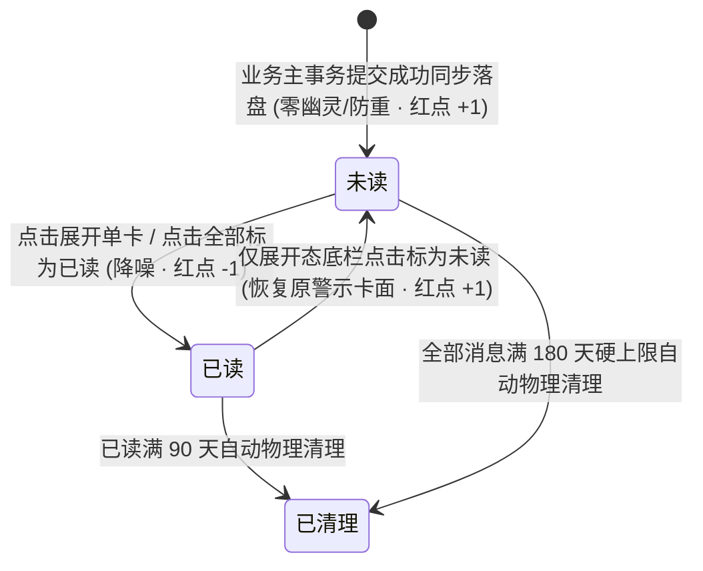
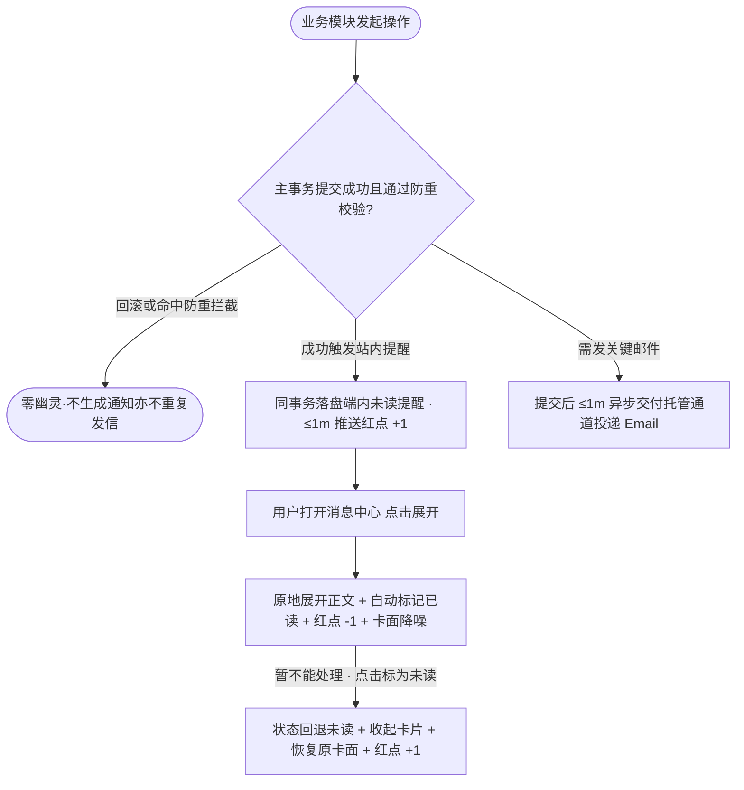

/** (c) 2024-2026 Topee (https://topee.top). All rights reserved. Proprietary and confidential. */

# 产品需求文档 (PRD) — 模块四：极简消息提醒与关键邮件通知 (Notification & Key Emails)

| **文档属性** | 内容 |
| :--- | :--- |
| **文档版本** | v3.1（能力底座红队收口版 · 接收视角隔离 / 混合原子契约 / 受控标签字典） |
| **所属模块** | 模块四：消息提醒与邮件通知能力底座 |
| **关联子模块** | [m0_workspace_and_home.md](./m0_workspace_and_home.md)（顶栏小红点与首页代表通知卡）｜ [m0a_auth_and_account.md](./m0a_auth_and_account.md)（账号绑定 Email 载体）｜ [GLOSSARY.md §4.1](../GLOSSARY.md#41-通知业务标签受控字典-controlled-notification-tags)（受控业务标签字典）｜ 各业务触发子模块（[M1B](./m1b_teacher_profile.md)/[M1C](./m1c_classes.md)/[M1E](./m1e_courseware.md)/[M2A](./m2a_course_orders.md)/[M2B](./m2b_refund_orders.md)/[M3A](./m3a_calendar_grid.md)/[M3B](./m3b_attendance_substitution.md)/[M3D](./m3d_course_scheduling.md)/[M5A](./m5a_transfer_collection.md)/[M5B](./m5b_weekly_settlement.md)） |
| **创建与更新日期** | 2026-11-05（创建） / 2026-11-13（收敛为「关键触发邮件 + 极简端内小红点列表」，取消多级通知矩阵与 30 分钟未读扫邮） / 2026-11-14（引入 `DESIGN.md §2.2.1` 三种语义卡面区分轻重缓急与已读自动降噪规则） / 2026-11-22（补全站内提醒四支柱 SSOT、单卡标为未读回退及去技术化清洗） / 2026-11-23（**能力底座纯化重构**：剥离一切具体业务触发事件枚举，本模块仅定义双通道发送能力、依赖的上游平台通道边界、端内收信/显示/只读生命周期与全局发送及脱敏限制；具体业务发送时机、接收对象、卡面选用与正文内容全部交由各自唯一归属的业务子 PRD 管辖） / 2026-11-23（**策略红队全面收口 `D1–D6` & `L-1–L-8`**：① `D1` 确立「账号投递 + 调用时显式声明『接收业务视角』」契约与首页公私分流隔离；② `D2/L-5` 确立「零幽灵通知、站内提醒随主事务原子落盘、关键邮件于主事务生效后异步托管重试」混合原子契约及 `≤1 分钟` 两段式口径；③ `D3` 收敛业务标签至 `GLOSSARY §4.1` 受控字典；④ `D4` 对齐 `DESIGN §2.2.1` 补全非时间窗高风险/资金异议/安全告警的浅红紧急卡授权条件；⑤ `D5/L-8` 明确临时触达载体定位与业务单据长期审计留痕分工；⑥ `D6` 新增可选防重标识及同内容 `60 秒` 轻量去重兜底；⑦ 补齐 `L-1~L-7` 留存期内只读措辞、失效/越权跳转降级、班长管理员禁露小名、无障碍语义辨识及含浅红卡一键已读二次确认） |

---

## 1. 概述与执行摘要 (Executive Summary)
消息提醒与关键邮件通知模块（`m4`）是全平台的**统一通知与关键邮件能力底座**，向各业务模块提供**“关键触发邮件（Email） + 极简端内站内提醒（小红点列表）”**双通道投递与展现能力。遵循 **SSOT 单一事实源边界**，本模块不列举具体业务发送场景——何时触发、发给谁、选用站内提醒还是同步发邮件、采用何种卡面等级以及正文携带哪些业务要素，100% 由各自唯一归属的业务模块子 PRD 定义；本模块专注约束**发送能力边界、依赖的平台基础通道、端内收信与已读/未读只读交互、生命周期留存及全局发送与隐私限制**。当前阶段：MVP 正式功能迭代。

---

## 2. 问题定义与边界原则 (Problem Statement & Scope Boundary)
- **避免双处定义导致的规格撕裂**：若在通知平台层重复枚举排课、续费、请假、周结、小班变动等具体业务场景，业务规则演进时极易出现业务 PRD 与通知 PRD 描述不一致。因此将触发条件、时点与受众彻底下沉至各业务模块 PRD。
- **去除过度调度机制**：摒弃多级数字分级矩阵、30 分钟未读扫描自动补发邮件兜底机制与防刷合并队列，采用事件即时触达与单页面原地展开的轻量化收信体系。

---

## 3. 目标用户与使用边界 (Users & Personas)
- **各业务子模块（能力调用方）**：按各自业务规则调用 M4 提供的站内提醒生成能力或邮件投递能力，**必须显式指定目标接收账号、`接收业务视角`（`家长` / `老师` / `班长` / `小班主理人` / `管理员`）、从 [GLOSSARY §4.1](../GLOSSARY.md#41-通知业务标签受控字典-controlled-notification-tags) 选取的标准业务标签、通用语义卡面等级、双语自然正文与可选跳转入口/防重标识**，并严格遵守 M4 全局脱敏与发送限制。
- **终端收信用户（家长 / 老师 / 班长 / 小班主理人 / 平台管理员）**：在端内通过顶栏铃铛小红点进入统一消息中心完成收信、阅读、已读降噪、单卡回退未读与快捷跳转，并在账号绑定 Email 中接收对应业务模块触发的关键即时邮件。

---

## 4. 核心能力与平台规则 (Platform Capabilities & Rules)

### 4.1 双通道发送能力、事务契约与平台依赖边界 (Delivery Capabilities, Atomicity & Dependencies)
1. **两类基础发送能力与强制调用契约**：
   - **端内站内提醒能力**：为指定目标账号生成一条包含 **`接收业务视角`**（必填：`家长` / `老师` / `班长` / `小班主理人` / `管理员`）、[GLOSSARY §4.1](../GLOSSARY.md#41-通知业务标签受控字典-controlled-notification-tags) **受控业务标签**、紧迫度卡面、中英双语自然正文、可选跳转入口及可选**防重标识**的站内记录，实时累加顶栏未读红点并进入统一消息中心列表；
   - **关键邮件（Email）即时投递能力**：向目标账号投递单封即时中英双语邮件（同样须指定 **`接收业务视角`** 与可选防重标识；仅当业务侧显式声明需发 Email 时调用，不自动附加“未读补发邮件”）。
2. **依赖的平台基础通道（零实现细节侵入，技术选型归口 TDD）**：
   - **唯一收件地址载体（依赖 [M0A 账号认证与安全](./m0a_auth_and_account.md)）**：全平台所有业务通知邮件的收件人地址唯一锚定接收方在 M0A 的当前账号绑定 Email；用户完成安全换绑邮箱后，后续新触发的邮件自动投递至新地址，业务层严禁另行缓存或使用私人联系邮箱覆盖账号载体；
   - **邮件外发与重试托管（依赖平台外发邮件与异步任务托管通道）**：关键邮件的触发执行、异步发送与失败重试统一交由平台既有邮件外发及异步托管通道承担，本模块及业务层**不自建邮箱网关、不维护独立的邮件投递流水表或重发后台页面**；
   - **端内实时角标刷新（依赖端内实时推送通道）**：在线用户收到新站内提醒时，依托端内实时推送通道同步刷新顶栏 🔔 未读计数及首页提醒状态。
3. **混合原子性、零幽灵通知与可靠性契约**：
   - **零幽灵通知铁律**：任何触发业务若因校验拦截、人工取消或并发冲突发生回滚而未生效，**严禁生成站内提醒，严禁外发关键邮件**，彻底杜绝“已撤销/未发生操作”的幽灵通知；
   - **站内提醒同事务原子落盘**：端内站内提醒记录随关联业务操作**在同一业务事务内同步落盘**——业务提交成功即确保站内提醒就绪可查（绝不因下游通知通道瞬时抖动静默丢失），在线端的顶栏角标实时推送则在主事务提交成功后异步触发（即使推送通道瞬时波动，用户打开或刷新【消息中心】仍可完整读取）；
   - **关键邮件事务后异步可靠投递**：关键邮件严格在**业务主事务确认提交成功后**再异步交付平台外发托管通道执行与失败自动重试；**外部邮件服务延迟或投递失败绝不反向阻断或回滚已成功确认的排课、收款、清退等主业务流程**。
4. **能力范围与视角协同红线**：
   - **不支持**基于“用户 X 分钟未读”的定时扫描自动补发邮件兜底；
   - **不支持**跨事件跨模块的防刷延迟合并队列（批量操作的摘要合并由具体触发业务方在调用前自行聚合成 1 次通知事件）；
   - **不支持**手机短信（SMS）或微信公众号模板消息推送；
   - **账号统一收件、视角严格分流**：同自然人账号在不同兼任角色（如班长兼家长、三合一管理员、老师兼家长）下共享唯一账号绑定 Email 与全站唯一顶栏 🔔【消息中心】，但**每条提醒的脱敏规则、双语语序、卡片来源微徽标及 [M0 首页](./m0_workspace_and_home.md) 家庭/老师专属聚合过滤，100% 严格按触发时传入的当条 `接收业务视角` 判定**（如 M0 首页「自家信息流 · 通知卡」仅抓取 `家长` 视角未读）；端内跳转链接与目标数据权限须实时遵守接收方当前有效业务权限边界。

### 4.2 端内收信、展现与只读标记规则 (In-App Receiving, Display & Read/Unread Rules)
- **唯一入口**：全站顶栏右侧铃铛图标常驻未读小红点角标（`1~99`，`>99` 显示 `99+`，`0` 隐藏）；点击进入单页面【消息中心】（无独立二级消息详情页）。
- **三种语义卡面通用分级准则（严格引用 [DESIGN.md §2.2.1](../../DESIGN.md)，严禁“一级/二级/三级”或 `Level 1/2/3` 数字等级标识）**：
  业务模块创建站内提醒时，统一依据以下标准从 3 档中择一指定卡面：
  1. **浅红紧急卡（带左侧粗红强调条）**：主锚用于距离课程开课不足 **`3 小时`** 的即时履约救火与突发应急变动，并严格限权覆盖 [DESIGN.md §2.2.1](../../DESIGN.md#221-卡片分级规范体系三种卡面与一个特例-three-surfaces--one-exception) 授权的三类**非时间窗紧急与高风险事件**：① 考勤异常与家长投诉待核（[M3B](./m3b_attendance_substitution.md)/[M5A](./m5a_transfer_collection.md)）；② 续费逾期已传凭证待急核及班长 `72h` 代清退异议复核告警（[M2A](./m2a_course_orders.md)/[M2B](./m2b_refund_orders.md)）；③ 账号与平台高危安全风险告警（[M0A](./m0a_auth_and_account.md)）；其余常规 `3~24h` 调度与普通续费催办严禁滥用浅红卡；
  2. **浅黄提醒卡**：用于当日（距离开课 **`3 ~ 24 小时`**）临期调度与变动、存在明确时间窗口或到期截止节点的预警、以及需要及时跟进核对的在途财务（周转账催办/驳回、未传凭证临期续费、代清退通知）或课表协同协商事项；
  3. **中性卡（常规）**：用于提前 **`>= 24 小时`** 的常规排期/协同知会、常规财务结果告知及已读降噪后的统一稳定卡面。
- **列表排序与查询窗口**：
  - 筛选胶囊仅保留 **`[ 全部 ]`**、**`[ 未读 (N) ]`**（不设细碎业务分类筛选）；
  - 默认展示最近 **`90 天`** 内有效记录，分页每页 **`20 条`**；默认按**未读高优（浅红紧急卡 → 浅黄提醒卡 → 中性卡）置顶，其余按生成时间倒序**排列。
- **原地手风琴展开、自动已读降噪与无障碍/跳转降级**：
  - 未展开态展示：左侧对应语义圆点（无障碍可读辨识：浅红紧急/浅黄提醒语义圆点辅以高对比微图形符号区分〔如紧急警示微标〕以便已读降噪成中性底色后色盲用户仍可直辨，严禁新增文字/数字等级标签）+ [GLOSSARY §4.1](../GLOSSARY.md#41-通知业务标签受控字典-controlled-notification-tags) **受控业务标签**（如 `[课程变动]`、`[续费提醒]`、`[转账催办]`、`[课酬对账]`，严禁自由造词）+ 视角来源中性微徽标（当账号具备多身份视角时展示，如 `家庭` / `教务` / `授课` / `管理`，采用中性浅灰微胶囊避免视觉杂色）+ 加粗单行标题 + 右侧相对时间 + 未读圆点 + 1 行关键摘要；
  - 点击未读卡片后**原地向下平滑展开完整正文**，并在 **`200ms`** 内自动将状态切换为 **`已读`**、顶栏铃铛未读数 `-1`；卡片底色与边框立即**降噪为中性卡外观**，仅保留标题左侧对应颜色与微图形的语义圆点并隐藏未读圆点；
  - 展开态右下角展示业务侧传入的标准快捷跳转文字链（如 `[ 查看课表 → ]`、`[ 去续费 → ]`、`[ 立即处理 → ]`），仅作目标页面定位导航，不对关联业务单据产生任何写入副作用；
  - **跳转目标失效与权限变更降级**：
    - **目标对象已变更/取消**：若跳转指向的购课/清退/转账单据仍保留只读快照（如已作废、已生效、已解散归档），照常进入其只读详情页展示当前终态；若指向的具体课次已取消或无独立详情页，自动落至对应周课表/业务默认列表页并展示温和中性提示「**该关联事项已取消或更新**」，严禁页面报错或白屏；
    - **接收方权限已撤销/变更**：若接收方事后因管理员撤职、老师离职或调出管辖组等原因丧失目标页面访问权，点击跳转时由端内与后台共同拦截，展示中性提示「**您当前暂无权限查看该关联内容**」，不修改原历史提醒记录。
- **顶栏一键已读（含防误触）与单卡“标为未读”回退**：
  - 顶栏右侧提供 **`[ 全部标为已读 ]`**：若当前未读列表中存在**至少 1 条浅红紧急卡**，点击后弹出轻量二次确认（「当前尚有 `N` 条浅红紧急提醒尚未展开查看，确认全部标为已读吗？」），确认后执行；若当前未读中无浅红紧急卡，则直接一键全部置为已读，清除顶栏红点并统一触发卡面降噪；
  - **仅限在具体已读卡片的展开态底栏左侧**提供 **`[ 标为未读 ]`**（严禁设置全局或批量改回未读按钮）：点击后 **`200ms`** 内状态改回 **`未读`**、卡片自动折叠收起并恢复原本对应的浅红/浅黄/中性卡面外观，顶栏红点计数 `+1`（若处于 `[ 未读 (N) ]` 筛选视图下，该卡片保留并计入未读总数 `N`）。

### 4.3 发送限制、双语排版与全域脱敏铁律 (Limits, Bilingual Layout & Privacy Rules)
1. **触发时效两段口径与底座去重兜底**：
   - **时效拆分边界**：**端内站内提醒**随关联业务主事务提交生效后立即可查，在线端的实时角标推送须在提交后 **`≤ 1 分钟`** 内完成触发（离线或实时通道瞬时波动下，打开或刷新【消息中心】即刻可见）；**关键邮件**须在业务主事务确认生效后 **`≤ 1 分钟`** 内提交至平台异步外发托管通道进入投递队列（外部邮箱最终送达耗时受接收方邮件服务商网络影响，发送异常由平台托管通道自动重试）；
   - **两层防重/去重保护**：业务方存在单次多格批量操作（如多周排课）或多孩同家庭同班级变更时，由触发业务方在调用 M4 前完成摘要合并；同时 M4 底座提供两道防重兜底——① 若调用方传入唯一**防重标识**，相同防重标识的重复调用直接拦截（不重复生成卡片，不重复触发邮件）；② 若未传防重标识，底座对同一接收账号、同一`接收业务视角`、同一受控业务标签且正文内容完全一致的连续调用，在 **`60 秒`** 防重窗口内仅保留首条，阻断连发轰炸。
2. **中英双语段落顺序与正文排版（严格按当条 `接收业务视角` 判定）**：
   - **当条 `接收业务视角 = 老师` 时**：强制**英文段落在前、中文段落在后**，方便外籍老师首眼直读（即便该自然人账号同时兼任家长或班长，发往其授课视角的通知仍严格保持英文在前）；
   - **当条 `接收业务视角 ∈ {家长, 班长, 小班主理人, 管理员}` 时**：强制**中文段落在前、英文段落在后**（或以中文为主）；
   - **正文排版限制**：统一采用自然文本段落，正文中涉及核对或行动的关键要素（时间、人物、节数、截止节点等）予以**加粗**突出，**严禁在正文中使用结构化表格或键值块**；界面与邮件文案严禁透出工程技术词汇。
3. **全域隐私与敏感字段脱敏红线（严格按当条 `接收业务视角` 判定）**：
   - **老师视角零财务、零小名红线**：任何 `接收业务视角 = 老师` 的站内提醒卡片与 Email 邮件，**严禁包含任何积分数值、内部单价或货币金额**（仅允许展示授课节数、课程时间、课次事实与备忘交接内容），且**严禁透出学员中文小名**（全量统一使用学员**`规范英文名`**如 `AliceZ12`）；
   - **班长 / 小班主理人 / 管理员视角禁露小名红线**：除 M1A 档案抽屉外，凡 `接收业务视角 ∈ {班长, 小班主理人, 管理员}` 的日常业务流水提醒与邮件，**统一主显学员`规范英文名`，严禁透出学员中文小名**（对齐 [GLOSSARY.md](../GLOSSARY.md) 全端隐私隔离口径）；
   - **家长视角（含小班零同班隐私与零线上财务红线）**：`接收业务视角 = 家长` 的 1v1 通知可标明自家孩子`规范英文名`（允许附带自家孩子中文小名）；但凡经由小班业务向已绑定正式学员家长账号发送的站内提醒与 Email 邮件，**严禁透出任何学费金额、积分单价、班内总人数、空余名额或其他同班同学姓名**；
   - **留存期内历史快照不可逆篡改**：提醒生成时即按当时业务事实、视角脱敏规则与紧迫度固化中英双语标题、正文与卡面等级，之后在 **§4.4 规定的留存期内全平台只读不可篡改**（即便原关联订单/课次后续状态变化或接收方权限变更，历史消息正文也不回改、不允许手工编辑或手工删除），期满由系统定期物理回收。

### 4.4 站内提醒唯一归口规范 (Entity Lifecycle, Fields, Logs & Retention SSOT)

> 本模块为全系统**【站内提醒】**实体的唯一定义归口（`SSOT`）。各触发模块只需按业务规则驱动生成提醒并传入 `接收业务视角`、受控标签、卡面、通道与脱敏正文，严禁在触发方 PRD 重复定义本节状态机、已读/未读规则、只读边界或清理周期。

#### 1. 生命周期状态机与转移矩阵
- **状态转换图**：

- **状态转移汇总规则**：
  | 状态跃迁 | 触发角色 / 机制 | 触发条件与前置守卫 | 业务结果与约束 |
  | :--- | :--- | :--- | :--- |
  | `[*] -> 未读` | 上游业务模块调用生成 | 业务主事务成功提交（回滚绝不产生幽灵提醒）；传入必填 **`接收业务视角`** 与 [GLOSSARY §4.1](../GLOSSARY.md#41-通知业务标签受控字典-controlled-notification-tags) **受控业务标签**，通过 §4.3 去重防重校验并符合双语与脱敏约束 | 与主事务同事务写入接收账号下的站内提醒，固化视角来源、受控标签、卡面等级、双语标题正文、摘要与跳转入口；顶栏红点 `+1`（在线实时角标及关联 Email 于提交后 ≤1m 异步触发） |
  | `未读 -> 已读` | 消息所属接收账号本人 | 在消息中心页点开未读卡片原地展开，或点击顶栏 `[ 全部标为已读 ]`（若含浅红卡须先通过轻量二次确认；含首页通知条点击标记已读） | 记录已读时间，顶栏红点对应递减，浅红/浅黄卡面自动降噪为中性卡外观（保留语义圆点与无障碍微图形符号） |
  | `已读 -> 未读` | 消息所属接收账号本人 | 仅限在该具体已读卡片的展开态底栏点击 `[ 标为未读 ]`（不设批量回退入口） | 清除已读展示态并自动折叠收起卡片，恢复原本对应的浅红/浅黄/中性卡面，顶栏红点 `+1` |
  | `已读/未读 -> 已清理` | 系统定期清理任务 | 已读消息距生成/已读满 `90 天`，或任意消息（含财务/安全类提醒）距生成满 `180 天` | 执行定期物理清理回收，不进入界面展示列表 |

#### 2. 关键字段可编与锁定边界
| 业务字段 | 生成后是否可编 | 变更角色与操作入口 | 锁定与禁止修改场景 |
| :--- | :---: | :--- | :--- |
| **接收账号、`接收业务视角`、受控业务标签、中英双语标题与正文、卡面紧急度、跳转入口** | **留存期内不可修改** | 创建即按触发源事件快照固化 | 留存期内全平台只读不可篡改，严禁任何角色编辑改写或手工删除；即便原关联单据后续变更（如账单已付/课次已撤销）或接收方权职变更，历史提醒正文保持原事实快照不回改，期满按期回收 |
| **阅读状态（`未读` / `已读`）** | **可逆切换** | 仅消息所属登录账号本人（展开、全部已读、单卡 `[ 标为未读 ]`） | 跨账号严禁读写他人的消息阅读态 |

#### 3. 状态流转、日志与财务审计分工边界
- **单条记录轻量留痕**：每条站内提醒自身保留 `生成时间` 与最近一次 `已读状态更新时间`，用于排序、相对时间展示、留存期内人工排查及 90/180 天自动清理判定；
- **触达载体定位与财务/安全长留痕分工**：站内提醒严格定位为**临时触达与操作导流载体**，不承担长期财务对账凭证或法定审计存证职责，**不另设独立冗余的跨模块消息已读审计流水表**；全部涉及资金、驳回原因、代清退 `72h` 异议、风控与管理员授权的长期可追溯审计留痕，**统一由各对应业务单据本体及其自有流转日志长期只读保存**（归口 [M0A](./m0a_auth_and_account.md)/[M2A](./m2a_course_orders.md)/[M2B](./m2b_refund_orders.md)/[M5A](./m5a_transfer_collection.md)/[M5B](./m5b_weekly_settlement.md)）。

#### 4. 数据留存与清理策略（L2 统一口径）
- **统一保留与物理清理阈值**：**全部类型消息（含财务催办、异议及安全类通知，不做永久保留特例）**均适用：**已读消息满 90 天**自动物理清理；**全部消息（含长期未读硬上限）满 180 天**后强制定期物理清理；
- **界面默认查询窗口**：消息中心列表与分页默认展示**最近 90 天**内的有效记录（超出 90 天的历史未读记录不进默认首屏列表干扰日常处理，满 180 天后自动清理）。

#### 5. 能力调用、纯导航与失效/越权降级边界
- **邮件投递与重试托管边界**：关键邮件的实际外发执行、状态跟踪与失败重试统一交由平台既有邮件发送通道托管，本模块及上游业务侧不再单独维护邮件投递流水实体；
- **纯导航无写入副作用**：点击通知卡右下角快捷跳转文字链仅作目标页面定位导航，阅读或标记未读操作除联动更新顶栏铃铛计数及 [M0](./m0_workspace_and_home.md) 首页代表通知卡外，不对购课单、课次 TS、周转账单或课酬单产生任何写入副作用；
- **目标失效与权限变更降级**：跳转命中已作废/已解散/已归档但仍可只读查阅的单据时直接呈现其只读当前态；命中已取消无详情页的课次时兜底跳往对应周课表/业务默认页并提示「该关联事项已取消或更新」；命中因事后职权变更已无权访问的资源时拦截提示「您当前暂无权限查看该关联内容」，绝不报错白屏或修改原消息。

---

## 5. 用户故事 (User Stories)
- **US-4-01（多端统一收信与关键邮件可达）**：作为平台任一角色用户，我希望各业务模块触发的重要事件能第一时间送达我当前绑定的登录 Email 并在顶栏铃铛内汇总展示，以便于换绑邮箱后无需额外配置即可继续无缝收信。
- **US-4-02（极简小红点、卡面分级与就地展开）**：作为一个用户，我希望点击顶栏铃铛进入单页面消息列表，一眼区分浅红紧急、浅黄预警与常规信息，点开单卡就能原地读完并自动消点降噪，暂时无法处理时也能撤回未读，无需频繁跳转页面。
- **US-4-03（双语可读性与隐私边界保障）**：作为海外老师或小班家长，我希望邮件和端内消息按我最易读的语言顺序排版，且严格保护个人隐私与商业脱敏红线（不泄露积分单价或同班他人信息）。

---

## 6. 验收标准清单 (Acceptance Criteria)
- **AC-4-01（双通道投递时效、零幽灵与唯一邮箱载体）**：凡业务模块调用 M4 触发发送，必须指定 **`接收业务视角`** 与 [GLOSSARY §4.1](../GLOSSARY.md#41-通知业务标签受控字典-controlled-notification-tags) **受控业务标签**；业务主事务未成功或并发回滚时**不得**产生任何站内提醒与外发邮件；主事务提交成功后站内提醒立即可查且在线实时角标及关键邮件均须在 **`1 分钟`** 内触发交付，邮件收件地址唯一锚定 M0A 当前绑定 Email（换绑生效后立即切往新邮箱，外部邮件延迟或失败不回滚主业务）。
- **AC-4-02（禁用定时补发与数字等级编号）**：系统**不得**运行“30 分钟未读扫描补发邮件”定时任务及跨事件防刷延迟合并队列；端内与邮件界面**严禁**出现“一级/二级/三级”或“Level 1/2/3”等等级数字标识。
- **AC-4-03（单页面就地展开与自动消点）**：在消息中心页点击任意未读消息卡片，卡片在原位平滑展开完整自然正文（无表格/结构化键值块，重点要素加粗），并在 `200ms` 内同步将该消息置为已读、顶栏铃铛红点数减 1。
- **AC-4-04（全部标为已读与含浅红卡二次确认）**：当未读列表包含至少 1 条浅红紧急卡时，点击顶栏 `[ 全部标为已读 ]` 必须弹出轻量二次确认告知未读紧急提醒条数，确认后全量置为已读；无浅红紧急卡时直接一键全量置为已读，顶栏红点角标立即隐藏，浅红/浅黄卡片同步降噪为中性卡外观。
- **AC-4-05（按接收视角隔离双语排版与全域脱敏）**：兼职同自然人账号的每条提醒与邮件严格按触发时传入的当条 **`接收业务视角`** 判定语序与脱敏（不按最高角色猜测）：`老师` 视角必须英文在前、中文在后且**严禁积分/单价/金额及学员中文小名**；`班长 / 小班主理人 / 管理员` 视角中文在前且**统一主显学员`规范英文名`、严禁透出学员中文小名**；`家长` 视角中文在前且 1v1 可附带自家孩子小名，小班家长通知严禁透出费用、积分、人数或其他同班学员姓名；多身份视角账号在消息卡呈现轻量中性视角来源徽标，且 M0 首页【自家信息流 · 通知卡】仅抓取 `家长` 视角未读提醒。
- **AC-4-06（三种语义卡面映射、无障碍微标与留存期内只读）**：未读消息必须按 [DESIGN.md §2.2.1](../../DESIGN.md#221-卡片分级规范体系三种卡面与一个特例-three-surfaces--one-exception) 映射为浅红紧急卡（覆盖 `<3h` 课程救火及已授权的考勤异常、逾期已传凭证急核、`72h` 代清退异议、高危安全告警）、浅黄提醒卡或中性卡；降噪为中性卡外观后保留左侧语义圆点并辅以高对比无障碍微图形区分原紧迫度；已生成的提醒内容、标签、`接收业务视角`与紧急度在留存期内全平台只读不可篡改或手工删除。
- **AC-4-07（单卡已读回退为未读与视觉恢复）**：仅支持在具体已读消息卡片的展开态底栏点击 `[ 标为未读 ]`（页面顶栏不设批量改回未读按钮）；点击后 `200ms` 内该单条消息状态切回 **`未读`**，卡片自动折叠收起并恢复其原本对应的浅红紧急/浅黄提醒/中性卡面外观，顶栏铃铛未读红点数加 1；若处于 `[ 未读 (N) ]` 筛选视图下，该卡片继续保留并计入未读总数 `N`。
- **AC-4-08（消息保留期、触达载体分工与默认列表窗口）**：消息中心默认列表仅展示最近 `90 天`内生成且未被清理的站内提醒（每页 `20` 条，默认未读高优置顶 → 时间倒序）；含财务/安全通知在内的已读消息满 `90 天`、全部消息（含未读硬上限）满 `180 天`定期物理清理，长期财务与安全审计追溯由对应业务单据本体及自有流转日志承载。
- **AC-4-09（受控标签校验与底座防重兜底）**：调用方传入的业务标签必须属于 [GLOSSARY §4.1](../GLOSSARY.md#41-通知业务标签受控字典-controlled-notification-tags) 受控字典；传入同一防重标识的重复调用，或未传防重标识但在 `60 秒` 内针对同账号、同视角、同标签且正文完全一致的重复调用，系统必须拦截去重，严禁产生重复站内卡片与重复外发邮件。
- **AC-4-10（跳转失效与越权拦截降级）**：点击快捷跳转链接时，若关联单据处于只读终态仍可正常查看；若原课次已取消无详情页，系统跳转至对应课表/默认列表页并展示中性提示「该关联事项已取消或更新」；若接收方当前已失去访问该目标的业务权限，前后台均予拦截并中性提示「您当前暂无权限查看该关联内容」，绝不报错白屏或改动历史消息快照。

---

## 7. 本期范围外清单 (Out of Scope)
- **不在本模块定义具体业务发送场景、触发时机与业务正文模板**（全部归属各自唯一业务模块子 PRD）。
- **不支持多级数字通知分级矩阵与防刷合并队列**。
- **不支持 30 分钟未读扫描自动补发邮件兜底机制**。
- **不支持手机短信或微信公众号模板消息推送**。
- **不支持独立消息详情二级页面、手工编辑/删除站内提醒记录，以及独立的邮件投递流水查询后台**。

---

## 8. 约束条件 (Constraints)
- **保留清理、窗口与默认排序**：已读消息满 `90 天`、全部消息（含未读硬上限）满 `180 天`定期自动物理清理；消息中心默认展示最近 `90 天`记录，分页每页 `20` 条，默认按**未读高优（浅红紧急卡 → 浅黄提醒卡 → 中性卡）置顶，其余按生成时间倒序**排列。
- **文案去技术化**：界面与 PRD 严禁出现工程技术词汇（如底层包名、推送协议名、调度队列中间件名称、数据库表名或路由路径）。

---

## 9. UI/UX 界面线框说明 (Wireframe Level)
- **消息中心页**：
  - 顶栏：`< 返回` + `消息中心` + 右侧 `[ 全部标为已读 ]`（若含未读浅红紧急卡，点击弹出轻量二次确认）；
  - 筛选胶囊：仅保留 **`[ 全部 ]`**、**`[ 未读 (N) ]`**（不设业务分类筛选）；
  - 消息卡片（严格遵循 [DESIGN.md §2.2.1](../../DESIGN.md#221-卡片分级规范体系三种卡面与一个特例-three-surfaces--one-exception) 三种卡面）：
    - **未展开态**：左侧对应颜色语义圆点（含浅红/浅黄无障碍微图形辨识，严禁数字/文字等级标签）+ 受控业务标签 + 视角来源中性微徽标（多身份账号时展示如 `家庭`/`教务`/`授课`/`管理`）+ 加粗单行标题 + 右侧相对时间 + 未读圆点；下方展示 1 行关键摘要；
    - **展开态**：原地向下展开**中英双语自然正文（无表格/结构化键值块，严格按当条`接收业务视角`排列语序并突出加粗要素，严守脱敏红线）**，底栏左侧提供 **`[ 标为未读 ]`** 文字链（点击后回退 **`未读`**、收起并恢复原警示卡面、红点 +1），右下角展示标准跳转文字链动作（如 `[ 前往查看 → ]`、`[ 去续费 → ]`、`[ 立即处理 → ]`；若目标已失效或已无权限展示对应中性降级提示）；
    - **已读降噪**：未读态按紧迫度呈浅红（含左侧粗红条）/浅黄/中性卡面；已读后统一降级为中性卡外观，保留对应颜色的语义圆点与无障碍微图形符号。

---

## 10. 能力调用与收信流程图 (Capability Flow Diagram)

