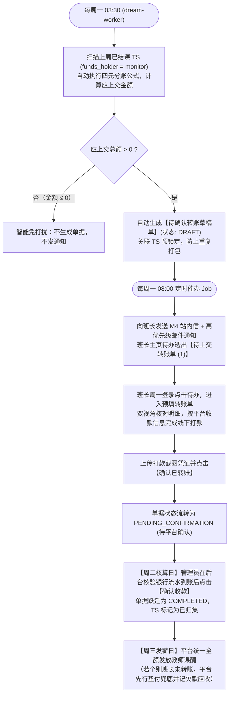

/** (c) 2024-2026 Topee (https://topee.top). All rights reserved. Proprietary and confidential. */

# 产品需求文档 (PRD) — 子模块 5A：结课跑批、异常回退与转账单归集 (Transfer & Capital Collection)

| 元数据项 | 说明 / 内容 |
|---|---|
| **模块代号** | `m5a` |
| **所属模块** | 模块五：周度财务对账与结算分账 (Weekly Settlement & Reconciliation) |
| **文档状态** | 待评审 (Draft) |
| **关联顶层 PRD** | [Prd-v5.md](../Prd-v5.md) |
| **关联规范文档** | [BUSINESS_RULES.md](../BUSINESS_RULES.md) |
| **关联模块划分** | [system_modules_overview.md](../system_modules_overview.md) |
| **创建与更新日期** | 2026-11-05 |

---

## 1. 概述与执行摘要 (Executive Summary)

结课跑批、异常回退与转账单归集子模块（`m5a`）是 Dream 系统的资产结课与中央资金收口枢纽。本子模块负责在每日凌晨 02:00 将前一日正常完课的 TS 自动批处理流转为 `已结课(待结算)`，提供“老师实际未上课但已被自动结课”的**异常未上课回退并自动补生待排 TS** 关键兜底保障，并驱动前端收款班长向中央平台发起**单向【转账单】（Transfer Order）**。系统内置小班课自负盈亏自动预留班长盈余与亏损贴补计算器，支持班长离职未结托管资产一键移交与资金持有人变更，确保散落于各班长手中的资金在周度发薪前安全归集至平台中央池。当前阶段：MVP 正式功能迭代。

---

## 2. 问题定义与背景 (Problem Statement)

- **痛点 1：跨日完课状态滞后导致财务核算基准不一**：若依赖人工逐节点击结课，极易产生遗漏或因班长作息不同导致账期割裂；次日凌晨统一跑批是保障日清周结的前提。
- **痛点 2：自动结课“误伤”未出勤课次引发课酬错发**：若教师实际旷课或因技术故障未上课，但系统到了次日凌晨依然自动将其置为结课，若无系统级冲退补生通道，将导致白白误发老师课酬且家长课时资产受损。
- **痛点 3：前端分散收款与中央统一发薪的对账断层**：资金由各班长在线下微信收取并托管，而教师课酬必须由平台管理员统一发放；若无严格的单向资金上交通道与凭证核验，极易产生班长挪用学费或平台垫资风险。
- **痛点 4：小班课自负盈亏核算复杂易生纠纷**：小班课班长享有净盈余分成同时自担招生亏损，若依靠人工核算上交金额，班长算错抽佣或漏扣自留盈余的概率极高。
- **痛点 5：班长离职引发托管资金烂尾风险**：班长离职时若名下仍有未消课时托管款，缺乏一键式的未结课次资产移交工具，会导致后续排课资金无主。

---

## 3. 目标用户与角色画像 (Users & Personas)

### 3.1 角色一：负责班长（Leo）
- **角色定位**：前端收款托管方与资金上交人。
- **核心诉求**：每周发课酬前，在后台一键勾选名下已结课 TS 打包生成转账单；界面自动按学生和老师双视角对账；系统自动扣除属于自己的小班课自留盈余，算出准确的应上交金额；线下转账打款并上传截图凭证。
- **预期成果**：账面清晰无糊涂账，自己该得的盈余当场预留扣除，应交平台的金额分文不差。

### 3.2 角色二：平台管理员（Sarah）
- **角色定位**：中央资金归集人与财务总把关人。
- **核心诉求**：在管理员后台统一查验各班长提交的转账单及银行打款凭证，确认到账后一键审核通过；对异常未上课的课次能安全回退并自动补生待排期，确保发薪节数绝对准确。
- **预期成果**：全域资金 100% 颗粒归仓，发薪前资金到位。

### 3.3 角色三：离职班长（Tom）
- **角色定位**：离职交割人。
- **核心诉求**：离职交接时一键生成离职移交单，将名下所有未上完的课次资金全额转给平台，系统批量将资金持有人改绑为平台。
- **预期成果**：干干净净离职交割，后续教学与退费责任完全交接。

---

## 4. 核心业务流程 (Main Flows)

### 4.1 次日凌晨 02:00 自动结课批处理流 (`dream-worker`)
1. 每日服务器时间凌晨 02:00，`dream-worker` 自动触发每日结课跑批 Job。
2. 系统检索前一自然日（06:00 - 00:00 营业期内）、当前处于 `已排期` 状态且未被冻结或取消的全部 TS。
3. 批处理程序在事务内将这些 TS 的状态批量更新为 **`已结课(待结算)`**（`status = 'FINISHED_PENDING_SETTLEMENT'`）。
4. 系统生成结课批次流水日志，记录本次结课的 TS 总数与时间戳。

### 4.2 异常未上课回退补生待排 TS 流程 (Rollback with Compensation)
1. 教师实际未上课（如网络中断、教师旷工），但跨过次日凌晨已被系统自动置为 `已结课(待结算)`。
2. 班长或管理员在后台找到该节异常 TS，点击【异常未上课回退】。
3. 系统校验该 TS 的财务状态：**该 TS 必须尚未被包含在状态为 `COMPLETED` 的转账单中**。
4. 经办人强制输入异常回退原因（必填，1-200 字，如“外教网络故障缺席，与家长协商补课”）。
5. 系统在数据库事务内原子执行：
   - 将该节异常 TS 状态由 `已结课(待结算)` 更新为终态 **`已取消`**（物理剔除出后续周课酬单与平台工具费单核算）；
   - 系统定位该 TS 所属的原购课单，在原单下**自动补生 1 节全新的【待排期 TS】**（完全继承原单的资金持有方 `holder_id`、原购课家长、原购课学生，以及单节财务快照）；
   - 记录全链路操作审计日志（记录操作人、时间戳、原 TS ID、补生 TS ID 及原因）。
6. 学生档案名下可用待排课时自动恢复 1 节，后续可正常重新约课。

### 4.3 班长常规周度转账单归集流程 (周一转账日、周二核算日、周三发薪日)

1. **每周一 03:30 系统自动跑批预生成【待确认转账草稿单 (DRAFT)】**：
   - 在凌晨 02:00 每日结课与 03:00 教师周课酬跑批完成后，`dream-worker` 自动触发班长转账草稿生成 Job；
   - 检索上一自然周（周一 00:00:00 至 周日 24:00:00）由当前班长收款托管且处于 `已结课(待结算)` 的全部 TS；
   - **智能免打扰规则**：若该班长上周应上交总额 $\le 0$（上周无课或结余冲抵），系统不生成单据，不触发任何通知；
   - 若应上交总额 $> 0$，系统在单一事务内自动创建转账草稿单（状态为 `DRAFT`），将这批 TS 预锁定，并预先算清：
     - ① 1v1 课次实付总积分；
     - ② 小班课固定工具费（$Max \times 6$）；
     - ③ 小班课平台服务分成（按 $R\%$ 扣减班长留存收益）；
     - ④ 最终应上交平台总额。
2. **每周一 08:00 定时催办提醒与待办透传**：
   - 每周一服务器时间 08:00，`dream-worker` 自动扫描名下存在 `DRAFT` 转账草稿单的班长；
   - 触发 M4 站内信与高优先级邮件：“尊敬的 [班长姓名]，您上一自然周的课时转账账单已出具，应上交总额为 XX 积分（￥XX）。请于今日内完成打款并提交凭证”；
   - 班长登录工作台后，主页教务待办区域浮现 `待上交转账单 (1)`，点击秒级直达该预填账单。
3. **班长极简操作流（线下打款 + 上传凭证一键确认）**：
   - 班长打开草稿单，界面提供双视角核对（按学生分组、按教师分组）；
   - 界面清晰展示平台对公收款信息（银行开户行、账号、收款人或收款码）；
   - 班长在线下完成真实资金打款后，上传 1~5 张打款截图凭证（或银行流水号），点击【确认已转账】；
   - 单据状态原子流转为 `PENDING_CONFIRMATION`（待平台审核确认）。
4. **周二核算日 (Tuesday Audit)**：
   - 平台管理员在后台集中查验各班长提交的转账单及银行打款流水；
   - 确认到账后点击【确认收款】，单据状态流转为终态 `COMPLETED`，关联 TS 状态流转为 `已归集`。
5. **周三发薪日与平台兜底策略 (Wednesday Payroll & Platform Fallback)**：
   - 平台管理员根据生成的【教师周课酬单】统一全额向授课外教发放薪酬，保障外教履约信心与教学稳定性；
   - **平台兜底发薪红线**：若个别班长周二前未完成资金转账上交，平台先行全额垫付发薪；未上交资金在管理后台标红预警，自动计入该班长对平台的应收款项（欠款），由财务线下微信群直接跟进催缴，严禁向外教转嫁班长拖欠风险。

### 4.4 班长离职未结资产移交流程 (Resignation Handover)
1. 班长准备离职交接，管理员在后台打开离职交接界面，或离职班长点击【离职资产移交】。
2. 系统一键检索并打包该班长名下当前持有的**所有未结 TS**（包含处于 `待排期` 的全部 TS，以及未结课的 `已排期` TS）。
3. 系统核算未结总积分托管款，生成类型为 `RESIGNATION_HANDOVER` 的离职移交转账单。
4. 离职班长将未结总托管款全额转账上交平台，上传打款凭证并提交。
5. 平台管理员核验银行流水到账后，点击【确认移交收款】。
6. 系统在事务内执行关键数据跃迁：
   - 转账单状态变更为 `COMPLETED`；
   - 批量将所涉及全部 TS 的 **“资金持有方（`holder_id`）”直接改绑为平台管理员账号 ID**；
   - 离职班长与这批 TS 彻底解绑，后续由平台直接承担资金托管与周结发薪责任。

> **与 M1B 的衔接**：在 M5A 完成离职资产移交转账单与平台收款确认后，系统方解除该班长资金持有人身份；随后可在 M1B 中推进教师团队改绑与班长职务注销。

### 4.5 转账单作废与驳回分支
- 若班长打款金额有误或凭证模糊，平台管理员在审核时点击【驳回转账单】并输入驳回原因；
- 转账单状态变更为 `CANCELLED`，关联的 TS 解除转账锁定，恢复为 `已结课(待结算)`，班长可重新发起打包。

---

## 5. 用户故事 (User Stories)

- **US-5A-01**：作为一个平台系统，我想要在每日凌晨 02:00 自动将正常完课的 TS 流转为已结课，以便于日清日结，为周度结算提供稳定数据基准。
- **US-5A-02**：作为一个负责班长，我想要在老师实际未上课时手动将已结课 TS 回退并自动补生 1 节待排期课次，以便于不扣除家长课时且不误发老师课酬。
- **US-5A-03**：作为一个负责班长，我想要在转账单界面按学生和按老师分组核对已结课明细，以便于对账一目了然、心服口服。
- **US-5A-04**：作为一个小班课班长，我想要系统自动扣除属于我自负盈亏的小班盈余后再上交差额，以便于我无需手动做二次拆分。
- **US-5A-05**：作为一个平台管理员，我想要在审核班长转账单时清晰查验银行打款凭证大图，以便于确认真金白银到账后才放行。
- **US-5A-06**：作为一个平台管理员，我想要在班长离职时一键移交所有未消课次资金并改绑资金持有人为平台，以便于杜绝离职坏账风险。
- **US-5A-07**：作为一个出资家长，我想要在转让后账单仍记在自己名下且跨家长转让在转账单中归原主，以便于财课分离账目规范。
- **US-5A-08**：作为一个财务合规风控，我想要严格禁止班长与班长之间互相转账，以便于全平台资金流向完全透明呈星型归集。

---

## 6. 验收标准清单 (Acceptance Criteria)

### 6.1 每日凌晨 02:00 自动结课跑批
- **AC-5A-01**：`dream-worker` 必须配置每日服务器时间 02:00 定时执行自动结课 Job。
- **AC-5A-02**：扫描目标严格限定为：上课日期等于前一日、处于 06:00-00:00 营业期内、且当前状态为 `SCHEDULED`（已排期）的 TS。
- **AC-5A-03**：命中 TS 的状态必须批量原子变更为 `FINISHED_PENDING_SETTLEMENT`（已结课待结算），并记录批处理日志（批次号、处理条数、耗时）。

### 6.2 异常未上课回退补生兜底
- **AC-5A-04**：处于 `已结课(待结算)` 状态的 TS 允许班长或管理员操作【异常未上课回退】；操作必须强制录入 1-200 字原因，空原因为非法请求。
- **AC-5A-05**：若目标 TS 已被关联在状态为 `COMPLETED` 的转账单中，系统必须物理置灰阻断回退操作，返回错误码 `409 TIMESLOT_ALREADY_SETTLED`。
- **AC-5A-06**：回退操作在事务内原子执行：
  - 原异常 TS 状态变更为终态 `CANCELLED`（已取消），物理从周课酬与工具费统计中剔除；
  - 在原购课单下自动补生 1 节全新的 `PENDING_SCHEDULE`（待排期）TS，其 `holder_id`、原购课家长、原学生及财务快照与原 TS 完全一致；
  - 写入全链路审计日志表 `dream.audit_logs`。

### 6.3 班长转账单打包与双视角对账
- **AC-5A-07**：班长转账单仅允许上交给固定接收方：平台管理员；**系统严禁支持班长之间的横向转账**。
- **AC-5A-08**：转账单勾选池仅允许包含当前登录班长名下持有的、且处于 `FINISHED_PENDING_SETTLEMENT` 的有效 TS。
- **AC-5A-09**：转账单界面必须支持**【按学生分组汇总】**与**【按教师分组汇总】**双视图无缝切换；发生过跨家长转让的 TS，在汇总统计时**出资人必须严格归属于原购课学生/家长名下**。
- **AC-5A-09a（周一 03:30 转账草稿自动生成跑批）**：`dream-worker` 必须配置每周一服务器时间 03:30 自动执行转账草稿跑批 Job，扫描上一自然周已结课 TS，按班长自动计算四元分账并生成处于 `DRAFT` 状态的转账草稿单，将关联 TS 状态置为转账预锁定；若应交总额 $\le 0$，系统智能跳过免打扰，不生成单据。
- **AC-5A-09b（周一 08:00 转账催办定时提醒 Job）**：`dream-worker` 必须配置每周一服务器时间 08:00 自动扫描处于 `DRAFT` 状态的转账单，通过 M4 向相关班长并发推送二级必达站内信与高优先级邮件，并在班长工作台主页待办区域透出 `待上交转账单 (1)`。
- **AC-5A-09c（周三平台兜底全额发薪与欠款留痕）**：周三平台管理员按教师周课酬单全额发薪，不以班长转账到账为前置阻断；若个别班长周二前未完成转账，平台先行垫付保障外教信誉，未转资金在管理后台标红预警并计入应收欠款，由财务跟进追缴。

### 6.4 小班课自负盈亏自动预留公式
- **AC-5A-10**：小班课 TS 的转账上交金额必须按单节精确执行以下四元分账算法：
  - 固定工具费 = 班级最大学生数（Max） × 6 积分；
  - 单节净盈余 = 单节实付总积分 - 教师单节课酬 - 固定工具费；
  - 若单节净盈余 $> 0$：平台抽佣 = $\lfloor \text{单节净盈余} \times R\% \rfloor$；班长自留盈余 = 单节净盈余 - 平台抽佣；班长实际应上交金额 = 教师单节课酬 + 固定工具费 + 平台抽佣；
  - 若单节净盈余 $\le 0$：平台抽佣 = 0；班长自留盈余 = 0；班长实际应上交金额 = 教师单节课酬 + 固定工具费（亏损差额由班长自垫）。
- **AC-5A-11**：转账单界面必须并排呈现三列总账：① `账面总实收积分`；② `班长自留预留盈余积分`；③ `实际应转平台总积分`。三者严格满足公式：`实际应转平台总积分 = 账面总实收积分 - 班长自留预留盈余积分 + 班长贴补亏损积分`。

### 6.5 转账单生命周期与凭证审核
- **AC-5A-12**：新建转账单必须上传至少 1 张打款转账截图凭证（支持 JPG/PNG/PDF，单文件 $\le 10$MB）；未上传凭证禁止提交。
- **AC-5A-13**：提交后单据状态由草稿 `DRAFT` 流转为 `PENDING_CONFIRMATION`（待平台审核），关联的所有 TS 状态标记为转账锁定（`TRANSFER_LOCKED`），禁止重复打包。
- **AC-5A-14**：平台管理员在后台点击【确认收款】后，转账单状态跃迁为终态 `COMPLETED`，关联 TS 状态流转为终态 `COLLECTED`（已归集）。
- **AC-5A-15**：若管理员点击【驳回/作废】，单据状态变为 `CANCELLED`，关联 TS 立即解除锁定，恢复为 `FINISHED_PENDING_SETTLEMENT`。

### 6.6 离职移交与资金持有人批量改绑
- **AC-5A-16**：离职移交转账单（类型：`RESIGNATION_HANDOVER`）必须一键打包该班长持有的**所有未结 TS（处于 `待排期` 的全部 TS 与 未结课的 `已排期` TS）**。
- **AC-5A-17**：平台管理员确认收款后，系统必须在事务内将这些 TS 的 `holder_id` 物理更新为平台管理员账号 ID，解除离职班长的后续财务归属。

---

## 7. 本期范围外清单 (Out of Scope)

- **教师周课酬单生成与管理员发薪**：归属子模块 M5B。
- **平台周工具费报表核算**：归属子模块 M5B。
- **银行直连对公 API 自动转账划扣**：本期不直连银行银企直连 API，班长转账统一为线下打款并上传凭证。
- **班长之间的横向资金借贷与互转**：系统底层物理禁止班长互转，一律单向归集至平台。
- **学生端对转账单的查阅**：转账单属于 B 端内部资金归集单据，对家长端物理隐藏。

---

## 8. 约束条件 (Constraints)

### 8.1 业务与合规约束
- **星型单向归集铁律**：所有教学资金必须由前端收款方（班长）向中心收口方（平台）单向流转，严禁网状互转。
- **不可逆回退红线**：已进入 `COMPLETED` 转账单的 TS 严禁执行未上课回退补生，杜绝账实失衡。
- **小班自负盈亏合规底线**：小班课亏损时，班长必须自行贴补确保上交金额足额支付教师课酬与平台工具费。

### 8.2 功能与规格限制
| 约束项 | 指标规格 / 限制值 |
|---|---|
| 自动结课执行时间 | 每日服务器时间 02:00:00 整点 |
| 周转账草稿跑批时间 | 每周一服务器时间 03:30:00 整点 |
| 周一转账催办提醒时间 | 每周一服务器时间 08:00:00 整点 |
| 回退原因字符数 | 必填，1 - 200 个字符 |
| 转账截图格式 / 大小 | JPG / PNG / PDF，单文件 $\le 10$MB，最多 5 张 |
| 转账单类型枚举 | `WEEKLY_SETTLEMENT`（常规周结上交） ｜ `RESIGNATION_HANDOVER`（离职移交） |
| 转账单状态枚举 | `DRAFT`（系统预生成草稿） ｜ `PENDING_CONFIRMATION`（待平台审核） ｜ `COMPLETED`（已完成） ｜ `CANCELLED`（已作废） |

### 8.3 外部文档与参照依据
| 文档名称 | 存放路径 / 链接 | 使用场景说明 |
|---|---|---|
| 核心业务规则与财务分账规约 | docs/BUSINESS_RULES.md | 资金持有方锁定、小班盈余公式、单向转账与异常回退补生机制 |
| 工程与编码规范 | docs/CODING_STANDARDS.md | dream-worker 结课跑批调度标准与 TaskRelay 状态码 |

---

## 9. UI/UX 界面线框说明 (Wireframe Level)

### 9.1 班长工作台 — 转账交割管理看板
- **界面结构与布局**：
  - **顶部资产总览卡片**：
    - 卡片一：当前名下已结课待转账总额（`X 积分`，含待转 TS 数量）；
    - 卡片二：预计小班自留盈余（`Y 积分`）；
    - 卡片三：实际应转平台金额（`X - Y 积分`）。
  - **操作栏**：【发起周度资金上交】主按钮、筛选标签（全部 / 待平台确认 / 已完成 / 已驳回）。
  - **历史转账单列表**：转账单号、转账类型（周结上交 / 离职移交）、关联 TS 节数、账面总实收、小班自留盈余、应转总额、凭证缩略图、状态标签、创建时间、操作列（【查看详情】）。

### 9.2 发起转账单抽屉面板与双视角分组对账 (Transfer Packaging Drawer)
- **界面结构与布局**：
  - 点击【发起周度资金上交】从右侧滑出全屏抽屉。
  - **核对视角切换器 (Segmented Control)**：
    - Tab 1：【按学生分组汇总】（展示学生姓名、出资家长、已结课次数、小计实付积分；跨家长转让的课次严格归属原出资学生展示）；
    - Tab 2：【按教师分组汇总】（展示授课老师、课次数量、是否代课）。
  - **小班自负盈亏拆分核算明细区**：
    - 表格展示所选 TS 中的小班课明细：班级名称、单节实收、教师单节课酬、工具费、单节净盈余、平台抽佣、班长自留盈余；
    - 底部汇总条清晰展示：`账面总积分` - `自留盈余` + `亏损贴补` = `实际应转平台金额`。
  - **打款凭证与提交区**：
    - 平台银行对公账户收款信息卡片；
    - 上传打款凭证组件（拖拽上传，最多 5 张）；
    - 提交按钮：【确认并提交转账单】（未上传凭证时置灰禁用）。

### 9.3 异常未上课回退补生确认弹窗 (Rollback Modal)
- **界面结构与布局**：
  - 点击异常 TS 的【未上课回退】唤起模态弹窗。
  - **课次信息卡片**：原上课日期时段、授课老师、学生昵称、单节实付积分。
  - **安全警示文案**：“⚠️ 此操作将把该课次改为【已取消】，并自动在原购课单下为学生补生 1 节全新的【待排期 TS】。该课次将从教师课酬与工具费中物理剔除。此操作不可撤销。”
  - **表单输入**：多行文本框（必填，`未上课原因及补课说明`，1-200字）。
  - **按钮**：【取消】、【确认回退并补生】。

### 9.4 管理员后台 — 资金归集审核看板 (Admin Approval Grid)
- **界面结构与布局**：
  - 位于管理员后台【财务中心 - 资金归集审核】。
  - 数据表格展示全平台各班长提交的处于 `PENDING_CONFIRMATION` 的转账单。
  - 每行显示：班长姓名、转账类型、账面总额、自留盈余、实转金额、凭证缩略图（点击原图放大预览）、提交时间。
  - 操作列：
    - 【确认收款】：点击弹出确认对话框“确认该笔款项已全额到账银行对公账户？确认后课次将流转为已归集并进入发薪池”，点击确认后单据变为 `COMPLETED`；
    - 【驳回】：点击输入驳回原因后将单据置为 `CANCELLED` 并释放 TS 锁定。

### 9.5 离职移交专项操作面板 (Resignation Handover Panel)
- **界面结构与布局**：
  - 位于管理员后台或离职班长专用入口【离职托管资产交割】。
  - 头部警示条：“正在进行班长 [Tom] 离职资金交割。系统将一键打包该班长名下所有未结课 TS（含待排期与未结课已排期）”。
  - 资产汇总卡片：待排期 TS 数量及积分、未结已排期 TS 数量及积分、应移交托管资金总计。
  - 班长上传转账截图后提交，平台确认收款后，系统自动在事务内将所涉所有 TS 的 `holder_id` 批量改绑为平台。

---

## 10. 用户流程图 (User Flow Diagram)

```mermaid
flowchart TD
    %% 凌晨自动结课
    subgraph 每日凌晨跑批
        BatchStart([每日 02:00 定时触发]) --> ScanFinished[扫描前一日 06:00-00:00\n处于已排期的 TS]
        ScanFinished --> AutoFinish[批量原子更新为\n已结课待结算 FINISHED_PENDING_SETTLEMENT]
        AutoFinish --> BatchEnd([结课跑批完成])
    end
    
    %% 异常未上课回退补生
    subgraph 异常未上课回退补生
        ExStart([发现老师未上课但已结课]) --> CheckSettled{是否已被打入\nCOMPLETED 转账单?}
        CheckSettled -- 是 已完成转账 --> DenyRollback[物理置灰阻断回退\n提示联系财务走线下冲正]
        CheckSettled -- 否 尚未归集 --> InputReason[输入 1-200 字回退原因]
        InputReason --> AtomicRollback[事务原子执行:\n1. 异常 TS 状态置为 已取消 CANCELLED\n2. 原购课单下自动补生 1 节全新待排期 TS\n3. 写入 audit_logs 审计日志]
        AtomicRollback --> RollbackEnd([学生课时恢复\n课酬物理剔除])
    end

    %% 周度转账单归集
    subgraph 班长向平台周度转账归集
        WeeklyDraft([周一 03:30 系统预生成转账单草稿 DRAFT]) --> WeeklyRemind([周一 08:00 定时推送催办提醒])
        WeeklyRemind --> OpenTransfer[班长查看待办 进入转账单详情]
        OpenTransfer --> LoadTS[核对名下已结课待结算 TS]
        LoadTS --> GroupView[双视角核对:\n按学生分组汇总 / 按教师分组汇总\n转让课次严格归属原出资人]
        GroupView --> CalcSmallGroup[自动执行小班约定基准核算公式:\n自动扣除班长自留盈余\n亏损由班长自垫补足]
        CalcSmallGroup --> ShowSummary[呈现三列总账:\n账面实收 ｜ 自留盈余 ｜ 实际应转平台]
        ShowSummary --> OfflinePay[班长周一线下转账打款给平台管理员]
        OfflinePay --> UploadProof[上传银行打款凭证截图]
        UploadProof --> SubmitOrder[提交转账单 PENDING_CONFIRMATION\n关联 TS 置为转账锁定]
        
        SubmitOrder --> AdminAudit{平台管理员周二审核}
        AdminAudit -- 凭证有误/未到账 --> RejectOrder[点击驳回 CANCELLED\n关联 TS 解除锁定]
        RejectOrder --> OpenTransfer
        AdminAudit -- 查验银行流水到账 --> ConfirmCollect[点击确认收款 COMPLETED\n关联 TS 流转为已归集 COLLECTED]
        ConfirmCollect --> CollectEnd([资金归集完成\n周三进入发薪闭环])
    end
    
    %% 离职移交
    subgraph 班长离职未结移交
        ResignStart([班长离职交接]) --> PackUnfinished[一键打包名下所有未结 TS\n包含 待排期 与 未结已排期]
        PackUnfinished --> PayPlatform[全额上交未结托管资金并上传凭证]
        PayPlatform --> AdminConfirmResign[平台管理员确认收款]
        AdminConfirmResign --> RebindHolder[批量将所有未结 TS 的 holder_id\n改绑为平台管理员账号]
        RebindHolder --> ResignEnd([离职班长财务解绑完成])
    end
```

---

## 11. 智能体/系统决策行为规范 (System Decision Rules Engine)

- **系统允许自动执行 (Allowed Operations)**：
  - `dream-worker` 每日 02:00 自动扫描前一日营业期完课 TS 并批量推进状态；
  - 异常未上课回退时，系统自动在原购课单下复制生成同快照属性的待排期 TS；
  - 发起转账单时，系统自动按公式精确核算小班课净盈余、平台抽佣与班长自留盈余，毫秒级得出应转总额；
  - 离职移交确认后，系统自动在数据库事务内批量改绑数百节 TS 的 `holder_id`。
- **系统绝对禁止 (Strictly Forbidden Operations)**：
  - **严禁**跨班长之间发起任何转账单（仅允许转给平台管理员）；
  - **严禁**对已在 `COMPLETED` 转账单中的 TS 执行异常未上课回退操作；
  - **严禁**在未上传打款凭证时允许班长提交转账单；
  - **严禁**小班课在亏损状态下免除班长贴补义务（班长必须足额上交教师课酬与工具费）。
- **无法判定/异常时的退避与人工兜底逻辑**：
  - 结课跑批时若遇到数据库死锁或网络异常，Worker 自动以 5 秒间隔重试 3 次；若仍失败向运维发出严重告警，由管理员人工排查后补跑；
  - 转账单金额与银行实际到账不符时，管理员必须执行【驳回】而不是强行确认，确保线上线下账实完全一致。

---

## 12. 待定事项与补充说明 (Further Notes)

- **本期已敲定并落盘决策**：
  1. 结课机制：每日 02:00 定时跑批扫描前一日营业期全部正常完课 TS，流转为 `已结课(待结算)`。
  2. 异常回退：尚未进入 `COMPLETED` 转账单的 TS 支持班长/管理员回退置为 `已取消`，并自动补生 1 节全新待排 TS（强制录入原因与审计）。
  3. 转账核对：单向转账给平台，提供按学生/按教师双视角核对，转让课次出资人归原主。
  4. 小班自负盈亏：有盈余扣除平台抽佣后预留班长盈余，亏损由班长自垫，界面并排呈现三列总账。
  5. 三步流转：系统预生成 `DRAFT` $\rightarrow$ 班长打款并上传凭证提交为 `PENDING_CONFIRMATION` $\rightarrow$ 管理员确认到账后转 `COMPLETED`，TS 流转为 `已归集`。
  6. 离职移交：一键打包所有未结 TS（`待排期` + 未结 `已排期`），全额上交资金后批量将 `holder_id` 改绑为平台。
- **后续版本演进考量 (Future Backlog)**：
  - 银企直连 API（后续规模扩大后，可接入银行企业网银直连实现班长端线上发起转账与平台自动流水核对）。
