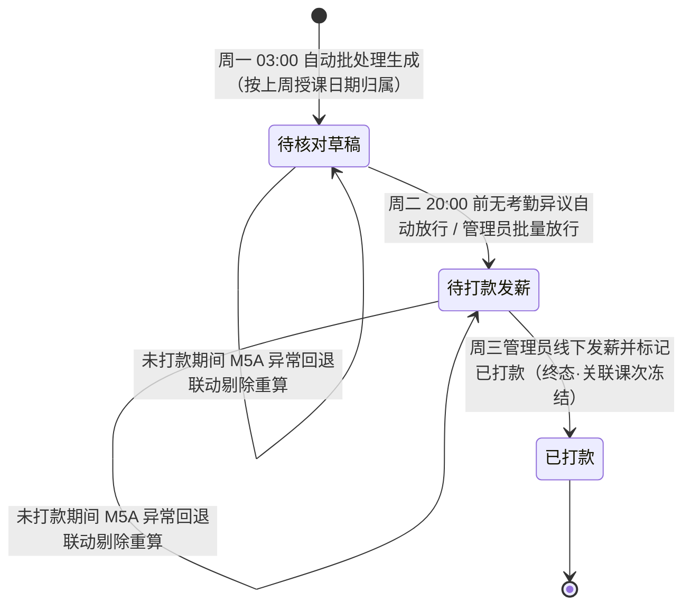
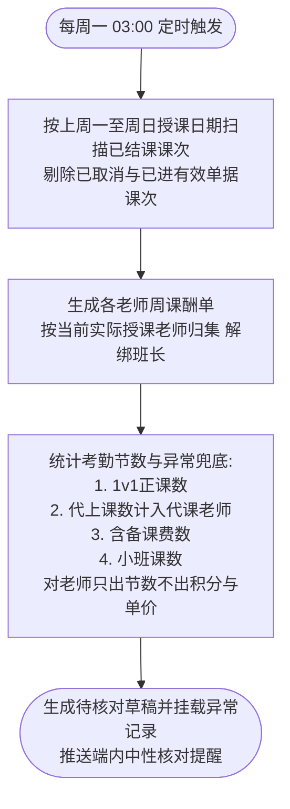
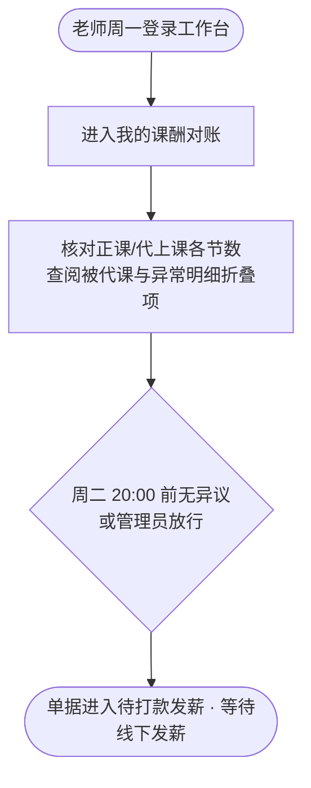
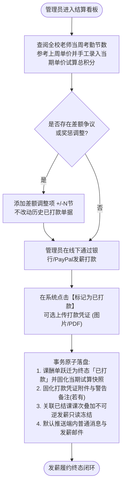

/** (c) 2024-2026 Topee (https://topee.top). All rights reserved. Proprietary and confidential. */

# 产品需求文档 (PRD) — 子模块 5B：老师周课酬单与周度发薪结算 (Weekly Settlement & Teacher Payout)

| 元数据项 | 说明 / 内容 |
|---|---|
| **模块代号** | `m5b` |
| **所属模块** | 模块五：周度财务对账与结算分账 (Weekly Settlement & Reconciliation) |
| **文档状态** | 待评审 (Draft) |
| **关联顶层 PRD** | [Prd-v5.md](../Prd-v5.md) |
| **关联规范文档** | [BUSINESS_RULES.md](../BUSINESS_RULES.md) |
| **关联模块划分** | [system_modules_overview.md](../system_modules_overview.md) |
| **创建与更新日期** | 2026-11-05 初稿；2026-11-10 增补与 M5A 转账单明细双向穿透审计规约；2026-11-12 卡片视觉改为只声明卡片类型，色值统一引用 DESIGN.md 2.2.1；2026-11-22 红队审查收口与双层实体/日志 SSOT 治理（去技术化与纯积分清理、统一周日授课归属自然周与全有效单据幂等、明确 1v1 代课按代课老师当期手工单价试算 + 上周参考提示、统一纯中文三态、新增 §4.5 异常回退同步流并升级 §4.6 四支柱与跨实体同事务联动清单） |

---

## 1. 概述与执行摘要 (Executive Summary)

老师周课酬单与周度发薪结算子模块（`m5b`）是 Dream 系统的周度发薪履约终局中心。系统于**每周一凌晨 03:00** 自动触发后台定时批处理，基于上一自然周营业期内已结课的课次资产，生成面向老师端的**【老师周课酬单】（每师每周一单，彻底解绑班长，坚决贯彻“对老师只出节数、严禁展示任何积分、单价或货币折算数值”铁律，代课次数严格计入代课老师）**。在管理员后台发薪看板中，管理员可为每位老师每次手工选填录入**仅管理员可见的当期内部课酬单价**（旁显该老师上一自然周最近一次已录入的单价参考数字）并由系统自动试算参考总积分；管理员在线下完成发薪后在后台标记【已打款】，周课酬单达到终态 **`已打款`**，系统对关联的已结课课次叠加不可逆财务防篡改只读冻结（课次主状态保持「已结课」不变）。*(注：系统已彻底取消平台工具费及【平台工具费单】)* 当前阶段：MVP 正式功能迭代。

---

## 2. 问题定义与背景 (Problem Statement)

- **痛点 1：老师端直接显示积分或折算数值引发汇率与税费歧义**：老师多居住在海外，实际发薪通常通过 PayPal/Wise/国际电汇折算法币支付；若课酬单直接展示系统积分、单价或货币折算数值，极易因汇率波动或跨境手续费引发老师与平台的算账争议。
- **痛点 2：代课课酬手工核算极易张冠李戴**：当发生临时代课次，若报表依然将课酬挂在原负责班长或原老师名下，管理员发薪时极易误发给原老师，代课老师需跨国私下讨薪。
- **痛点 3：发薪后数据未锁定引发历史账目脏写**：若发薪完成后底层已结课课次不执行只读冻结，一旦后续发生误操作退款、挪位或状态篡改，会导致历史周报表与线下真实打款流水无法对平。
- **痛点 4：考勤争议反向篡改历史账目破坏审计连续性**：若允许对历史已发薪周课酬单据随意反向修改，会导致全链路财务审计凭证失效。

---

## 3. 目标用户与角色画像 (Users & Personas)

### 3.1 角色一：一线授课老师（David，老师）
- **角色定位**：发薪对账人。
- **核心诉求**：每周一登录老师工作台，清晰查阅上周自己的授课次数（1v1 正课次数、代上课次数、含额外备课费节数、小班课次数）；核对课表流水无误后，等待平台管理员将外币薪酬打入个人银行/PayPal 账户；收到款后在系统看到单据更新为【已打款】。
- **预期成果**：节数清晰无遗漏，代课付出有明确体现。

### 3.2 角色二：代课老师（Elena，老师）
- **角色定位**：代课授课人。
- **核心诉求**：替同事上的代课次数，在周一自动出单时 100% 呈现在自己的周课酬单中，且单据与原老师完全解绑、不涉积分或单价数值。
- **预期成果**：代课付出稳妥到账。

### 3.3 角色三：平台管理员（Sarah）
- **角色定位**：发薪执行人与财务总把关。
- **核心诉求**：每周一在后台集中查阅全校老师的周课酬单，可参考上周录入数值为当期单据手工选填仅管理员可见的内部课酬单价，以自动试算参考总积分；在线下完成发薪打款后，上传打款凭证（可选）并一键标记【已打款】。
- **预期成果**：全校发薪闭环可控，历史发薪不可篡改。

---

## 4. 核心业务流程 (Main Flows)

### 4.1 每周一凌晨 03:00 周课酬单自动批处理流
1. 每周一服务器时间凌晨 03:00（在 02:00 每日自动结课批处理完成之后），平台后台定时批处理服务自动触发周结算批处理。
2. 统计周期与归属边界严格界定为：**上周一至上周日营业期（每日 `06:00–24:00`）内授课、且当前已处于终态「已结课」的课次**（以 ISO 自然周为周期编号，如 `2026-W45`）。**注**：周日营业期（含最晚 `23:30–24:00`）的课次虽在周一凌晨 02:00 才完成自动结课，但按原排课授课日期仍 100% 归属于上一自然周统计周期，严禁遗漏。
3. 系统检索上述统计周期内所有处于 **`已结课`** 终态、且**尚未关联任何有效（未作废）周课酬单**的课次（已取消的异常课次严禁计入）。
4. **批处理生成【老师周课酬单】**：
   - 遍历当周所有有结课记录，**或存在老师责任类非常规出勤异常（`<24h` 请假/直接代课、老师旷课、异常未上课回退）的老师**（按**当前实际授课老师**归集，**彻底解绑班长**；即使当周实际结课为 `0` 节，只要存在上述非常规记录，仍兜底生成一张 `0` 节课酬单，防止请光课程或全数异常回退后在结算看板隐身）；
   - 为每位老师生成一张独立的周课酬单（初始为 **`待核对草稿`**，至周二 `20:00` 前无考勤异议自动放行、或由管理员手动批量放行后进入 **`待打款发薪`**）；
   - 精确统计 4 个考勤维度（**每节已结课课次严格只计入总授课节数 1 次，绝不因同时命中多个标签而重复叠加**）：1v1 正课次数、代上课次数（含 1v1 代课与小班临时代课）、含额外备课费节数（附加标识计数，不重复计入总节数）、小班正课次数（若小班临时代课则在代课老师课酬单中计为 1 次小班代课授课，原老师计 0，且老师端绝不展示积分、单价或任何货币折算数值）；
- **贯彻铁律：单据对外只出节数，不出积分与单价**；**在管理员后台发薪看板/课酬单详情中，管理员可为每位老师当期手工选填录入“仅管理员可见的老师内部课酬单价（选填）”**（不作为老师档案持久字段，新单默认留空、但旁显该老师上一自然周最近一次已录入的参考单价数字），录入后系统自动按节数试算**参考总积分**：
  - **1v1 正课与 1v1 代课**：统一在**实际授课老师（代课时即代课老师本人）**的周课酬单内，按管理员为**该实际授课老师当期手工录入的内部课酬单价**试算（`内部单价 × 节数 + 10 × 备课次数`；**严禁**沿用原任老师单价，亦严禁与家长端付费「价位」混淆换算）；
  - **小班正课与小班临时代课**：直接按继承自 M1C 建班手工录入的「老师单节课酬积分」TS 快照核算；
  - 同步在课酬单上固化挂载当周《出勤异常记录》快照与近 30 天滚动统计（含正常结课、学员临期 `<3h` 变动备查，以及老师侧非常规请假/非常规直接代课的分时间窗口汇总：`<3h` / `3~24h` / `>=24h`），确保账目与出勤清晰可对账。
*(已取消原【平台工具费单】)*

### 4.2 老师端周课酬节数对账流
1. 老师登录老师工作台，进入【我的课酬对账】。
2. 列表清晰展示每周单据（如 `2026-W45 课酬单`，状态展示 `待核对草稿`、`待打款发薪` 或 `已打款`；老师端不设「确认无误」阻塞按钮，若对节数无异议至周二 20:00 自动进入待打款）。
3. 老师点击展开详情：
   - 顶部统计卡片：`当周实际出勤总节数：12 节`（按实上总课次去重汇总；微徽标分项列明 `1v1 正课` / `代上课〔含小班代课〕` / `含备课费〔不重复计总〕` / `小班正课`）；
   - 下方课表流水：按日期时段罗列每一节课的实际上课学员昵称（小班仅标小班名）、班型、时长；
   - **代课标记**：代上课次（含小班临时代课）在**代课老师本人**课酬单内计 1 次，高亮带有 🟣【代课】标签，注明“替 [原老师名] 代上”，**全程绝不展示任何积分、单价或货币折算数值**；
   - **被代课与出勤异常备查区**：单据下方提供折叠项“当周被代课与出勤异常明细”，罗列当周被代课次数、**本人非常规请假/非常规代课时间窗口明细（`<3h` / `3~24h` / `>=24h`）、老师迟到/早退记录及管理员发薪警告/调整说明**，以及学员临期（`<3h`）变更记录、学员/老师旷课及异常未上课回退记录，方便老师与班长核实对账（严格不显示积分、单价公式及管理员内部试算字段）。

### 4.3 管理员线下发薪与系统标记“已打款”闭环流
1. 平台管理员在管理员后台打开【老师周课酬结算看板】。
2. 管理员筛选当前周（如 `2026-W45`），表格罗列全校所有老师当周考勤节数、**【非常规请假】标红告警微徽标（当周含 `<24h` 记录或近 30 天命中已排课请假/代课 `>12.5%` 或 `>=4节` 时标红，仅作管理端软提示、不阻断老师请假）**、参考试算总积分、发薪状态；支持勾选【仅看含非常规请假】快速聚焦审查。
3. 管理员点击【查看明细】核验异常原因与处理结果；若需惩罚或补贴，可直接通过 **【添加差额调整项】** 录入正负节数调整与原因，并在【标记为已打款】时填写 **发薪警告备注**（可选同步向老师推送一条端内警告消息）。
4. 管理员可参考框旁显示的**该老师上一自然周参考单价**，当期手工录入老师内部课酬单价核对试算参考总积分后，根据老师的付款通道（PayPal / 银行账户）线下执行跨境或本地发薪打款。
5. 管理员回到系统，点击该老师课酬单旁的操作按钮【标记为已打款】。
6. 弹窗填写打款信息（可选上传：`打款凭证`，图片在客户端自动等比例压缩不限原图大小，PDF ≤ 10MB；选填：打款备注/警告说明；不再强制录入银行流水号）。
7. 系统在同一事务内原子执行：
   - 该老师周课酬单状态跃迁为终态 **`已打款`**，同步固化当期已录入内部课酬单价、试算参考总积分、打款凭证附件快照（若有）及状态流转历史；
   - 底层关联的课次主状态保持 **`已结课`** 不变；
   - **不可逆数据冻结**：凡属于已标记 `已打款` 课酬单包含的课次，系统全端叠加发薪物理只读冻结防线，严禁任何清退（M2B）、异常未上课回退（M5A）、挪位（M3B）或更换上课学员操作；
   - **默认发薪通知**：系统默认向该老师推送 [M4](./m4_notification.md) **端内普通消息（中性卡）** 并同步发送**发薪通知邮件**（告知本周课酬已打款，仅展示节数摘要与打款备注，不含管理员内部单价与试算积分）。
8. 老师工作台该周课酬单即时显示为已打款徽章（样式见 DESIGN.md）。

### 4.4 跨周发薪争议与人工差额调整流 *(已取消平台工具费单)*
1. 若某周发薪后，老师提出上周某节课由于系统故障漏算或核对有误：
2. **严禁篡改处于「已打款」终态的历史课酬单**。
3. 管理员在为该老师核算**下一周尚未发薪的课酬单**（`待核对草稿` 或 `待打款发薪`）时，点击【添加差额调整项】。
4. 录入调整内容：调整节数（如 `+1` 节或 `-1` 节）、调整说明原因（1-200 字，如“补发 2026-W44 漏计代课 1 节”）、审批凭单号（选填）。
5. 系统在当周课酬单中单独呈现该调整项，即时加减总节数；在管理端同步按当期已录入的 1v1 内部课酬单价联动重算试算参考总积分，在老师端仅展示调整节数与说明，确保历史账单不可逆、本期调整有据可查。

---

### 4.5 异常未上课回退同步剔除与 0 课兜底流
1. 当某节已在周一 `03:00` 计入周课酬单的已结课课次发生【老师实际未上课】，且对应班长或管理员在 [M5A](./m5a_transfer_collection.md#42-异常未上课回退补生待排-ts-流程) 执行【异常未上课回退】时：
2. **发薪冻结前置阻断**：若该课次所属的 M5B 老师周课酬单已处于终态 **`已打款`**（包括周三平台兜底先行发薪的场景），系统物理置灰并阻断 M5A 异常未上课回退，确保已发薪历史账目零脏写。
3. **未打款单据联动剔除与 0 课兜底留痕**：若该课次所属的 M5B 老师周课酬单仍处于 **`待核对草稿`** 或 **`待打款发薪`**，M5A 回退同一事务内自动将该课次从本课酬单授课明细中剔除并重算 4 项考勤节数及管理端试算参考总积分；因 M5A 回退同步为原授课老师写入了 `异常未上课回退`《出勤异常记录》，即使剔除后当周实结节数降为 **`0` 节**，系统仍**兜底保留该 `0` 节周课酬单并挂载该异常记录**（不自动销毁单据），确保管理员可在发薪看板持续审查并按需做警示/调整留痕。

### 4.6 老师周课酬单四支柱生命周期、字段锁定、留痕与永久只读留存策略（附跨实体联动清单）

> 本节为【老师周课酬单】实体生命周期、字段可编/锁定矩阵、流转与操作留痕及数据留存策略的**全局唯一归口定义 (SSOT)**；涉及驱动外部实体状态变更的动作统一收敛于本节第 5 项跨实体联动清单。

#### 4.6.1 生命周期状态机与转移矩阵
- **状态机全景图**：

- **状态转移规则与前置守卫矩阵**：
  | 当前状态 | 目标状态 | 触发事件 / 动作 | 操作人 / 驱动源 | 前置守卫条件与锁定规则 | 伴随副作用与跨实体流转 |
  | :--- | :--- | :--- | :--- | :--- | :--- |
  | **`[*]`** | `待核对草稿` | 周一 03:00 周结算批处理 | 系统定时任务 | 存在上周一至上周日营业期内授课且状态为「已结课」的课次（尚未关联任何有效周课酬单），**或**存在当周老师责任类非常规出勤异常记录 | 每师每周生成 1 张单据（含异常 0 课兜底单），按当前实际授课老师归集、彻底解绑班长；单据只出节数、当期手工单价默认空值并旁显上周参考；向老师推送 [M4](./m4_notification.md) 端内中性卡提醒（不含邮件与积分单价） |
  | `待核对草稿` / `待打款发薪` | 保持原状态（明细更新） | M5A 异常未上课回退同步剔除 | 班长 / 管理员（经 [M5A §4.2](./m5a_transfer_collection.md#42-异常未上课回退补生待排-ts-流程) 触发） | 课酬单尚未进入终态「已打款」，且关联课次未纳入「已完成入账」周转账单 | 同一事务内剔除该异常课次并重算 4 项节数与管理端试算总积分；同步挂载新增的《出勤异常记录》；若节数归零仍兜底保单供审查 |
  | `待核对草稿` | `待打款发薪` | 周二 20:00 自动放行 / 管理员手动批量放行 | 系统定时任务 / 平台管理员 | 单据处于「待核对草稿」 | 单据进入周三待发薪池，开放管理端【标记为已打款】终态操作入口（在「待核对草稿」与「待打款发薪」期间均可提前添加差额调整项与试算单价） |
  | `待打款发薪` | `已打款` | 管理员线下发薪并标记已打款 | 平台超级管理员 | 单据处于「待打款发薪」；打款凭证图片/PDF、打款备注与内部单价均为选填，不强制银行流水号 | 1. 跃迁为永久终态「已打款」，固化当期内部单价（若有）、试算总积分、差额调整、打款凭证与警告快照； 2. 关联已结课课次主状态保持「已结课」不变，**叠加不可逆发薪只读冻结**； 3. 向老师发送 [M4](./m4_notification.md) 端内发薪通知与邮件（若勾选发送警告则附发端内警告通知） |

#### 4.6.2 字段可编与锁定规则矩阵
| 单据状态 | 可编辑 / 允许变更的业务内容 | 物理锁定 / 禁止变更的字段与操作 |
| :--- | :--- | :--- |
| **`待核对草稿`** | 管理员当期手工选填/修改「内部课酬单价」（仅管理员可见）；新增【差额调整项】（正负节数 + 1-200 字原因 + 选填审批凭单号）；随 M5A 未上课回退自动剔除异常课次重算节数 | **严禁**人工直接改写单节已结课课次的实上课记录或小班「老师单节课酬积分」快照；「上周参考单价」仅作只读参照展示；老师端**物理隐藏**内部单价、上周参考及试算总积分 |
| **`待打款发薪`** | 管理员当期手工选填/修改「内部课酬单价」；新增【差额调整项】；随 M5A 未上课回退自动剔除异常课次重算节数；执行【标记为已打款】（选传打款凭证与打款备注/警告） | **严禁**退回「待核对草稿」；**严禁**人工篡改原始已结课授课明细；老师端严禁透出任何积分、单价或管理员惩罚内部备注 |
| **`已打款`** | 无任何可编辑字段（永久归档终态） | **全字段永久只读锁定**（4 项节数统计、授课明细、前置归集转账单号追溯链接、差额调整项、当期内部单价与试算总积分快照、打款凭证附件、发薪警告备注、当周出勤异常快照及近 30 天滚动统计均不可修改或撤销）；单内全部已结课课次永久物理冻结，严禁清退、回退、挪位或更换上课学员 |

#### 4.6.3 流转与修改留痕规则（唯一归口定义）
1. **状态流转历史时间轴**：老师周课酬单每次状态跃迁（包含周一 03:00 自动生成「待核对草稿」、周二 20:00 自动或手动放行至「待打款发薪」、以及周三管理员标记「已打款」）必须在同一事务内追加一条只读状态流转记录（记载原状态、目标状态、操作人/系统、流转时间及打款凭证/备注摘要），并在详情页只读时间轴展示；**老师端仅展示状态变更节点与时间，严格过滤管理员内部单价试算与内部惩罚备注**。
2. **差额调整与警告留痕**：未打款前新增每条【差额调整项】均追加不可删改的调整明细行（记录调整正负节数、1-200 字原因、选填审批凭单号、操作人及操作时间）；标记「已打款」时录入的打款备注/警告说明与可选凭证永久随单固化，老师端仅可查看面向老师的调整节数说明与警告消息正文。
3. **异常回退同步留痕**：因 [M5A §4.2](./m5a_transfer_collection.md#42-异常未上课回退补生待排-ts-流程) 触发从未打款周课酬单剔除课次时，自动刷新单内挂载的当周《出勤异常记录》快照与单据操作变更日志，确保管理员可溯源“为何某节已结课课次从本周课酬明细移出”。

#### 4.6.4 数据留存与清理策略
- **永久只读留存、严禁物理删除**：所有老师周课酬单主记录（含 0 节异常兜底单据及历史 `已打款` 单据）、授课明细快照、差额调整记录、当期管理员试算快照、打款凭证附件及状态流转历史，均属于核心财务与税务审计凭证，与 [BUSINESS_RULES.md §3.2](../BUSINESS_RULES.md) 保持一致，**全生命周期永久只读留存，严禁任何角色物理删除或定时清理**。

#### 4.6.5 跨实体同事务联动清单
当 M5B 触发下列业务动作时，驱动本模块主实体与跨模块宿主实体在同一事务内保持最终一致（宿主实体各自状态机与规则详见对应唯一归口 PRD）：

| 触发动作 | 同事务驱动的外部 / 跨模块实体 | 结果方向与原子性说明 | 宿主归口 PRD |
| :--- | :--- | :--- | :--- |
| **周一 03:00 自动生成周课酬单** | **站内提醒 (`Notification`)** | 周课酬单生成草稿后，向对应老师推送 1 条端内中性提醒卡（提示本周课酬节数已出请核对，严禁包含任何积分、单价或触发邮件） | [M4 消息与关键邮件](./m4_notification.md) |
| **周三确认已完成打款** | **课次 (`TS`)**、**站内提醒 (`Notification`)**、**发薪邮件** | ① 为单据关联的全部已结课课次叠加不可逆**发薪财务只读冻结**（课次主状态保持「已结课」，反向阻断 M2B 清退、M3B 挪位/换学员与 M5A 异常回退）；② 向对应老师发送端内普通通知卡与发薪通知邮件（含节数摘要，不含积分单价；若管理员勾选发送发薪警告则同步投递警告提醒） | [BUSINESS_RULES.md §3.2](../BUSINESS_RULES.md)、[M4 消息与关键邮件](./m4_notification.md)、[M5A 归集与回退](./m5a_transfer_collection.md) |

---

## 5. 用户故事 (User Stories)

- **US-5B-01**：作为一个授课老师，我想要在周一早晨看到自己上周的完整考勤节数，以便于清晰核对自己的劳动付出。
- **US-5B-02**：作为一个代课老师，我想要替同事代上的课次节数准确计入我个人的周课酬单，以便于劳有所得。
- **US-5B-03**：作为一个平台管理员，我想要在发薪看板旁参考上周录入单价并手工为老师当期填写内部课酬单价、自动试算参考总积分，以便于我在线下打款时快速核对（该单价与试算结果对老师端与家长端严格保密）。
- **US-5B-04**：作为一个平台管理员，我想要在线下打款后一键标记已打款，以便于对关联的已结课课次叠加不可逆发薪只读冻结，严防历史账目篡改。
- **US-5B-06**：作为一个授课老师，我想要单据中不出易引起争议的积分或单价而是只出节数，以便于按合约与汇率核对实际外币到账。
- **US-5B-07**：作为一个财务审计人员，我想要所有发薪后的历史课次永久物理冻结，以便于满足税务合规与不可篡改审计要求。
- **US-5B-08**：作为一个平台财务，我想要考勤争议通过下一周未打款单据的差额调整项调平，以便于绝不破坏历史已封账单的完整性。

---

## 6. 验收标准清单 (Acceptance Criteria)

### 6.1 周度结算自动批处理调度
- **AC-5B-01**：平台后台定时批处理服务必须配置每周一服务器时间 03:00 自动执行周结算批处理（位于每日凌晨 02:00 自动结课批处理之后）。
- **AC-5B-02**：结算统计周期严格锁定为：上周一至上周日营业期（每日 `06:00–24:00`）内授课、且已处于终态「已结课」的课次（按原排课授课日期归属上一 ISO 自然周，含周日营业期授课并于周一凌晨 02:00 结课的课次）；单据编号规则为：`[老师编号]-2026-W45`。
- **AC-5B-03**：周批处理仅扫描处于 **`已结课`** 终态且**尚未关联任何有效（未作废）周课酬单**的课次（禁止只排除了「已打款」而重复扫入「待核对草稿 / 待打款发薪」单据）；处于「已取消」的异常课次严禁计入。

### 6.2 老师周课酬单（只出节数，严禁积分与单价）
- **AC-5B-04**：老师周课酬单必须按**当前实际授课老师**独立出单，**彻底解绑班长**，实行“每师每周一单”。
- **AC-5B-05**：**只出节数铁律**：老师端界面、导出的老师端对账单（表格导出仅含节数与课次/异常事实明细）及发薪通知邮件中，严禁出现任何形式的积分、单价或货币折算数值；统计维度如下（**总授课节数按实际已结课课次去重计数，每节课严格仅计 1 次，小班临时代课在代课老师单内只计为 1 次小班代课、不因同时命中“代课”与“小班”双属性重复累加**）：
  - ① 1v1 正课实际授课次数；
  - ② 代上课授课次数（含 1v1 代课与小班临时代课；明细行标注班型与 🟣【代课】）；
  - ③ 含额外备课费授课次数（附加属性微标，不重复计入总节数）；
  - ④ 小班正课实际授课次数。
- **AC-5B-06**：代上课次数必须全额归属于接时代课老师（B 老师），原老师（A 老师）的课酬节数统计中该节计为 0。
- **AC-5B-07**：原老师课酬单必须折叠提供【当周被代课明细（不计酬）】列表，列明被代课次段与接时代课老师姓名，供原老师核实对账。
- **AC-5B-07a（出勤统计与异常标记透明透出）**：老师周课酬单与管理员结算看板必须同步挂载当周《出勤异常记录》明细，清晰列出：正常结课次数、老师请假/非常规直接代课的提前时间窗口（`<3h` / `3~24h` / `>=24h`）、近 30 天滚动请假节数与占比、**老师迟到 / 老师早退记录与情况说明**、学员 `<3h` 临期挪位/请假备查、学员/老师旷课及异常未上课回退记录（老师端仅展示事实与节数，严格不显示积分、单价公式及管理员内部惩罚备注）。
- **AC-5B-07b（非常规标红阈值与 0 结课兜底出单）**：当周存在 `<24h` 老师责任类异常记录、老师旷课/迟到/早退/异常未上课回退记录，或近 30 天命中已排课请假/代课 `> 12.5%`（或 `>= 4 节`）时，管理员看板必须对该老师行标红高亮并支持筛选过滤（与 [BUSINESS_RULES.md §3.5](../BUSINESS_RULES.md#L216) 对齐，**仅作管理端软告警，绝不阻断老师请假**）；即使老师当周实际结课 `0` 节（含因 M5A 异常回退剔除后归零），只要存在上述非常规记录，仍必须生成或兜底保留 `0` 节课酬单，确保可在发薪看板审查留痕。
- **AC-5B-07c（发薪惩罚与补偿闭环）**：管理员可通过看板【添加差额调整项】对老师非常规请假进行负向扣减惩罚，也可在老师因学员 `<3h` 临期退课受损时录入正向备课补贴（在管理端按当期内部单价联动重算试算参考总积分），并在标记已打款时填写发薪警告备注（可选同步推送端内警告消息给老师）；惩罚/补贴与警告随课酬单不可变快照永久归档。

### 6.3 管理员发薪闭环与课次冻结防线
- **AC-5B-08（管理员后台当期手工单价录入 · 上周参考提示与自动试算总积分 · 可选）**：在管理员后台发薪看板与课酬单详情页，支持为每位老师当期手工选填录入**仅管理员可见的内部课酬单价（选填，不持久化至 M1B 老师档案）**；新出单默认留空、不跨周自动继承，但**在录入框占位或辅助灰字中回显该老师上一自然周最近一次已录入的参考单价数字（如 `上周：XX 积分/节`）供管理员参照**；录入当期单价后，系统自动根据当周授课明细计算并展示**试算参考总积分**：
  - **1v1 正课与 1v1 代课**：均在**实际授课老师（代课时即代课老师本人）**的周课酬单内，按管理员为**实际授课老师本人当期录入的内部课酬单价**试算（`内部单价 × 节数 + 10 × 备课次数`；**严禁**沿用原任老师单价，亦严禁使用家长端付费价位快照换算）；
  - **1v1 差额调整项**：在管理端按当期已录入内部单价同步联动加减试算参考总积分；
  - **小班正课及小班临时代课**：直接累加该小班课次快照继承自 M1C 建班手工录入的「老师单节课酬积分」；
  - 试算列须标注“仅管理员可见，仅供线下发薪参考”；未录入当期内部单价时仅展示节数（与小班已固化积分），不强行用家长价位换算。
- **AC-5B-09**：管理员点击【标记为已打款】时，允许可选上传打款凭证（图片不限原图大小由客户端等比例压缩后上传，PDF ≤ 10MB）及选填备注/警告说明，**不强制输入银行流水号或上传凭证**，直接支持确认标记；标记成功后默认向该老师发送端内普通消息与发薪通知邮件。
- **AC-5B-10（打款标记与存证快照）**：打款标记成功后，课酬单状态跃迁为终态 **`已打款`**；系统底层固化该课酬单、当期已录入内部单价与试算参考总积分（若有）、打款凭证附件（若有）与关联课次列表的不可变存证快照，关联课次主状态保持 **`已结课`** 不变。
- **AC-5B-11**：**不可逆物理冻结防线**：任何关联至处于 **`已打款`** 终态课酬单的课次，系统全端物理锁定，禁止任何清退（M2B）、异常未上课回退（M5A）、挪位（M3B）及更换实际上课学员操作，成为永久历史财务归档记录。
- **AC-5B-11a（资金链路双向穿透追溯规约）**：老师周课酬单明细中包含的所有已结课课次，系统底层必须关联记录其对应的前置归集凭单——[M5A](./m5a_transfer_collection.md) 班长【前置归集周转账单编号】；管理员在课酬单明细中点击该转账单编号，支持直接穿透跳转至对应 M5A 转账单详情页，验证该批课次的前置资金归集与打款凭证，保证“班长交款 ➔ 平台归集 ➔ 老师发薪”全链路资金对账闭环。

### 6.4 差额调整与审计追踪 *(原平台周工具费报表核算已彻底取消)*
- **AC-5B-12**：处于 **`已打款`** 终态的历史课酬单严禁任何反向修改、撤销或重算。
- **AC-5B-13**：管理员可在处于 **`待核对草稿`** / **`待打款发薪`** 的课酬单中新增【差额调整项】（支持正负节数），**必须填写调整原因（1-200 字），审批凭单号改为选填**；调整项在课酬单明细中独立单行罗列，与正常上课流水清晰区分；未打款期间若因 M5A 异常未上课回退同步剔除某课次，自动重算节数与试算参考总积分并在单据操作日志留痕。
- **AC-5B-13a（教师周课酬单状态流转历史与时间轴）**：教师周课酬单每次状态跃迁（包括生成「待核对草稿」、进入「待打款发薪」、确认「已打款」）必须在同一事务内追加只读状态流转记录（含原状态、目标状态、操作人/系统、流转时间与打款凭证/备注摘要）；管理员在发薪看板单据详情页可查看完整【状态流转历史】只读时间轴（老师端仅展示状态变更节点与时间，严格隐藏管理员内部单价试算、上周参考单价及惩罚内部备注）。

### 6.5 界面交互与列表卡片类型规范 (三种卡面模型)
- **AC-5B-14（紧凑出勤汇总条，精简四并排统计大卡片）**：老师工作台周课酬对账页首行仅保留单行紧凑出勤数据汇总条（`出勤总节数` 与 `1v1 / 代课 / 备课费 / 小班` 微徽标），不设 4 块平铺大卡片，释放首屏空间给授课课表明细。
- **AC-5B-15（单据列表卡片类型映射）**：
  管理员发薪看板与课酬单据列表卡片严格遵循 [DESIGN.md Section 2.2.1] 的三种卡面，PRD 不重复定义底色、边框与文字颜色：
  1. **待办**：处于 **`待核对草稿`** / **`待打款发薪`** 的单据使用【浅黄提醒卡】；
  2. **常态**：处于 **`已打款`** 的单据使用【中性卡】，不整卡染色；
  3. **操作层级**：待发薪主操作（【标记为已打款】）使用主按钮，次要操作使用次要按钮；代课标识使用微型语义徽章；
  4. **可读性**：卡内文字层级与对比度统一遵循 DESIGN.md 的可读性硬红线。

---

## 7. 本期范围外清单 (Out of Scope)

- **线上自动国际电汇/代扣缴个税**：平台发薪统一由管理员线下通过银行、Wise 或 PayPal 执行打款，系统不直连第三方支付通道服务。
- **多币种实时外汇牌价自动换算**：系统管理端内部仅基于当期参考积分基准试算，外币折算由管理员在线下发薪时按当日汇率人工计算。
- **班长代发老师课酬**：所有老师课酬统一由平台管理员直接发放，严禁由班长代发。
- **跨月年终奖与阶梯教学提成**：本期仅支持按周结算标准课酬节数，不设复杂的年终累计阶梯提成模型。

---

## 8. 约束条件 (Constraints)

### 8.1 业务与合规约束
- **只出节数底线**：老师端对外账单、详情页及导出的老师对账单绝对不出任何积分、单价或货币折算数值，防范汇率纠纷与合同歧义。
- **不可逆冻结铁律**：标记「已打款」后，关联课次主状态保持 **`已结课`** 不变，并叠加全平台永久只读财务发薪冻结保护（不新增第 5 状态）。
- **代课激励确定性**：代课课酬节数 100% 归接时代课老师，原老师零截留；1v1 代课在管理端试算按代课老师本人当期手工录入的内部课酬单价核算。

### 8.2 功能与规格限制
| 约束项 | 指标规格 / 限制值 |
|---|---|
| 周结算批处理时间 | 每周一服务器时间 03:00 整点（统计上周一至上周日营业期内授课且已结课的课次） |
| 自然周周期格式 | ISO-8601 周格式，如 `2026-W45` |
| 打款凭证附件 | 可选，常见图片格式由客户端等比例压缩不限原图大小；PDF ≤ 10MB（取消银行流水号必填） |
| 差额调整说明字符 | 必填，1 - 200 个字符（审批凭单号可选） |
| 表格导出格式支持 | 管理员看板导出支持 Excel 表格与 CSV 表格（含可选试算汇总）；老师端如提供导出仅限纯节数与课次明细，严禁含积分与单价字段 |
| 课酬单标准状态 | **`待核对草稿`** ｜ **`待打款发薪`** ｜ **`已打款`** |

### 8.3 外部文档与参照依据
| 文档名称 | 存放路径 / 链接 | 使用场景说明 |
|---|---|---|
| 教务排课与分账 PRD v5.1 | [Prd-v5.md](../Prd-v5.md) | 老师周课酬单、只出节数单与发薪终态规约 |
| 核心业务规则与财务分账规约 | [BUSINESS_RULES.md](../BUSINESS_RULES.md) | 代课课酬归集铁律、管理员内部单价试算与已结课课次发薪只读冻结红线 |
| 全局统一术语表 | [GLOSSARY.md](../GLOSSARY.md) | 价位语义铁律与全站标准中文词库 |

---

## 9. UI/UX 界面线框说明 (Wireframe Level)

### 9.1 老师工作台 — 我的周课酬对账面板 (Teacher View)
- **界面结构与布局**：
  - 位于老师工作台【课酬对账】。
  - **顶部周切换选择器**：下拉选择自然周（如 `当前周：2026-W45` / `2026-W44`），右侧显示发薪状态徽章（【已打款】或【待发薪 / 待核对】，样式见 DESIGN.md）。
  - **单行出勤数据紧凑条（遵循轻量规范，废除 4 块平铺卡片）**：
    - 首行大字突出：`当周实际出勤总节数：T 节`（按实上总课次去重计数，每节只计 1 次；纯出节数，严禁展示任何积分、单价或货币折算数值）；
    - 下方单行微徽标平铺：`1v1 正课 N 节` ｜ `代上课 M 节〔含小班代课〕`（带 🟣 微标） ｜ `备课费 K 节〔不重复计总〕` ｜ `小班正课 P 节`；保持单行紧凑布局，释放全屏空间给授课课表明细。
  - **授课课表明细列表**：
    - 表格列：上课日期、时间段、实际上课学员昵称（小班仅标小班名）、班型（1v1/小班）、是否代课、是否含备课费；
    - 代上课行（含小班临时代课）带有明显的 🟣【代课】徽章，标注“替 [原老师名] 代上”，在代课老师单内只计为 1 次授课、严禁展示积分与单价；
  - **底部被代课与出勤异常备查折叠区**：
    - 弱化文字展开栏：`▼ 当周被代课与出勤异常备查（被代课 1 节 / 非常规请假 1 节）`；
    - 展开后展示被代课日期时段与接时代课同事姓名、本人非常规请假时间窗口与原因、老师迟到/早退记录与说明、管理员面向老师的发薪调整/警告说明，以及学员 `<3h` 变动备查；底部附轻量提示“如对节数有疑问，请联系负责班长”（已上传微信二维码时附 **`[ 💬 联系负责班长 ]`** 按钮唤起二维码灯箱）。

### 9.2 管理员后台 — 老师周课酬结算与发薪看板 (Admin Settlement Grid)
- **界面结构与布局**：
  - 位于管理员后台【财务中心 - 老师周课酬结算】。
  - 顶部筛选栏：自然周选择器（默认上一自然周）、发薪状态筛选（全部 / 待核对草稿 / 待打款发薪 / 已打款）、**【仅看含非常规请假】开关**、老师姓名搜索输入框、批量导出按钮（支持 Excel 与 CSV 表格）；看板默认按 **`含非常规请假` 标红行置顶 → `待打款发薪 / 待核对草稿` → `已打款`** 排序（同状态按试算参考总积分/结课节数降序）。
  - **主数据表格**：
    - 列：老师姓名、老师价位（仅作家长付费参照标签）、1v1正课数、代上课数、含备课费数、小班课数、总节数、**非常规请假（标红微徽标展示 `<3h` / `3~24h` 节数与近 30 天占比）**；
    - **管理端专属当期手工单价、上周参考提示与试算列**：`【当期内部课酬单价（选填手工录入，仅管理员可见）】`（默认空白不跨周自动生效，**输入框占位/下方灰字回显 `上周参考：XX 积分/节` 供参照填入**） ➔ 录入后自动计算 `【试算参考总积分】（带灰字提示“仅管理员可见，仅供线下发薪参考”）`；
    - 状态列：`待核对草稿` / `待打款发薪` / `已打款`（若上传了打款凭证则附带凭证预览入口）；状态徽标样式见 DESIGN.md；
    - 操作列：
      - 待核对/待打款行：【标记为已打款】（已放行至 `待打款发薪` 后可用，或未打款期间支持先执行调整）、【添加差额调整项】、【查看明细】（点击跳转至独立的【老师课酬单详情页】（严禁使用抽屉或弹窗），展示该老师当周授课课次列表、前置归集的【前置归集周转账单编号 (可穿透跳转至 M5A 详情页)】、完整【状态流转历史】只读时间轴，以及**当周《出勤异常记录》明细与近 30 天滚动频次**）；
      - 已打款行：【查看明细】、【下载对账单】。
- **标记已打款弹窗**：
  - 弹窗展示该老师姓名、当周总节数、试算参考总积分（若有）；
  - 上传区（可选）：`上传打款凭证`（常见图片不限原图大小由客户端等比例压缩，PDF ≤ 10MB，无需填写银行流水号）；
  - 输入框（可选）：`打款备注/警告说明`（勾选后可同步向老师推送端内警告提醒）；
  - 提示文案：确认后将默认向老师发送端内普通消息及发薪通知邮件；
  - 确认按钮：【确认已完成打款】（点击后单据流转为终态 `已打款`，关联已结课课次叠加不可逆物理只读冻结，同步固化当期内部单价与试算快照）。

### 9.3 差额调整项录入弹窗 *(已移除平台周工具费报表)*
- **界面结构与布局**：
  - 在未处于「已打款」终态的老师课酬单详情页点击【添加差额调整】唤起。
  - 调整类型：单选按钮（【补发节数 (+)】 ｜ 【扣减节数 (-)】）。
  - 调整节数：数字步进器（如 `1` 节）。
  - 调整原因（必填，1-200 字，如“补发 2026-W44 漏算代课”）与审批凭单号（选填，如 `#AP8842`）。
  - 确认后直接在当周课酬单中插入单行差额调整记录，总节数即时联动加减；管理端同步按当期已录入的 1v1 内部课酬单价联动重算试算参考总积分（老师端仅可见节数与说明）。

---

## 10. 用户流程图 (User Flow Diagram)

### 10.1 周一凌晨周结批处理调度流

### 10.2 老师端课酬核对查阅流

### 10.3 管理员线下发薪与系统终态闭环流

---

## 11. 智能体/系统决策行为规范 (System Decision Rules Engine)

- **系统允许自动执行 (Allowed Operations)**：
  - 每周一 03:00 自动按上周一至周日营业期内授课日期汇总已结课课次（与非常规异常 0 课兜底记录），无人工干预自动生成全校老师周课酬单（`待核对草稿`）；周二 20:00 对无异议草稿单自动放行至 `待打款发薪`；
  - 自动将代上课次数精准归入代课老师周课酬单，原老师考勤计数自动归零；
  - 标记「已打款」时，系统自动对关联已结课课次叠加不可逆发薪物理只读冻结，课次主状态保持 **`已结课`** 不变。
- **系统绝对禁止 (Strictly Forbidden Operations)**：
  - **严禁**在老师端界面、老师端导出对账单或发薪邮件中输出任何形式的积分、单价或货币折算数值（坚决执行只出节数铁律）；
  - **严禁**将未打款期间 M5B 已打包的课次重复扫入第二张有效周课酬单，或仅以「已打款」作为幂等过滤条件；
  - **严禁**反向修改处于终态「已打款」的历史课酬单；
  - **严禁**对已发薪（关联课酬单处于终态「已打款」）的已结课课次进行任何清退、异常未上课回退、挪位或更换实际上课学员操作；
  - **严禁**将已取消的异常未上课课次计入老师周课酬统计。
- **无法判定/异常时的退避与人工兜底逻辑**：
  - 若周结算批处理因异常中断，系统自动向管理员告警，管理员可在后台一键点击【重新执行上周批处理】，系统内置基于有效周课酬单的幂等去重防重复出单；
  - 老师若对考勤节数提出异议，核实后统一通过后续未打款周课酬单新增【差额调整项】调平，绝对不反向打开历史已封账单据。

---

## 12. 待定事项与补充说明 (Further Notes)

- **本期已敲定并落盘决策**：
  1. 跑批时机与周期边界：每周一凌晨 03:00 自动跑批上周一至周日营业期内授课且已结课的课次（含周日授课周一 02:00 结课课次），幂等排除已关联任何有效周课酬单的课次。
  2. 只出节数铁律与当期手工单价试算：老师端纯出节数不出积分与单价；管理端不将内部单价持久化至 M1B 老师档案，而是由管理员每期在看板手工选填并旁显上周录入参考数字，1v1 正课与代课均按实际授课老师当期录入单价自动试算参考总积分。
  3. 代课归集：代课老师全额计入代上课次数，原老师计 0 并在单据下方保留折叠备查明细。
  4. 状态收口与终态冻结：周课酬单统一为纯中文三态（`待核对草稿 → 待打款发薪 → 已打款`），周二 20:00 无异议自动放行或管理员批量放行；标记「已打款」后关联课次主状态维持「已结课」不变，并叠加不可逆发薪物理只读冻结保护。
  5. 工具费单废除：系统彻底取消工具费与【平台工具费单】，后台不再保留工具费结算报表。
  6. 差额与异常处理闭环：已打款历史单据只读不改，争议通过未打款周单的差额调整项调平；未打款期间若遇 M5A 异常未上课回退则同事务剔除重算并 0 课兜底保单审查。
  7. 视觉规范收敛：全面对齐 DESIGN.md 2.2.1「三种卡面」；待核对/待打款=浅黄提醒卡、已打款=中性卡；具体底色、边框与文字色由设计规范统一规定，彻底废除平铺大卡片。
- **后续版本演进考量 (Future Backlog)**：
  - 跨境发薪批量导出格式适配（二期根据老师主流使用的银行或支付工具，定制化导出特定格式的批量打款 CSV 模板）。
