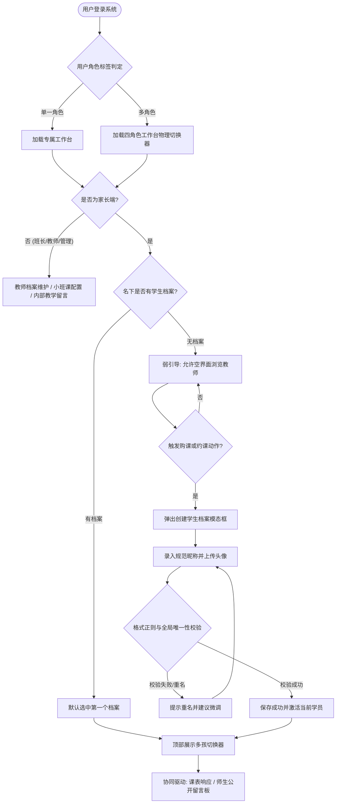

# 产品需求文档 (PRD) — 教学教务档案中心 (Master Data & Profile)

---

## 1. 概述与执行摘要 (Executive Summary)

教学教务档案中心（模块一）是 Dream 教务排班与分账管理系统的基座主数据系统。本功能面向管理员、班长、授课教师及学生家长四大核心角色，实现“登录账号与学员档案解耦”、“多孩共管”、“教师多媒体履历档案与班长 1:1 强绑定”、“统一班级实体（1v1 静默建班与小班课显式管控）”以及“双权限流式留言板”。

本期为系统正式功能的 MVP 阶段，旨在建立干净、防呆、具备可扩展性的基础档案模型，为下游的购课单管理、智能日历排班与财务分账提供可信的主数据源。

---

## 2. 问题定义与背景 (Problem Statement)

- **多孩共管与账号混淆痛点**：少儿教务场景中，出资与日常约课操作由家长完成，实际上课与课时消耗主体为低龄学员。传统教务系统常将“账号”与“学员”强绑定，导致二胎/多胎家庭必须注册多个账号来回切换，或单账号下多个孩子的课时、课表混杂在一起，极易发生误排和错退。
- **跨家长转让检索难题**：家长之间在线下微信转让未消课次时，由于缺乏唯一标识，转出方难以在系统内精准指定接课孩子，易发生转错人甚至安全纠纷。
- **教师履历信息割裂与展示薄弱**：家长预约临时课前需要直观了解外教的教学风格、口音与性格，传统纯文字简历无法支撑转化；且教师归属责任不清晰，缺乏固定的中方班长对接人。
- **教学交接与隐私敏感风险**：代课老师代课前无法快速获知孩子的真实英语底子与性格注意事项；若将内部教学评语公开展示给家长，极易引发客诉矛盾。

---

## 3. 目标用户与角色画像 (Users & Personas)

### 3.1 角色一：多孩出资家长（Amy，二孩妈妈）
- **角色定位**：拥有大宝 Alice（12岁）与二宝 Bob（10岁），负责全家购课出资、课程预约与日常家校沟通。
- **核心诉求**：使用一个邮箱账号登录，在工作台顶部即可自由切换大宝和二宝的课表与课次；能给每个孩子上传头像；在预约老师前能在卡片内直接点开看外教的双语自我介绍与试讲视频。
- **预期成果**：两孩档案清晰隔离，随时掌握每个孩子各自的待排课次与课后反馈。

### 3.2 角色二：教务服务经纪人（班长 Leo）
- **角色定位**：负责管理 10-15 位固定外教团队，兼任小班课班级负责人，负责教师档案录入、小班招生运营与教学交接协调。
- **核心诉求**：为新入职外教录入中英文简介并上传试讲视频、ClassIn 二维码；手动创建小班课，配置人数与抽佣；在学生档案内部留言板记录孩子性格特点，供正课老师和代课老师查阅。
- **预期成果**：所辖教师资料完整对外展示，教学内部沟通不被家长窥探。

### 3.3 角色三：一线授课教师（Teacher David）
- **角色定位**：母语外教，负责按排期授课，偶尔替请假老师代课。
- **核心诉求**：课后在公开留言板快速记录学生本节课完成的教材章节与表现；临时代课时，能点开学生的内部留言板查看原老师留下的教学注意事项。
- **预期成果**：教学进度交接无缝，家校沟通透明。

### 3.4 角色四：平台管理员（Admin Sarah）
- **角色定位**：平台统筹运营与中央风控。
- **核心诉求**：统一维护系统底层课程类型枚举；查看全平台师生数据；对误发或违规的留言执行终极清理。

---

## 4. 核心业务流程 (Main Flows)

### 4.1 流程一：家长工作台空档案冷启动与学员创建流程 (Happy Path)
1. 家长注册并成功登录后，默认进入【家长工作台】。
2. 系统检测当前账号名下无任何学生档案，顶部的【多孩档案切换器】显示“未绑定学员”，页面不阻断，允许家长正常浏览教师列表与空日程（弱引导模式）。
3. 当家长在界面中点击【立即预约】或【去购课】时，系统阻断操作并弹出【创建学生档案】模态框。
4. 家长录入学生姓名、英文名、姓首字母、年龄、性别、出生日期，系统自动组装并预览昵称（如 `AliceZ12`），支持家长上传自定义正方形头像。
5. 家长点击提交，系统严格校验昵称正则格式与全平台唯一性：
   - 若昵称已被他人占用，系统阻断并提示：“该昵称已被使用，建议微调（如添加后缀 AliceZ12b）”。
   - 若校验通过，系统创建档案并将其设为当前激活学员（Active Profile）。
6. 弹窗自动关闭，页面自动联动刷新，允许继续后续业务动作。

### 4.2 流程二：教师多媒体档案代录与中英双语维护流程
1. 班长登录【班长工作台】，进入【我负责的教师】列表，点击【新建/编辑教师档案】。
2. 录入教师真实姓名、绑定当前班长为责任人（1:1 关系）、选择教师级别（如 Senior、Standard）。
3. 勾选教师擅长的课程类型（如少儿英语、生活口语、KET）。
4. 分别录入**中文自我介绍**（便于国内低龄家长阅读）与**英文自我介绍**（真实还原教师表达风格）。
5. 点击上传照片、介绍视频（MP4）与 ClassIn 二维码图片，前端通过预签名凭据直接上传至对象存储，界面实时呈现上传进度条与缩略图预览。
6. 保存成功后，教师信息立即在家长端教师列表中生效，家长可原位展开观看试讲视频。

### 4.3 流程三：小班课创建与开班边界控制流程
1. 班长或管理员进入【班级管理】，点击【创建小班课】。
2. 录入班级名称、选择授课教师、指定小班课负责人（班长）、配置课程类型、设置开班人数区间：最少人数（Min，默认 2）与最大容纳人数（Max，如 6）。
3. 配置财务指标：教师单节课酬积分、平台净盈余抽佣比例（R%）。
4. 提交创建后，班级进入【招募中】状态。
5. 招生逻辑与边界判定：
   - 当报名人数达到 Max 时，前台选班入口直接标记为【已满员】并置灰，禁止后续加入。
   - 若达到开课日期时报名人数仍未达到 Min（如仅有 1 人报名）：系统高亮标记提醒，但允许负责人根据实际运营情况点击【强制开班】转为正常开课状态，或点击【取消班级】全额退回学员课时。

### 4.4 流程四：学生档案双权限流式留言板发布与撤回流程
1. 授课老师上完课后，进入对应学生的档案留言板。
2. 选择留言类型：
   - 🔓 **师生公开**：录入本节课学习反馈与课后作业，点击发布。该留言立即对家长、学生及所有教学人员可见。
   - 🔒 **仅内部教学可见**：录入学员情绪状态、底子薄弱点或代课交接提示，点击发布。该留言对家长完全隐藏，仅教师、班长和管理员可见。
3. **5分钟自主撤回时限**：发布成功后，发布者在 5 分钟内可看到【撤回】按钮；点击撤回后，该留言从界面移除，后端做物理或逻辑抹除。
4. **超时锁定**：超过 5 分钟后，撤回按钮消失，内容锁定不可修改。如后续存在客诉或敏感纠纷，仅管理员角色具备后台【软删除】操作权限。

---

## 5. 用户故事 (User Stories)

- **US-01（多孩共管）**：作为一个二胎家长，我想要在同一个登录账号下创建并管理大宝和二宝的独立学生档案，以便于无需频繁登出切换账号即可分别查看他们的课表。
- **US-02（唯一昵称防呆）**：作为一个需要跨家长转让课程的家长，我想要输入对方孩子的规范昵称并精准匹配出接收人，以便于线下微信交割后线上不会把课时转错给陌生人。
- **US-03（多媒体外教浏览）**：作为一个挑选中外教的家长，我想要在教师卡片中直接原位播放试讲视频并一键切换中英文介绍，以便于快速判断该老师是否适合孩子的学习风格。
- **US-04（小班满员保护）**：作为一个小班课负责人，我想要设定班级的最大学生容纳上限并在满额时自动封顶，以便于保障课堂教学质量不超载。
- **US-05（内部交接防泄露）**：作为一个带班中方班长，我想要在学生档案中记录孩子的性格弱点且仅限老师之间可见，以便于代课老师能因材施教且不引发家长焦虑或客诉。
- **US-06（留言防手滑撤回）**：作为一个教师，我想要在打错字或选错公开/内部标签后 5 分钟内一键撤回，以便于修正错误的教学记录。

---

## 6. 验收标准清单 (Acceptance Criteria)

### 6.1 角色工作台与全局档案切换器 (Workspace & Profile Switcher)
- **AC-01**：用户登录后，系统检查其角色标签。若用户仅有 1 个角色标签（如仅家长），页面顶部工作台区域固定展示当前工作台名称，不展示任何下拉切换控件。
- **AC-02**：若用户拥有 2 个及以上角色标签（如管理员兼家长），顶部常驻工作台切换器，点击可瞬间跳转对应工作台，菜单与主题色物理隔离。
- **AC-03**：在家长工作台顶部常驻【多孩档案切换器】。当家长名下存在多个学生时，切换选中的孩子后，页面在不发生全页刷新的前提下，响应式重新加载当前选中孩子的排课数据与留言板。

### 6.2 学生档案管理 (Student Profile)
- **AC-04**：单个家长账号最多允许创建 10 个学生档案。当达到 10 个时，【添加孩子】按钮置灰并提示“已达档案创建上限 (10个)”。
- **AC-05**：创建/编辑学生档案时，昵称必须严格匹配 `英文名 + 姓首字母 + 年龄` 格式（如 `AliceZ12`，年龄支持 1-2 位数字）。不符合规则时，表单实时提示“昵称格式必须为：英文名+姓首字母+年龄（例如 AliceZ12）”，禁止提交。
- **AC-06**：学生昵称在全系统内大小写不敏感全局唯一。若提交的昵称已被其他家长名下学员占用，系统阻断提交并明确提示“该昵称已被占用，请尝试添加后缀微调”。
- **AC-07**：家长支持上传比例为 1:1 的正方形自定义头像，图片体积上限为 2MB，格式支持 JPG、PNG、WebP。

### 6.3 教师档案与多媒体呈现 (Teacher Profile & Media)
- **AC-08**：每位教师档案必须且只能绑定 1 位负责班长。负责班长账号有权查看并编辑所辖教师的档案信息。
- **AC-09**：教师档案中文字介绍与英文介绍均为必填项。家长端教师主页支持【中文 / English】一键切换按钮，切换后即时切换文本。
- **AC-10**：教师介绍视频统一支持 MP4 格式，体积上限 50MB。在家长端卡片内点击视频封面支持展开就地播放；视频播放器右下角必须包含原生全屏切换按钮。
- **AC-11**：教师 ClassIn 二维码图片上传后，家长端支持点击放大查看，以便手机扫码添加。

### 6.4 班级实体与边界管控 (Classes)
- **AC-12**：1v1 课程排定或购课时，系统在后台静默完成班级实体的创建与绑定。家长端与教师端的所有展示界面中，严禁出现“1v1 班级”文字或实体概念，仅展示“意向授课老师 + 课程类型”。
- **AC-13**：小班课创建时，Min 限制 $\ge 1$ 且 $\le Max$；Max 限制 $\le 20$。抽佣比例 R% 取值区间为 $[0.00, 100.00]$。
- **AC-14**：小班课当前报名有效学员数达到 Max 时，选班与约课入口状态变更为“已满员”，按钮禁用并阻止任何新选课提交。
- **AC-15**：小班课若未达到 Min 人数，小班负责人工作台提供【强制开班】按钮；点击确认并二次弹窗提示后，班级强制进入正式开课状态。

### 6.5 双权限留言板 (Profile Messages)
- **AC-16**：家长角色发布的留言，系统强制固定为【师生公开】，严禁家长选择或发布【仅内部教学可见】留言。
- **AC-17**：教师、代课教师、班长、管理员可自由选择发布【师生公开】或【仅内部教学可见】。在所有家长端视图中，系统物理屏蔽所有【仅内部教学可见】数据，接口绝对不向下透传。
- **AC-18**：留言发布者在成功发布后 5 分钟（300 秒）内，界面展示【撤回】操作项；超过 300 秒后撤回按钮物理隐藏。
- **AC-19**：管理员角色在后台管理视图中，对任意留言均具备【删除】操作项，执行删除后数据从公开流中隐藏。

### 6.6 PWA、端侧缓存与全站双语 (PWA, Caching & i18n)
- **AC-20**：系统全面支持 **PWA (Progressive Web App)** 规范，支持在手机端与平板端浏览器“添加到主屏幕 (A2HS)”独立运行。手机端排版为单列触控卡片流，平板端（$\ge 768px$）自适应切换为多列并排网格，触控热区均 $\ge 44px$。
- **AC-21**：端侧数据实施分级缓存：静态资源与基础字典（如课程类型、定级标准）以及当前激活学员上下文实行强缓存；教师公开卡片支持弱网/离线只读浏览；任何购课资金、退款与排班抢位操作严格要求在线，离线状态下强制置灰阻断。
- **AC-22**：全站用户界面支持**中文简体 (`zh-CN`) 与英文 (`en-US`)** 无刷新双语切换，覆盖导航菜单、表单提示、7色状态标签与后端业务错误码（如重名、超时等）；用户语言偏好持久化保存至本地存储。

---

## 7. 本期范围外清单 (Out of Scope)

以下功能明确**不在本期（MVP）**实现范围内，严禁在开发中发生需求蔓延：
- **暂不实现结构化教材大纲库管理**：本期不开发结构化章节教材、课件预览或在线大纲库；教学进度继续依赖学生留言板中的文字记录，全局大纲使用外部腾讯文档共享。
- **暂不实现小班课排队候补机制 (Waitlist)**：小班课满员后直接禁止选课，不设计复杂的自动递补与候补队列机制。
- **暂不实现除中英文以外的第三方多语种**：本期全面覆盖中文与英文双语，暂不接入西语、日语法语等其他小语种。
- **暂不实现学生档案的跨家长合并或亲友共享账号**：每个学生档案严格归属于创建它的唯一家长登录账号，不提供“爸爸妈妈两个账号共同管理一个孩子档案”的双主权机制。

---

## 8. 约束条件 (Constraints)

### 8.1 业务与合规约束
- **财课解耦底线**：档案中心作为纯教务主数据，严禁在此阶段计算任何课时抵扣、转账分账或生成结算单，资金流永远通过下游的【购课单】与【转账单】流转。
- **隐私保护**：内部教学留言可能包含对学员性格特征或家庭情况的敏感评价，对家长端的屏蔽必须在数据接口层实现物理阻断，严禁前端仅靠 CSS 隐藏。

### 8.2 功能与规格限制
- **单家长档案数上限**：10 个。
- **教师介绍视频**：单一 MP4 格式，时长推荐 1-3 分钟，体积上限 50MB。
- **头像与二维码图片**：JPG/PNG/WebP 格式，单图体积上限 2MB。
- **文本长度限制**：
  - 学生昵称：3 - 30 字符。
  - 教师中/英文介绍：各自上限 2000 字符。
  - 留言板单条留言：上限 1000 字符。

---

## 9. UI/UX 界面线框说明 (Wireframe Level)

### 9.1 页面一：家长工作台顶部与多孩切换器
- **顶部顶栏**：
  - 左侧：Dream 品牌标识。
  - 右侧：当前工作台标题（无切换时展示纯文本；多角色时为切换下拉菜单）、个人头像与退出登录。
- **二级吸顶操作条（家长端专属）**：
  - 【当前学员切换器】：下拉选择框，展示 `[头像] 昵称 (如 AliceZ12)`。
  - 点击下拉：展示名下所有学员列表，底部固定为【+ 添加新宝贝 (N/10)】。
  - 若名下无学员：显示 `[暂未绑定学员]`，右侧附高亮按钮【立即添加孩子】。

### 9.2 页面二：创建学生档案模态弹窗 (Modal)
- **弹窗标题**：添加新学员档案
- **表单内容**：
  - 头像上传区：圆形头像框，支持点击选择图片裁剪为正方形。
  - 英文名输入框（如 `Alice`）与 姓氏拼音首字母输入框（如 `Z`）。
  - 年龄与出生年月选择框。
  - 实时预览展示：`系统生成昵称：AliceZ12`（附提示：全平台唯一，用于跨家长转让精准匹配）。
  - 性别单选组（男 / 女 / 保密）。
  - 选课偏好（课程类型复选标签组，默认勾选“不限”）。
- **交互动作**：【取消】、【确认创建】（异步提交并校验重名）。

### 9.3 页面三：教师列表卡片与多媒体交互
- **卡片头部**：教师头像、姓名、定级徽标（如 Senior）、负责班长昵称。
- **语言切换条**：右上角提供文字按钮组 `[中文简介] | [English]`，点击平滑切换文字区域内容。
- **介绍视频区**：
  - 默认状态：视频封面卡片，中央展示半透明播放图标。
  - 点击播放：封面淡出，就地展开原生 HTML5 视频播放器自动播放，右下角提供全屏控制按钮。
- **底部操作区**：ClassIn 扫码图标、擅长课程类型标签流、以及【预约试听 / 约临时课】按钮。

### 9.4 页面四：学生档案简易留言板组件
- **留言发布框**：
  - 多行输入文本框（最多 1000 字）。
  - 权限切换单选框（仅教师/班长可见）：`🔓 师生公开` vs `🔒 仅内部教学可见`。
  - 右下角【发布留言】按钮。
- **历史留言列表（时间倒序流水）**：
  - 每条留言卡片：发表人角色标识（如 `[正课老师] David`、`[代课老师] Bob`、`[班长] Leo`、`[家长]`）、发表时间。
  - 内部标签：若为内部留言，显示明显的黄色锁状标签 `[仅内部教学可见]`。
  - 撤回操作项：发布时间在 300 秒内的高亮显示 `[撤回 (剩余 240s)]`。

---

## 10. 用户流程图 (User Flow Diagram)

---

## 11. 智能体/系统决策行为规范 (System Decision Specification)

本模块暂不引入外部自主智能体或非确定性大模型推理，所有业务逻辑均由**系统确定性规则引擎**管控：
1. **防重名自动判定**：系统在接收创建/编辑学员请求时，严格执行原子化互斥防重校验。发现同名立即拦截，禁止出现模糊容错。
2. **多孩切换全局广播**：切换学员档案后，必须同步通知所有依赖组件拉取最新数据，严禁残留上一名学员的课表或课次。
3. **数据脱敏与越权强阻断**：当 HTTP 请求主体为家长角色时，系统服务层物理注入数据过滤条件，若发现请求内部留言直接拦截阻断，绝对禁止向外输出内部教务信息。

---

## 12. 待定事项与补充说明 (Further Notes)

- **待定项 1（教师请假日程联动）**：教师档案中设置的常规休息时段与后续模块三的 7 色日历联动的精确规则，将在日历模块中深度展开。
- **待定项 2（大龄独立成人学员）**：对于成人学生，系统当前完全兼容——其登录账号即为出资家长，创建名下唯一的成人学生档案即可，交互无须额外分支。
- **技术交接提醒**：本 PRD 已经完整收敛功能与交互边界，后续可调用 `technical-design-doc-creator` 对齐本需求生成的实现方案，严格按照 C-S-M 架构与 12 位短 ID 落地编码。
