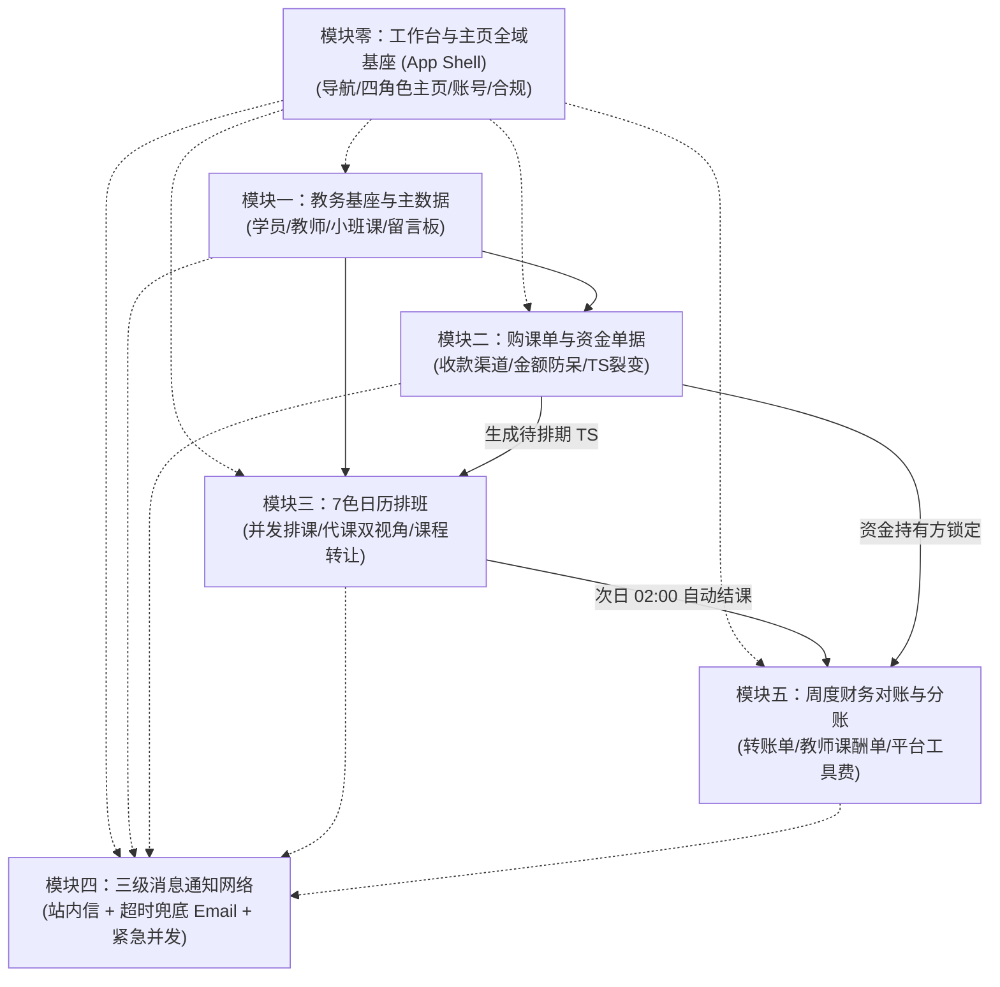

/** (c) 2024-2026 Topee (https://topee.top). All rights reserved. Proprietary and confidential. */

# Dream 系统核心业务模块划分规约 (System Modules Overview)

本文档基于 `docs/Prd-v5.md`（需求规格说明书）与 `DESIGN.md` / `docs/CODING_STANDARDS.md` / `docs/BUSINESS_RULES.md` 架构规范体系，正式定义 Dream（教务排班与分账管理系统）的 **M0 顶层横向基座与 M1–M5 五大核心业务模块的划分、边界职责、协作拓扑与领域实体归属**，作为全工程跨端（后端、核心共享库、批处理、前端 Web）研发与后续版本迭代的唯一顶层业务领域基准。

---

## 一、 系统架构哲学与六大核心红线

在深入各模块细节前，全系统所有模块必须且强制遵守以下六项底层红线：

1. **账号与档案解耦 (Account vs. Profile)**：自然人操作主体（Account）与实际上课实体（Student Profile）物理隔离，单个家长账号可挂载多个学生档案（多孩共管），二者主键均采用 12 位短 ID。
2. **多角色工作台物理隔离 (Workspace Isolation)**：四套工作台在导航菜单、路由与顶部身份 Banner（家长夜蓝 / 教师深青绿 / 班长深梅红 / 管理员紫夜，低饱和 800/900 + 纹理）上物理隔离；内容卡片按用途浅色分型（课程/任务 amber、消息/通知 indigo、资产/财务 emerald、提醒/风险 rose、备忘/中性 slate），角色色不进入卡片。严防跨角色误操作。
3. **资金持有人锁定铁律 (Funds Holder Lock)**：TS（最小课次单元）的收款资金持有方永远锁定最初收款的班长或平台，后续无论发生何种同师挪位、临时代课或跨家长转让，持有方归属保持不变，直至周度转账单归集。
4. **财课分离与转让追踪 (Finance & Schedule Decoupling)**：课程发生转让时，原购课单与原付款家长的资金归属完全不变；排课层将 TS 实际授课学生档案变更为接收方学生，即时在其课表呈现。
5. **异常未上课回退补生兜底 (Safe Rollback with Compensation)**：针对教师实际未上课但已被次日凌晨系统自动结课的异常 TS，允许班长/管理员修改为“已取消”，记录严格审计日志，并由系统在原单下自动补生 1 节全新“待排期 TS”，课酬统计物理剔除。
6. **外壳与业务解耦 (Shell–Business Separation)**：M0 顶层基座只负责导航、工作台切换、角色主页聚合、账号设置与法律合规，不重复 M1–M5 的业务规则；所有业务动作仍由对应模块的 Service 承载，所有 SQL 仍只能落在 `dream-core` 的 Mapper 中。

---

## 二、 M0 顶层基座与五大核心业务模块划分与规格

---

### 模块零：工作台与主页全域基座 (Workspace & Home Foundation)

- **模块代号**：`module0_workspace_home`（`m0`）
- **业务定位**：整个系统的顶层横向基座（App Shell），统领 M1–M5 五大垂直业务模块。M0 只做统一入口、角色导航、主页聚合、账号设置与法律合规，不重复各模块的业务规则。
- **PRD 依据**：[m0_workspace_and_home.md](./prd/m0_workspace_and_home.md)
- **细分为四个子域**：
  1. **全局导航与多角色外壳 (`m0_workspace_shell`)**：
     - 管理员、班长、教师、家长四套工作台在路由、菜单与主题上物理隔离；
     - 单角色用户隐藏切换器；多角色用户在顶部常驻“身份秒切胶囊”，按账号记忆上次退出的工作台，首次登录按 管理员 > 班长 > 教师 > 家长 进入；
     - 跨角色待办红点透传：胶囊显示目标工作台待办数，点击 0.1 秒级切换并直达待办列表，切换不整页刷新、不保留上一角色敏感数据。
  2. **角色专属主页与待办工作区 (`m0_role_home`)**：
     - 家长端围绕当前孩子：下一节课焦点卡、ClassIn 双模入口、动态待办、课时资产快照与六大高频入口；
     - 班长端聚焦紧急教务：待调配代课、待排满 4 周固定位、待确认购课/退费、待上交转账单，附提前 7 天续费出单预警与八大入口；
     - 教师端极简双语：今日授课概览、下一节课大卡片、代课交接摘要、待补录反馈提醒与 7 色课表；
     - 管理员端聚焦中央结算：转账单审核、教师课酬打款、平台直收确认、异常申诉与抽佣配置；
     - 全端手机优先、平板自适应，不做 PC 浏览器适配。
  3. **统一个人中心与账号安全中心 (`m0_account_security`)**：
     - 账号资料卡、修改密码、换绑邮箱/手机号（双向验证码）；
     - 家长多孩档案集中管理（单账号上限 10 个）；
     - 中英双语即时切换、通知偏好、PWA 缓存管理与退出登录；
     - 登录、注册、找回密码与 Token 刷新统一委托 `@topeetop/auth-core`。
  4. **法律合规与品牌信任中心 (`m0_legal_about`)**：
     - 关于我们、用户服务协议、隐私保护政策；
     - 协议固化固定位四周一轮、12.5% 请假配额、3 小时阶梯熔断、代课差价多退少不补、退费原收款方退回等核心契约；
     - 未成年人个人信息保护专章与跨国数据跨境传输脱敏说明；V1 只提供入口与占位内容，不记录用户同意版本。
- **边界约束**：主页待办与统计的数据归属 M1–M5，M0 只做展示与跳转，不新增业务规则；工作台记忆等外壳偏好由 M0 自行保存。

---

### 模块一：教学教务基座与主数据 (Master Data & Profiles)

- **模块代号**：`module1_master_data`
- **业务定位**：整个教务系统的主数据与实体档案基座，为排班日历、购课单与财务核算提供可信的数据源头与防越权校验实体。
- **细分为四个子模块**：
  1. **M1A 学员与多孩档案中心 (`m1a_student_profile`)**：
     - 单个家长账号挂载上限 10 个学生档案，弱引导冷启动（未绑定时不阻断浏览，购课/约课时强提示补录）；
     - 支持正方形自定义头像上传至 S3/R2，数据库只存相对 Key；
     - 规范昵称严格遵循 `英文名 + 姓首字母 + 年龄`（正则 `^[A-Za-z]+[A-Za-z][0-9]{1,2}$`，如 `AliceZ12`），数据库大小写不敏感全局唯一，支持跨家长转让精确检索；
     - 家长工作台常驻【多孩全局档案切换器】（由 M0 外壳承载，M1A 提供档案数据与增删改能力），Pinia 驱动下层单据无感刷新。
  2. **M1B 教师与班长档案管理 (`m1b_teacher_profile`)**：
     - **全量班长管理**：管理员专属工作台支持查看全量班长列表（显示姓名、绑定邮箱、电话、委任日期、在职/已离职状态）及当前负荷统计（所辖外教数、负责小班数、托管未结课次资产）；
     - **委任新班长**：通过检索平台已注册自然人 Email 校验匹配，录入显示名称与电话，授予 `monitor` 角色并建立班长档案；
     - **教师 1:1 强绑定与改绑**：每位教师档案必须且只能绑定 1 位负责班长；支持在班长列表侧一键批量改绑或在教师档案编辑侧单人改绑负责班长；
     - **解除班长职务（离职注销）两道强防线阻断**：
       - 防线一（资金清算）：名下持有未结 TS（`待排期` 或 未结 `已排期`）时强制阻断解除，必须先在 M5A 完成离职资产移交转账单并全额归集平台；
       - 防线二（教务管辖）：名下存在在职外教或小班课时强制阻断解除，必须先批量改绑接手班长；
       - 解除后收回 `monitor` 角色，班长档案软删除（`deleted_at IS NOT NULL`），保留历史单据只读追溯；兼任家长的账号仍可正常登录家长端约课；
     - **外教多媒体履历**：必填**中文自我介绍**与**英文自我介绍**，前台一键切换；预签名直传风采相册多图（1~6 张，自由排序并点选 1:1 独立裁切主头像；前台紧凑网格展示，支持点击唤起全屏灯箱放大查看）、试讲视频（MP4 $\le 50\text{MB}$，卡片内就地播放与原生全屏切换）、ClassIn 二维码图片（支持点击放大扫码与一键唤醒）；
     - **基础字典**：教师定级字典与擅长课程类型技能标签匹配。
  3. **M1C 统一班级与招生管控 (`m1c_classes`)**：
     - **1v1 个人班**：首次排课时后台静默创建并维护关联，前端对家长和教师完全屏蔽“班级”实体概念；
     - **小班课班级**：手动创建，核心参数包括班级名称、课程类型、指定教师、小班课负责人（班长）、Min 开班人数（默认 2）、Max 容量人数（$\le 20$）；
     - 满员强阻断：报名人数达到 Max 时前台入口标记“已满员”并禁用；未达 Min 时支持负责人点击“强制开班”；
     - 核心财务指标：教师单节课酬积分、平台净盈余抽佣比例 $R\%$ ($0\% \sim 100\%$)。
  4. **M1D 双权限教学留言板 (`m1d_profile_messages`)**：
     - 挂载于学生档案，按时间倒序流式记录；
     - **师生公开 (`public_teacher_student`)**：全员可见（家长、正课老师、代课老师、班长、管理员），用于课后作业与学习反馈；
     - **仅内部教学可见 (`internal_teaching_only`)**：对家长端物理过滤隐藏（接口层拦截），仅教师、代课教师、班长、管理员可见，用于记录性格特点与代课交接提示；
     - **5 分钟防手滑撤回时限**：发布者在 300 秒内可撤回留言，超过 300 秒锁定不可修改（仅管理员具备后台软删除权限）。
  5. **M1E 课件库与学员在学课件管理 (`m1e_courseware`)**：
     - **课件元数据资产**：维护中文名、英文名、中英文简介、封面图、归属课程类型（多选），支持多级英文级别及每级 0~9 张内页样章配图与调序；
     - **学员在学课件配置**：支持管理员与责任班长在学生档案中配置 1~6 门【课件+级别】（家长端只读），调整变更强制沉淀审计日志；
     - **教学与多端协同**：外教课表待上课详情卡片直观透出课件及级别标签（含样课大图预览），实现课前精准备课。

---

### 模块二：购课单与资金单据 (Course Orders & Funds)

- **模块代号**：`module2_course_orders`
- **业务定位**：正向资金出资、积分转换、TS 课次裂变与逆向退款冲退枢纽，严格遵守“资金持有人锁定”与“财课分离”铁律。

#### 1. 子模块 2A：购课录单、防呆校验与 TS 裂变引擎 (`m2a_course_orders` - 正向资金流)
- **业务定位**：正向课时资产生成中心，下游排课的唯一资产供给源。
- **核心功能**：
  - **三大收款渠道线下录单**：支持 1v1 班长收款、小班课班长收款、平台管理员直收三种路径（1元 = 1积分，按单购课，不设账户资金池）。
  - **两步流转确认机制**：录单生成【待付款确认】单据，核对凭证后点击【确认收款】，原子裂变生成待排期 TS。
  - **整班录入小班课模式**：小班课由小班班长自负盈亏，按整班录入一张总购课单并裂变小班课 TS（对家长端物理隐藏）。
  - **智能防呆金额强提醒**：录入金额自动比对 `课数 × (教师级别标准价 + 工具费 2 积分 + 额外备课费 10 积分)`，不一致时拦截并弹窗公式强提醒，二次确认携带 `force_submit: true` 强制提交。
  - **除不尽尾差兜底处理**：强制提交特殊优惠总价时，单节 TS 积分取整，除不尽尾差计入最后一节 TS，确保 N 节 TS 快照之和 100% 等于单据总积分。
  - **12.5% 请假配额计算**：单据确认即自动计算并锁定周期请假上限：`Math.floor(课次数 × 0.125)`（向下取整）。
  - **TS 原子裂变与财务快照**：单据确认收款后，事务内原子裂变生成 $N$ 节【待排期 TS】，永久锁定收款人（`holder_id`），并固化实付总积分、教师课酬、工具费、备课费快照。

#### 2. 子模块 2B：退款单与课时冲退核算 (`m2b_refund_orders` - 逆向资金流)
- **业务定位**：逆向资金冲销与风控中心，负责垫底退费审批与课时冲退。
- **核心功能**：
  - **退费前置条件校验**：固定位需先尝试同师挪位或线下转让，确需退费须提前 24 小时申请。
  - **退款单创建与打款凭证上传**：经办人录入退款原因，上传打款凭证截图。
  - **未结 TS 勾选冲退**：从原购课单勾选未排期或未结 TS，原子置为【已取消】。
  - **违约金按比例拆分算法**：扣除的违约金自动按原 TS 的“教师课酬”与“平台工具费”比例拆分入账。
  - **全链路审计流转**：记录详细审计日志，退款单流转至终态。

---

### 模块三：7色智能日历、排班、考勤与课程转让 (7-Color Calendar, Scheduling & Transfer)

- **模块代号**：`module3_calendar_schedule`
- **业务定位**：高频教学运营与排课网格调度引擎，依托 PostgreSQL 原生行级排他锁（`SELECT ... FOR UPDATE`）保障并发抢位零超卖，对齐 7 色视觉标准、阶梯考勤熔断与财课分离转让铁律。
- **细分为三个子模块**：

#### 1. 子模块 3A：7色日历网格与排班抢位引擎 (`m3a_calendar_schedule` - 正向日历排课)
- **业务定位**：教学时间网格基座与正向占位抢位中心。
- **核心功能**：
  - **智能紧凑日历与动态时间窗裁剪**：以每日 06:00 - 00:00 为标准底盘（全天 36 个半小时单元格）；单师日历根据周模板与排课动态外接裁剪 $[T_{\min}, T_{\max}]$（首尾非营业时段物理隐藏，默认仅展示约 08:00-20:00，保底 6h 并保留全天展开兜底），日间连续 $\ge 2\text{h}$ 全休自动折叠为 22px 条；移动端单元格行高收敛至 28px 高密度排版；班长管辖多师（$\ge 3$ 位）支持顶部状态卡 + 底部抽屉透视排课负荷；日历顶栏升级为“4周一轮”双层极速分段导航（内层 4 等宽胶囊 1 键秒切第 1~4 周，外层整轮平移）；家长端看孩子专属课表默认【本周日程清单】卡片流（零滚动秒读）；教师周模板面板默认收敛聚焦于 08:00-21:00 核心营业窗并提供作息快捷预设；
  - **7 色日历统一 DTO 渲染引擎**：全端统一由后端 Service 层计算并注入 `colorCode`（`ORANGE | YELLOW | BLUE | PURPLE | GRAY | GREEN | RED`），全端组件实施“哑组件化”，移动端抽屉流与 PC 端 7 列周网格物理适配；
  - **1v1 固定位排班**：四周一轮（买 4 排 4），具备最高锁位优先级，一次性批量锁定未来 4 周 🟠 橙色网格；提前 7 天（最后一周周一 08:30）自动预排续费单并挂载日历 HOLD 虚线锁定；
  - **1v1 临时课预约**：家长提前 1-7 天自主抢位预约（🟡 黄色网格）；
  - **小班课整班排课**：连续锁定 1 小时（2 个基础网格），全班统一课表；
  - **并发防超卖行锁保障**：PostgreSQL 原生 `SELECT ... FOR UPDATE` 行级排他锁，杜绝毫秒级高并发撞课。
- **状态流转**：TS 由 `待排期` $\rightarrow$ `已排期`。

#### 2. 子模块 3B：考勤、请假挪位与代课调度 (`m3b_attendance_substitution` - 变更调度与考勤)
- **业务定位**：已排期课次的高频考勤、请假退回与紧急代课履约中枢。
- **核心功能**：
  - **12.5% 请假配额校验与实时扣减**：周期内请假次数上限拦截与已用次数累计；
  - **阶梯式时间熔断规则矩阵**：
    - $\ge 24\text{h}$：常规同师挪位，或临时课退回 `待排期`（释放原日历网格为 🟢 空闲可约）；
    - $3\text{h} \sim 24\text{h}$（或超配额）：强制同师改期或转让，禁止退回待排期；
    - $< 3\text{h}$：**前端全端熔断锁死**，关闭所有变更入口，缺席照常按已结课扣费；
  - **教师考勤与代课调配**：
    - 教师主动请假与销假（开课前 > 5 分钟不占配额）；
    - 班长后台代课调配（指派空闲教师 B 代课，更新 `is_substitute=true`，记录 `original_teacher_id` 与 `current_teacher_id`）；
  - **代课双视角渲染与财务锁定**：原老师 A 视角显示 🔵【被代课】，代课老师 B 视角显示 🟣【代上课】（可点开学生留言板看交接进度），课酬归代课老师，**资金持有方（`holder_id`）永久保持不变**。
- **状态流转**：`已排期` 内部时段平移、代课人变更，或退回 `待排期`。

#### 3. 子模块 3C：课程转让与权益交割引擎 (`m3c_course_transfer` - 权益流转与财课分离)
- **业务定位**：未上课已排期课程（距开课 $\ge 3$ 小时）的学生间上课权益交割中心。
- **核心功能**：
  - **同家庭多孩直转**：大宝转给二宝，家长在端内直接通过名下学生档案下拉框一键完成交割；
  - **跨家长转让（双路径防转错）**：
    - 线下家长微信自结资金；
    - 线上支持“输入接收方精确规范昵称（如 `BobZ10`）校验匹配”或联系班长后台代办；
  - **“财课分离”铁律底层落盘**：
    - 财务底层：原购课单、原出资家长、收款班长资金持有人 **100% 保持不变**，不产生跨账户积分拆借；
    - 教学排课层：仅将 TS 的 `actual_student_profile_id` 更新为接收方学生，直接呈现在接收方课表上；
  - **视觉角标与提醒**：课表上橙色网格保持显示，并加注【转】字角标及接收学生昵称；
  - **协同消息触达**：自动向授课教师发送 Email + 站内信（提示上课孩子已变更并附受让学生留言板入口），同时邮件通知接收方家长排课已生效。
- **状态流转**：TS 状态保持 `已排期`，更新 `actual_student_profile_id` 并标记 `is_transferred = true`。

---

### 模块四：三级消息通知分发网络 (Notification Network)

- **模块代号**：`module4_notification`
- **业务定位**：全链路多渠道家校沟通与超时未读升级兜底中心，依托 `@topeetop/notification-core` 与 `dream-worker`。
- **核心功能**：
  - **一级常规通知（仅站内信）**：课表生成、每周教师课酬节数单生成、学生档案留言板新公开回复。
  - **二级必达通知（站内信 + 超时兜底 Email）**：购课单确认、新排课成功、24h 之外常规请假/挪位。系统先发站内信，若超出未读超时阈值（默认 30 分钟），由 Worker 自动向家长绑定的通知邮箱补发 Email。
  - **三级紧急通知（站内信与 Email 并发即时派发）**：24h 之内紧急改期/挪位、课程转让成功、小班课整班停课、教师紧急请假与安排临时代课、中途退款单生成。
  - **敏感隐私物理屏蔽**：针对学生档案中的“仅内部教学可见”留言，系统严禁向家长端触发任何形式的站内信或邮件通知。
  - **极简双页表现层（列表直读 + 独立详情页）**：采用轻量级二段式界面替代复杂抽屉与弹窗。<120 字常规通知在列表卡片就地全文直读，≥120 字或结构化明细一键下钻独立详情页（支持已读自动标记）；提供“全部/仅看未读”与业务分类（课表与代课/账单与资产）快速分段过滤。

---

### 模块五：周度财务对账与结算分账 (Weekly Settlement & Reconciliation)

- **模块代号**：`module5_settlement`
- **业务定位**：后台批处理跑批、单向资金中央归集、教师发薪与平台纯收益核算。
- **细分为两个子模块**：

#### 1. 子模块 5A：结课跑批、异常回退与转账单归集 (`m5a_transfer_collection` - 资产结课与资金归集)
- **业务定位**：每日教学资产状态流转、异常课次兜底补生与班长向平台的资金归集枢纽。
- **核心功能**：
  - **次日凌晨 02:00 自动结课跑批 (`dream-worker`)**：扫描前一日营业期内（06:00-00:00）正常完课的已排期 TS，原子更新流转为 `已结课(待结算)`；
  - **异常未上课回退补生机制 (关键兜底)**：老师实际未上课但已被自动结课的异常 TS，班长/管理员手动置为 `已取消`，系统强制记录审计日志，并在原单下**自动补生 1 节全新的【待排期 TS】**，课酬统计物理剔除；
  - **班长单向转账单归集 (Transfer Order)**：
    - 班长只转账给平台管理员（**严禁班长之间互转**）；
    - **周一 03:30 自动生成草稿**：系统自动扫描上周结算周期，预生成转账单草稿（`DRAFT`，若应转 $\le 0$ 则静默跳过）；
    - **周一 08:00 自动催办提醒**：系统向有未提交转账草稿的班长统一推送站内通知与邮件；
    - 1v1 按已结课 TS 实付总积分全额计入；
    - **小班课按约定基准核算并自动预留班长盈余**：系统自动扣除属于小班班长的自留盈余，仅上交 `教师单节课酬 + 工具费(Max×6) + 平台分成比例`；
    - 班长周一线下打款并上传凭证，点击确认提交（`PENDING_CONFIRMATION`）；平台管理员周二核对水单确认收款（`COMPLETED`），周三平台统筹发放教师薪资；
  - **班长离职未结移交**：离职班长一键将名下所有未结 TS（`待排期`与未结`已排期`）全额移交平台，资金持有方（`holder_id`）变更为平台。
- **状态流转**：TS 由 `已排期` $\rightarrow$ `已结课(待结算)`；转账单 `DRAFT` $\rightarrow$ `PENDING_CONFIRMATION` $\rightarrow$ `COMPLETED`。

#### 2. 子模块 5B：双周结单、教师发薪与平台纯收益核算 (`m5b_weekly_settlement` - 结算报表与发薪闭环)
- **业务定位**：周末自动批处理出单、全校教师考勤发薪与平台净收益核算中枢。
- **核心功能**：
  - **周末跑批①：教师周课酬单 (每师每周一单，彻底解绑班长)**：
    - 代课课酬严格计入代课老师周课酬单，原老师记 0；
    - **核心铁律：只出课节数与备课费标记，不出具体金额**（清晰统计 1v1 正课节数、代上课节数、含备课费节数、小班课节数）；
    - 管理员线下核算发薪后，在后台将课酬单标记为 `已打款`，底层关联的所有 TS 达到终态 `已结算`；
  - **周末跑批②：平台工具费单 (每周一张，全局纯财务收益报表)**：
    - 无状态字段，不与家长挂钩；
    - 按老师分组汇总并下钻 TS 明细，统计平台每周从总池子里沉淀的净收益（1v1 工具费 2积分/节 + 小班课工具费 Max×6积分 + 小班课平台净盈余抽佣）；
  - **对账看板与导出**：管理员总账看板，支持按周对账审计与数据导出。
- **状态流转**：课酬单 `PENDING_SETTLEMENT` $\rightarrow$ `SETTLED` $\rightarrow$ `PAID`；TS 终态 `已结算`。

---

## 三、 Monorepo 物理工程映射规约

所有业务模块在代码工程中严格遵循单一职责与跨层隔离：

| 模块名称 | 共享领域核心 (`dream-core`) | HTTP 接口层 (`dream-backend`) | 异步跑批 (`dream-worker`) | 前端表现层 (`dream-frontend`) |
| :--- | :--- | :--- | :--- | :--- |
| **模块零：工作台与主页基座** | `WorkspacePreferenceMapper`（仅存工作台记忆等外壳偏好） | `WorkspaceController`（外壳偏好与主页聚合入口；账号安全委托 `@topeetop/auth-core`） | - | App Shell、四角色主页、顶部秒切胶囊、多孩 Profile Switcher、个人中心、法律合规页、ClassIn 双模唤醒 |
| **模块一：主数据** | `StudentProfileMapper` `TeacherProfileMapper` `ClassMapper` `ProfileMessageMapper` | `StudentProfileController` `TeacherProfileController` `ClassController` `ProfileMessageController` | 基础主数据清理 | 学员/教师/班级/留言板管理页面 TDesign 移动端适配 |
| **模块二：购课单** | `CourseOrderMapper` `CourseOrderService` 12.5%请假算法 | `CourseOrderController` 防呆金额强提醒拦截 | - | 购课表单与防呆强提醒弹窗 积分明细列表 |
| **模块三：排班日历** | `TimeslotMapper` `TimeslotLeaveMapper` `TimeslotTransferMapper` `TimeslotScheduleService` `TimeslotAttendanceService` `TimeslotTransferService` | `CalendarController` `ScheduleController` `AttendanceController` `TransferController` | - | 7 色智能排课日历网格 代课双视角渲染 跨家长转让检索弹窗 |
| **模块四：通知网络** | 站内信与邮件分发客户端集成 (`@topeetop/notification-core`) | 业务触发点透传通知事件 | 超时 30 分钟未读兜底邮件轮询 Job | 顶部未读站内信红点抽屉 邮件接收状态标记 |
| **模块五：财务分账** | `TransferOrderMapper` `SettlementMapper` 小班课自负盈亏公式计算器 | `TransferOrderController` `SettlementController` | 凌晨 02:00 自动结课 Job 周末周结单跑批 Job | 班长转账交割看板 教师周课酬只出节数单 平台工具费报表 |

---

## 四、 研发演进与当前落地现状

| 模块与阶段 | 涵盖范围 | 当前状态 | 核心产出与依据 |
| :--- | :--- | :--- | :--- |
| **模块 0** | 工作台外壳、四角色主页、跨角色待办透传、个人中心与账号安全、法律合规、ClassIn 双模唤醒 | 📝 **PRD 已就绪** | `docs/prd/m0_workspace_and_home.md` |
| **模块 1A** | 学员档案、多孩共管、规范昵称、S3头像 | ✅ **已完成 (Pass 100%)** | `StudentProfileMapper`, `StudentProfileService`, 60/60 单测全通 |
| **模块 1B** | 教师团队、1:1绑定班长、双语介绍、多媒体预签名直传 | ✅ **已完成 (Pass 100%)** | `TeacherProfileMapper`, `TeacherProfileService`, `FileUploadService`, 132/132 单测全通 |
| **模块 1C** | 1v1静默建班、小班课容量管控、抽佣配置、强制开班 | 📝 **方案已就绪** | `docs/prd/m1c_classes.md`, `docs/tdd/m1c_classes.md` |
| **模块 1D** | 学生档案简易留言板、师生公开与内部双权限、5分钟撤回 | 📝 **方案已就绪** | `docs/prd/m1d_profile_messages.md`, `docs/tdd/m1d_profile_messages.md` |
| **模块 1E** | 课件库与分级样章图谱、学员在学课件配置（最多6门）、外教备课穿透 | 📝 **PRD 已就绪** | `docs/prd/m1e_courseware.md` |
| **模块 2A** | 购课录单、防呆校验、TS 裂变快照、请假配额 | 📝 **PRD 已就绪** | `docs/prd/m2a_course_orders.md` |
| **模块 2B** | 1v1 退款单、课时冲退、违约金双向拆分、日历释放 | 📝 **PRD 已就绪** | `docs/prd/m2b_refund_orders.md` |
| **模块 3A** | 7 色日历网格、并发行锁防超卖、1v1 与小班课排班 | 📝 **PRD 已就绪** | `docs/prd/m3a_calendar_schedule.md` |
| **模块 3B** | 12.5% 配额、阶梯时间熔断、同师挪位、代课双视角 | 📝 **PRD 已就绪** | `docs/prd/m3b_attendance_substitution.md` |
| **模块 3C** | 课程转让、同家庭直转、跨家长转让、财课分离 | 📝 **PRD 已就绪** | `docs/prd/m3c_course_transfer.md` |
| **模块四** | 站内信、30分钟超时兜底邮件、紧急并发通知（中英双语） | 📝 **PRD 已就绪** | `docs/prd/module4_notification.md` |
| **模块 5A** | 凌晨02:00结课、异常未上课回退补生、单向转账单归集、小班自负盈亏预留 | 📝 **PRD 已就绪** | `docs/prd/m5a_transfer_collection.md` |
| **模块 5B** | 教师周课酬单（只出节数单）、平台周工具费报表、管理员发薪闭环 | 📝 **PRD 已就绪** | `docs/prd/m5b_weekly_settlement.md` |
