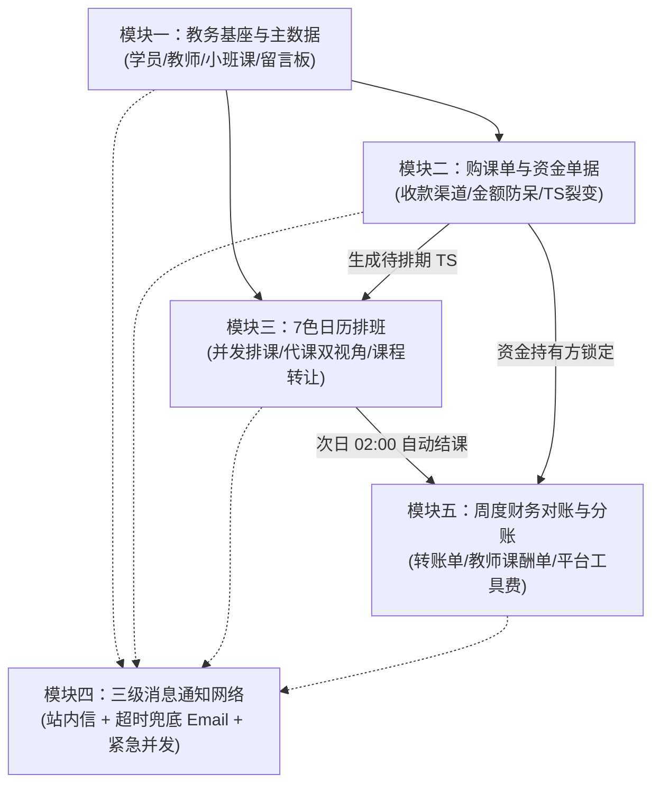

/** (c) 2024-2026 Topee (https://topee.top). All rights reserved. Proprietary and confidential. */

# Dream 系统核心业务模块划分规约 (System Modules Overview)

本文档基于 `docs/Prd-v5.md`（需求规格说明书）与 `docs/conventions/` 架构规范体系，正式定义 Dream（教务排班与分账管理系统）的**五大核心业务模块划分、边界职责、协作拓扑与领域实体归属**，作为全工程跨端（后端、核心共享库、批处理、前端 Web）研发与后续版本迭代的唯一顶层业务领域基准。

---

## 一、 系统架构哲学与五大核心红线

在深入各模块细节前，全系统所有模块必须且强制遵守以下五项底层红线：

1. **账号与档案解耦 (Account vs. Profile)**：自然人操作主体（Account）与实际上课实体（Student Profile）物理隔离，单个家长账号可挂载多个学生档案（多孩共管），二者主键均采用 12 位短 ID。
2. **多角色工作台物理隔离 (Workspace Isolation)**：管理员（黑金）、班长（深靛蓝）、教师（极简中性）、家长（清新浅色）四套工作台导航菜单、路由与主题色物理隔离，严防跨角色误操作。
3. **资金持有人锁定铁律 (Funds Holder Lock)**：TS（最小课次单元）的收款资金持有方永远锁定最初收款的班长或平台，后续无论发生何种同师挪位、临时代课或跨家长转让，持有方归属保持不变，直至周度转账单归集。
4. **财课分离与转让追踪 (Finance & Schedule Decoupling)**：课程发生转让时，原购课单与原付款家长的资金归属完全不变；排课层将 TS 实际授课学生档案变更为接收方学生，即时在其课表呈现。
5. **异常未上课回退补生兜底 (Safe Rollback with Compensation)**：针对教师实际未上课但已被次日凌晨系统自动结课的异常 TS，允许班长/管理员修改为“已取消”，记录严格审计日志，并由系统在原单下自动补生 1 节全新“待排期 TS”，课酬统计物理剔除。

---

## 二、 五大核心业务模块划分与规格

---

### 模块一：教学教务基座与主数据 (Master Data & Profiles)

- **模块代号**：`module1_master_data`
- **业务定位**：整个教务系统的主数据与实体档案基座，为排班日历、购课单与财务核算提供可信的数据源头与防越权校验实体。
- **细分为四个子模块**：
  1. **M1A 学员与多孩档案中心 (`m1a_student_profile`)**：
     - 单个家长账号挂载上限 10 个学生档案，弱引导冷启动（未绑定时不阻断浏览，购课/约课时强提示补录）；
     - 支持正方形自定义头像上传至 S3/R2，数据库只存相对 Key；
     - 规范昵称严格遵循 `英文名 + 姓首字母 + 年龄`（正则 `^[A-Za-z]+[A-Za-z][0-9]{1,2}$`，如 `AliceZ12`），数据库大小写不敏感全局唯一，支持跨家长转让精确检索；
     - 家长工作台常驻【多孩全局档案切换器】（Profile Switcher），Pinia 驱动下层单据无感刷新。
  2. **M1B 教师团队与多媒体履历 (`m1b_teacher_profile`)**：
     - 教师档案与负责班长建立 **1:1 强绑定关系** (`monitor_id`)；
     - 必填**中文自我介绍**（低龄家长易读）与**英文自我介绍**（原汁原味展示），前台一键切换；
     - 预签名直传对象存储：个人照片、试讲视频（MP4 $\le 50\text{MB}$，支持卡片内展开播放与原生全屏切换）、ClassIn 二维码图片（支持点击放大扫码）；
     - 教师定级字典与擅长课程类型技能标签匹配。
  3. **M1C 统一班级与招生管控 (`m1c_classes`)**：
     - **1v1 个人班**：首次排课时后台静默创建并维护关联，前端对家长和教师完全屏蔽“班级”实体概念；
     - **小班课班级**：手动创建，核心参数包括班级名称、课程类型、指定教师、小班课负责人（班长）、Min 开班人数（默认 2）、Max 容量人数（$\le 20$）；
     - 满员强阻断：报名人数达到 Max 时前台入口标记“已满员”并禁用；未达 Min 时支持负责人点击“强制开班”；
     - 核心财务指标：教师单节课酬积分、平台净盈余抽佣比例 $R\%$ ($0\% \sim 100\%$)。
  4. **M1D 双权限教学留言板 (`m1d_profile_messages`)**：
     - 挂载于学生档案，按时间倒序流式记录；
     - **师生公开 (`public_teacher_student`)**：全员可见（家长、正课老师、代课老师、班长、管理员），用于课后作业与学习反馈；
     - **仅内部教学可见 (`internal_teaching_only`)**：对家长端物理过滤隐藏（接口层拦截），仅教师、代课教师、班长、管理员可见，用于记录性格特点与代课交接提示；
     - **5 分钟防手滑撤回时限**：发布者在 300 秒内可撤回留言，超过 300 秒锁定不可修改（仅管理员具备后台软删除权限）。

---

### 模块二：购课单与资金单据 (Course Orders & Funds)

- **模块代号**：`module2_course_orders`
- **业务定位**：正向资金出资、积分转换、TS 课次裂变与逆向退款冲退枢纽，严格遵守“资金持有人锁定”与“财课分离”铁律。

#### 1. 子模块 2A：购课录单、防呆校验与 TS 裂变引擎 (`m2a_course_orders` - 正向资金流)
- **业务定位**：正向课时资产生成中心，下游排课的唯一资产供给源。
- **核心功能**：
  - **三大收款渠道线下录单**：支持 1v1 班长收款、小班课班长收款、平台管理员直收三种路径（1元 = 1积分，按单购课，不设账户资金池）。
  - **两步流转确认机制**：录单生成【待付款确认】单据，核对凭证后点击【确认收款】，原子裂变生成待排期 TS。
  - **整班录入小班课模式**：小班课由小班班长自负盈亏，按整班录入一张总购课单并裂变小班课 TS（对家长端物理隐藏）。
  - **智能防呆金额强提醒**：录入金额自动比对 `课数 × (教师级别标准价 + 工具费 2 积分 + 额外备课费 10 积分)`，不一致时拦截并弹窗公式强提醒，二次确认携带 `force_submit: true` 强制提交。
  - **除不尽尾差兜底处理**：强制提交特殊优惠总价时，单节 TS 积分取整，除不尽尾差计入最后一节 TS，确保 N 节 TS 快照之和 100% 等于单据总积分。
  - **12.5% 请假配额计算**：单据确认即自动计算并锁定周期请假上限：`Math.floor(课次数 × 0.125)`（向下取整）。
  - **TS 原子裂变与财务快照**：单据确认收款后，事务内原子裂变生成 $N$ 节【待排期 TS】，永久锁定收款人（`holder_id`），并固化实付总积分、教师课酬、工具费、备课费快照。

#### 2. 子模块 2B：退款单与课时冲退核算 (`m2b_refund_orders` - 逆向资金流)
- **业务定位**：逆向资金冲销与风控中心，负责垫底退费审批与课时冲退。
- **核心功能**：
  - **退费前置条件校验**：固定位需先尝试同师挪位或线下转让，确需退费须提前 24 小时申请。
  - **退款单创建与打款凭证上传**：经办人录入退款原因，上传打款凭证截图。
  - **未结 TS 勾选冲退**：从原购课单勾选未排期或未结 TS，原子置为【已取消】。
  - **违约金按比例拆分算法**：扣除的违约金自动按原 TS 的“教师课酬”与“平台工具费”比例拆分入账。
  - **全链路审计流转**：记录详细审计日志，退款单流转至终态。

---

### 模块三：7色智能日历、排班、考勤与课程转让 (7-Color Calendar, Scheduling & Transfer)

- **模块代号**：`module3_calendar_schedule`
- **业务定位**：高频教学运营与排课网格调度引擎，依托 PostgreSQL 原生行级排他锁（`SELECT ... FOR UPDATE`）保障并发抢位零超卖。
- **核心功能**：
  - **7 色日历视觉标准**：
    - 🟠 **橙色 (固定位)**：四周一轮买 4 排 4，具备最高锁位优先级；
    - 🟡 **黄色 (临时课)**：家长提前 1-7 天自主预约；
    - 🔵 **蓝色 (被代课)**：原请假教师视角、班长与学生视角显示，提示本节课由他人代上且不计入原老师课酬；
    - 🟣 **紫色 (代上课)**：接时代课教师视角显示，提示替别人代课并计入课酬，可原位查看学员内部留言备忘；
    - ⚪ **灰色 (不可约)**：教师未开放授课的常规休息时段；
    - 🟢 **绿色 (空闲可约)**：教师常规开放授课时段；
    - 🔴 **红色 (已请假)**：教师主动请假时段或整班停课时段。
  - **营业时间窗与班型网格**：每日 06:00 - 00:00（全天 36 个 30 分钟单元）；1v1 占 1 格（授课 25 分钟 + 休息 5 分钟），小班课占 2 格（连续占用 1 小时）。
  - **未上课 TS 课程转让 ($\ge 3\text{h}$)**：
    - 同家庭直转：大宝转给二宝，一键切换实际排课上课学生档案；
    - 跨家长转让：家长线下自行微信转钱交割；线上通过“输入接收方精确规范昵称”或班长代办；
    - **财课分离落地**：账面出资归属（原购课单、原购课家长、收款班长）完全不变，排课层直接呈现在接收方孩子课表上正常上课，并自动发邮件通知授课教师。
  - **请假与同师挪位矩阵**：
    - $\ge 24\text{h}$ 且未超配额：允许同师挪位或退回待排期；
    - $3\text{h} \sim 24\text{h}$ 或超配额：强制同师改期或转让；
    - $< 3\text{h}$：触发熔断锁死，关闭所有前端变更入口。

---

### 模块四：三级消息通知分发网络 (Notification Network)

- **模块代号**：`module4_notification`
- **业务定位**：全链路多渠道家校沟通与超时未读升级兜底中心，依托 `@topeetop/notification-core` 与 `dream-worker`。
- **核心功能**：
  - **一级常规通知（仅站内信）**：课表生成、每周教师课酬节数单生成、学生档案留言板新公开回复。
  - **二级必达通知（站内信 + 超时兜底 Email）**：购课单确认、新排课成功、24h 之外常规请假/挪位。系统先发站内信，若超出未读超时阈值（默认 30 分钟），由 Worker 自动向家长绑定的通知邮箱补发 Email。
  - **三级紧急通知（站内信与 Email 并发即时派发）**：24h 之内紧急改期/挪位、课程转让成功、小班课整班停课、教师紧急请假与安排临时代课、中途退款单生成。
  - **敏感隐私物理屏蔽**：针对学生档案中的“仅内部教学可见”留言，系统严禁向家长端触发任何形式的站内信或邮件通知。

---

### 模块五：周度财务对账与结算分账 (Weekly Settlement & Reconciliation)

- **模块代号**：`module5_settlement`
- **业务定位**：后台批处理跑批、单向资金中央归集、教师发薪与平台纯收益核算。
- **核心功能**：
  - **次日凌晨 02:00 自动结课跑批 (`dream-worker`)**：扫描前一日营业期内（06:00-00:00）正常完课的已排期 TS，原子更新流转为 `已结课(待结算)`。
  - **异常未上课回退补生机制 (关键兜底)**：老师实际未上课但已被自动结课的异常 TS，班长/管理员手动置为 `已取消`，系统强制记录审计日志，并在原单下**自动补生 1 节全新的【待排期 TS】**，课酬统计物理剔除。
  - **班长单向转账单归集 (Transfer Order)**：
    - 每周发课酬前，班长汇总名下持有的已结课 TS 打包上交平台（**严禁班长之间互转**）；
    - **小班课班长预留盈余机制**：系统自动扣除属于小班班长的自负盈亏净盈余，班长仅上交 `教师单节课酬 + 工具费(Max×6) + 平台盈余抽佣`；
    - 班长离职移交：一键将名下所有未结 TS（`待排期`与未结`已排期`）全额移交平台，资金持有方变更为平台。
  - **教师周课酬单 (Weekly Teacher Settlement)**：每师每周 1 单（彻底解绑班长）。代课课酬严格计入代课老师。**只出课节数与备课费标记，不出金额**，管理员线下核算打款后标记 `已打款`，TS 达到 `已结算` 终态。
  - **平台工具费单 (Weekly Platform Tool Settlement)**：每周 1 张全局纯财务报表，汇总 1v1 工具费（2积分/节）、小班课工具费及平台抽佣，无状态字段，不与家长挂钩，用于管理员核对平台每周净收益。

---

## 三、 Monorepo 物理工程映射规约

所有业务模块在代码工程中严格遵循单一职责与跨层隔离：

| 模块名称 | 共享领域核心 (`dream-core`) | HTTP 接口层 (`dream-backend`) | 异步跑批 (`dream-worker`) | 前端表现层 (`dream-frontend`) |
| :--- | :--- | :--- | :--- | :--- |
| **模块一：主数据** | `StudentProfileMapper` `TeacherProfileMapper` `ClassMapper` `ProfileMessageMapper` | `StudentProfileController` `TeacherProfileController` `ClassController` `ProfileMessageController` | 基础主数据清理 | 四角色工作台物理隔离 多孩 Profile Switcher TDesign 移动端适配 |
| **模块二：购课单** | `CourseOrderMapper` `CourseOrderService` 12.5%请假算法 | `CourseOrderController` 防呆金额强提醒拦截 | - | 购课表单与防呆强提醒弹窗 积分明细列表 |
| **模块三：排班日历** | `TimeslotMapper` `TimeslotService` 行锁防超卖与转让状态机 | `CalendarController` `TimeslotController` `TransferController` | - | 7 色智能排课日历网格 代课双视角渲染 跨家长转让检索弹窗 |
| **模块四：通知网络** | 站内信与邮件分发客户端集成 (`@topeetop/notification-core`) | 业务触发点透传通知事件 | 超时 30 分钟未读兜底邮件轮询 Job | 顶部未读站内信红点抽屉 邮件接收状态标记 |
| **模块五：财务分账** | `SettlementMapper` `TransferOrderMapper` 小班课自负盈亏公式计算器 | `TransferOrderController` `SettlementController` | 凌晨 02:00 自动结课 Job 周末周结单跑批 Job | 班长转账交割看板 教师周课酬只出节数单 平台工具费报表 |

---

## 四、 研发演进与当前落地现状

| 模块与阶段 | 涵盖范围 | 当前状态 | 核心产出与依据 |
| :--- | :--- | :--- | :--- |
| **模块 1A** | 学员档案、多孩共管、规范昵称、S3头像 | ✅ **已完成 (Pass 100%)** | `StudentProfileMapper`, `StudentProfileService`, 60/60 单测全通 |
| **模块 1B** | 教师团队、1:1绑定班长、双语介绍、多媒体预签名直传 | ✅ **已完成 (Pass 100%)** | `TeacherProfileMapper`, `TeacherProfileService`, `FileUploadService`, 132/132 单测全通 |
| **模块 1C** | 1v1静默建班、小班课容量管控、抽佣配置、强制开班 | 📝 **方案已就绪** | `docs/prd/m1c_classes.md`, `docs/tdd/m1c_classes.md` |
| **模块 1D** | 学生档案简易留言板、师生公开与内部双权限、5分钟撤回 | 📝 **方案已就绪** | `docs/prd/m1d_profile_messages.md`, `docs/tdd/m1d_profile_messages.md` |
| **模块二** | 购课单、防呆金额强提醒、TS裂变快照、退款单 | ⏳ **待排期** | 对齐 `docs/Prd-v5.md` 第二节与财务规范 |
| **模块三** | 7色智能日历、并发行锁、同师挪位、代课双视角、课程转让 | ⏳ **待排期** | 对齐 `docs/Prd-v5.md` 第三节与7色日历规范 |
| **模块四** | 站内信、30分钟超时兜底邮件、紧急并发通知 | ⏳ **待排期** | 对齐 `docs/conventions/notification_conventions.md` |
| **模块五** | 凌晨02:00自动结课、异常回退补生、单向转账单、双周结单 | ⏳ **待排期** | 对齐 `docs/Prd-v5.md` 第四节与批处理调度 |
