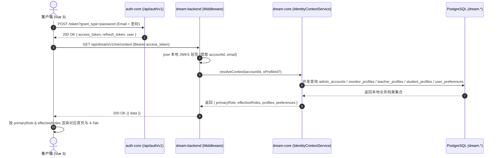

/** (c) 2024-2026 Topee (https://topee.top). All rights reserved. Proprietary and confidential. */

# 技术设计文档 (TDD) — M0A：JWKS 无状态鉴权、四角色本地解耦解析与工作台上下文

| 元数据项 | 说明 / 内容 |
|---|---|
| **技术负责人 (Tech Lead)** | @Dream-Architecture |
| **关联需求 / PRD** | [m0a_auth_and_account.md](../prd/m0a_auth_and_account.md) / [m0_workspace_and_home.md](../prd/m0_workspace_and_home.md) / [m1b_teacher_profile.md](../prd/m1b_teacher_profile.md) |
| **文档状态** | 已落地 (Implemented) |
| **适用工程规范** | [GEMINI.md](../../GEMINI.md) / [TDD_STANDARDS.md](../TDD_STANDARDS.md) / [CODING_STANDARDS.md](../CODING_STANDARDS.md) / [auth_integration_guide.md](../../../packages/docs/auth_integration_guide.md) |
| **创建与更新日期** | 2026-11-18 (创建) / 2026-11-19 (对齐 TDD_STANDARDS 与整点分钟缓存实现) |

---

## 1. 背景与上下文 (Context)

Dream 系统包含 **管理员 (`admin`)、班长 (`monitor`)、授课老师 (`teacher`)、家长 (`parent`)** 四类业务角色，且普遍存在“班长兼家长”、“管理员兼班长与家长”的多重身份聚合场景。根据 `M0-T2` 架构决议与 [m0a_auth_and_account.md](../prd/m0a_auth_and_account.md)：
- 自然人账号认证、密码/邮箱换绑、双 Token 轮换（Access Token + Refresh Token Rotation）统一由 `@topeetop/auth-core` 承载；
- **Dream 彻底不使用 `auth-core` 的角色权限体系**，四大业务身份完全由 Dream 本地业务档案与配置天然驱动，按 `admin > monitor > teacher > parent` 聚合展示。

当前 `dream-backend` 的 [auth.middleware.ts](../../dream-backend/src/middlewares/auth.middleware.ts) 仍为早期开发占位实现：直接读取前端可控的 `x-account-id` / `x-roles` Header，且在中间件内裸写 `executeQuery` SQL。本方案旨在将鉴权底座升级为生产级 **JWKS 无状态验签 + `dream-core` Mapper 隔离身份解析 + 前后端防并发续期与路由守卫闭环**。

---

## 2. 问题陈述与动因 (Problem Statement & Motivation)

### 2.1 正在解决的核心痛点
- **安全红线风险**：当前 `auth.middleware.ts` 信任 `x-account-id` 与 `x-roles` 请求头，存在严重的伪造身份与越权（IDOR）漏洞；
- **架构违规债务**：当前 `auth.middleware.ts` 直接调用 `executeQuery` 查询 `dream.student_profiles`，违反了 [CODING_STANDARDS.md](../CODING_STANDARDS.md)“所有 SQL 必须收敛于 `dream-core` `*Mapper`”的绝对红线；
- **多角色聚合无契约**：前端尚无统一的 `GET /api/dream/v1/me/context` 聚合接口来一次性下发当前账号的 `effectiveRoles`、主身份、名下学员/班长/老师档案及语言偏好。

### 2.2 为什么必须现在解决？
- **业务驱动**：`M0A` 已确立纯自助注册与四角色本地解耦规则，前端登录、首页聚合、Tab 2/3/4 隔离路由与个人中心均依赖后端精准的身份上下文返回；
- **技术驱动**：后续 M2–M5 业务开发必须建立在真实的 JWT `accountId` 与服务层防越权体系之上，不能继续基于占位 Header 开发。

### 2.3 不解决的代价 (Impact of NOT Solving)
继续沿用占位中间件会导致所有下游业务 API 暴露伪造身份与 IDOR 风险；若在中间件层继续堆积裸 SQL，将破坏 `dream-core` 的 Mapper 单元测试隔离体系。

---

## 3. 范围边界 (Scope)

### ✅ 本期必须交付 (In Scope - V1)
1. **Auth 插件挂载与认证对接 (`dream-backend`)**：按 `auth_integration_guide.md` 直接在 `dream-backend` 挂载 `@topeetop/auth-core` 的 `createAuthFastifyPlugin`（`/api/auth/v1/*`）与 `createJwksFastifyPlugin`（`/api/auth/.well-known/jwks.json`），支持仅开放 Email 注册与密码登录配置；
2. **JWT 无状态验签 (`dream-backend`)**：通过 `@topeetop/shared-core` `JwtAuthHook` 校验 `Authorization: Bearer <token>` 并提取 `accountId` 与 `email`；
3. **四角色本地解析服务 (`dream-core` `IdentityContextService`)**：内置 **0–60 秒整点 `:00` 过期全量角色目录缓存**（`admin_accounts` / `monitor_profiles` / `teacher_profiles`），常规请求 O(1) 零查库判定角色；`/me/context` 并发查询 `student_profiles` 与 `user_preferences`；
4. **`GET /api/dream/v1/me/context` & `PUT /api/dream/v1/me/preferences` 接口**：供前端登录后初始化工作台与持久化语言/时区偏好；
5. **高危操作实时验活守卫 (`verifyActiveAccount`)**：针对 M5A/M2B/M1B 高危操作实时调用 `GET /api/auth/v1/user` 核验账号未被封禁；
6. **前端 HTTP 互斥续期拦截器与 Vue Router 守卫**：实现 `isRefreshing` + `failedQueue` 并发 401 换票队列及 `meta.allowedRoles` 路由隔离。

### ❌ 本期明确不做 (Out of Scope - V1)
- 不使用 `auth-core` 的 `roles` 表或角色授予/回收接口；
- 不实现手机号注册、短信免密登录、个人中心手机换绑与后台代建老师账号；
- 不引入 Redis 分布式黑名单缓存（常规接口依赖 15 分钟短效 Access Token 自然淘汰，高危接口直查 `/api/auth/v1/user`）。

### 🔮 未来规划与演进 (Future Considerations - V2+)
- 若后续业务规模扩大需跨节点实时秒级踢下线，可在 `verifyActiveAccount` 之上演进为集中式黑名单校验，或结合变更事件广播失效整点分钟缓存。

---

## 4. 技术方案与系统架构 (Technical Solution)

### 4.1 架构全景与分层职责（严格对齐 C-S-M）

- **表现层 (`dream-frontend`)**：
  - `httpClient`：请求拦截器注入 `Authorization: Bearer <access_token>` 与当前选中孩子 `X-Profile-Id`；响应拦截器维护 `isRefreshing` 锁与 `failedQueue`，防并发 401 触发 Refresh Token Rotation 误杀；
  - `authStore`：维护 `authUser`（来自 `/api/auth/v1/user`）与 `dreamContext`（来自 `/api/dream/v1/me/context`）；
  - `router.beforeEach`：校验登录态及路由 `meta.allowedRoles` 与 `dreamContext.effectiveRoles` 的交集，不匹配时重定向至工作台首页（禁止顶部强身份切换器）。
- **中间件与控制器层 (`dream-backend`)**：
  - `authCore.plugin.ts`：挂载 `createAuthFastifyPlugin`（含 Zod v4 作用域 `safeParse` 校验适配）与 `createJwksFastifyPlugin`，并向容器注入 `JwtTokenProvider`；
  - `authenticateAndResolveProfile`：调用 `@topeetop/shared-core` `JwtAuthHook` 验签（仅 `NODE_ENV === 'test'` 限定的 `LEGACY_TEST_MOCK_TOKENS` 白名单允许测试模拟），再调用 `IdentityContextService` 注入 `request.identity`（常规请求走 `resolveRolesFromCache` 0 查库；携带 `X-Profile-Id` 走 `resolveContext` 校验归属）；
  - `requireRole(allowedRoles)`：基于 `request.identity.effectiveRoles` 拦截越权请求；
  - `verifyActiveAccount`：策略 B 实时验活守卫，高危操作前请求 `GET /api/auth/v1/user` 核验封禁状态；
  - `MeController`：暴露 `GET /me/context` 与 `PUT /me/preferences`（Zod Fail-Fast 校验）。
- **领域服务层 (`dream-core`)**：
  - `IdentityContextService`：编排四大身份判定规则（`admin > monitor > teacher > parent`），处理 `X-Profile-Id` 归属校验与默认语言策略（外教默认 `en-US`，家长/班长默认 `zh-CN`）。
  - **0–60 秒整点分钟角色目录缓存（无定时器 Serverless 安全）**：按 `minuteBucket = Math.floor(now() / 60_000)` 分桶缓存全量 `admin_accounts`、`monitor_profiles`、`teacher_profiles` 最小字段快照，自然对齐每分钟 `:00` 秒多节点同步过期，并配备 single-flight 并发防击穿锁与 `invalidateRoleDirectoryCache()` 主动失效接口。
- **数据访问层 (`dream-core` `*Mapper`)**：
  - 所有 SQL 100% 收敛至 `AdminAccountMapper`、`MonitorProfileMapper`、`TeacherProfileMapper`、`StudentProfileMapper`、`UserPreferenceMapper`，统一继承 `BaseMapper` 并通过构造函数注入 `DatabaseService`，显式声明 `dream.` 前缀。

### 4.2 四角色区分判定规则 (Role Resolution Matrix)

| 业务身份 | 判定数据源（唯一可信源） | 判定条件 | 兼任与优先级 |
|---|---|---|---|
| **管理员 (`admin`)** | `dream.admin_accounts` | `account_id = :id AND status = 'ACTIVE' AND deleted_at IS NULL` | 优先级 **1（最高）**；可同时兼任 `monitor` 与 `parent` |
| **班长 (`monitor`)** | `dream.monitor_profiles` | `account_id = :id AND status = 'ACTIVE' AND deleted_at IS NULL` | 优先级 **2**；在 M1B 委任置 `ACTIVE`，离职置 `RESIGNED` + 软删除 |
| **老师 (`teacher`)** | `dream.teacher_profiles` | `account_id = :id AND status IN ('ACTIVE', 'ON_LEAVE') AND deleted_at IS NULL` | 优先级 **3**；在 M1B 绑定 Email 生效，离职置 `RESIGNED` 即自然收回（休假仍可看课表） |
| **家长 (`parent`)** | 账号天然具备 + `dream.student_profiles` | 任意已注册自然人账号默认具备 `parent` 基础身份；名下挂载 `account_id = :id AND status = 'ACTIVE' AND deleted_at IS NULL` 的学员档案 | 优先级 **4（兜底）**；仅纯老师且无孩子档案时底部导航收起为老师 3-Tab |

> **关键说明**：为什么增加 `dream.admin_accounts` 而不每次请求都查 `auth-core`？
> Access Token 载荷仅保证携带 `userId / email / sessionId`。通过本地 `dream.admin_accounts`（由管理员初始化脚本或受控后台维护），所有业务 API 均可在**零跨服务 RPC** 的情况下完成 4 角色毫秒级无状态/单库鉴权；同时高危操作叠加 `GET /api/auth/v1/user` 实时核验 `is_admin` 与封禁态。

### 4.3 架构时序流向图 (Mermaid Sequence Diagram)



### 4.4 核心 API 契约设计 (API Contracts)

| 接口端点 (Endpoint) | HTTP 方法 | 功能描述 | 请求 Schema (Zod) | 响应数据格式 |
|---|---|---|---|---|
| `/api/dream/v1/me/context` | `GET` | 获取当前账号四角色上下文、关联档案与语言偏好 | Header: `Authorization`, 可选 `X-Profile-Id` | `200 OK ({ data: MeContextDto })` |
| `/api/dream/v1/me/preferences` | `PUT` | 更新当前账号语言与时区偏好 | `UpdatePreferencesSchema` | `200 OK ({ data: UserPreferenceDto })` |

```typescript
// packages/dream-core 入参校验与返回契约 (禁止硬编码中文)
import { z } from 'zod';

export const BusinessRoleSchema = z.enum(['admin', 'monitor', 'teacher', 'parent']);

export const UpdatePreferencesSchema = z.object({
  locale: z.enum(['zh-CN', 'en-US']).optional(),
  timezone: z.string().min(1).max(64).optional(),
});

export interface MeContextDto {
  accountId: string; // 12-char Short UUID
  email: string;
  primaryRole: z.infer<typeof BusinessRoleSchema>;
  effectiveRoles: Array<z.infer<typeof BusinessRoleSchema>>;
  adminAccount: { id: string } | null;
  monitorProfile: { id: string; displayName: string; wechatQrUrl: string | null } | null;
  teacherProfile: { id: string; displayName: string } | null;
  studentProfiles: Array<{ id: string; nickname: string; avatarKey: string | null }>;
  preferences: { locale: 'zh-CN' | 'en-US'; timezone: string };
}
```

### 4.5 数据存储与模型设计 (Database Modeling)

为先确保四角色状态机与身份解析的必要底座字段齐备（其余业务扩展字段留待各模块具体落地时按需补充），本期通过 `migration_v005_auth_context_and_role_status.sql` 完成两项最小变更（统一采用 `VARCHAR(12)` 短 ID 与 `dream.` 前缀）：

1. **新增两张基础表**：`dream.admin_accounts`（管理员白名单）与 `dream.user_preferences`（语言/时区偏好）；
2. **为三张存量身份表补齐必要 `status` / `account_id` 约束**：
   - `dream.monitor_profiles`：补齐 `status`（`ACTIVE` / `RESIGNED`）与 `resigned_at`；
   - `dream.teacher_profiles`：补齐 `status`（`ACTIVE` / `ON_LEAVE` / `RESIGNED`）；
   - `dream.student_profiles`：补齐 `status`（`ACTIVE` / `UNBOUND` / `ARCHIVED`），并将 `account_id` 放宽为可空（支撑 `UNBOUND` 试课代建档）。

```sql
-- 1. 平台管理员白名单表（解耦 auth-core 角色字段，支持本地毫秒级鉴权）
CREATE TABLE IF NOT EXISTS dream.admin_accounts (
    id VARCHAR(12) PRIMARY KEY,
    account_id VARCHAR(12) NOT NULL,
    status VARCHAR(16) NOT NULL DEFAULT 'ACTIVE',
    note VARCHAR(128) DEFAULT NULL,
    created_at TIMESTAMP WITH TIME ZONE DEFAULT NOW(),
    updated_at TIMESTAMP WITH TIME ZONE DEFAULT NOW(),
    deleted_at TIMESTAMP WITH TIME ZONE DEFAULT NULL,
    CONSTRAINT chk_admin_account_status CHECK (status IN ('ACTIVE', 'DISABLED'))
);

CREATE UNIQUE INDEX IF NOT EXISTS uq_admin_accounts_account
ON dream.admin_accounts (account_id)
WHERE deleted_at IS NULL;

-- 2. 用户语言与界面偏好表（对齐 M0-T5 决议）
CREATE TABLE IF NOT EXISTS dream.user_preferences (
    id VARCHAR(12) PRIMARY KEY,
    account_id VARCHAR(12) NOT NULL,
    locale VARCHAR(16) NOT NULL DEFAULT 'zh-CN',
    timezone VARCHAR(64) NOT NULL DEFAULT 'Asia/Shanghai',
    created_at TIMESTAMP WITH TIME ZONE DEFAULT NOW(),
    updated_at TIMESTAMP WITH TIME ZONE DEFAULT NOW(),
    CONSTRAINT chk_user_pref_locale CHECK (locale IN ('zh-CN', 'en-US'))
);

CREATE UNIQUE INDEX IF NOT EXISTS uq_user_preferences_account
ON dream.user_preferences (account_id);

-- 3. 存量角色表补齐最小必要 status 与可空约束
ALTER TABLE dream.monitor_profiles
    ADD COLUMN IF NOT EXISTS status VARCHAR(16) NOT NULL DEFAULT 'ACTIVE',
    ADD COLUMN IF NOT EXISTS resigned_at TIMESTAMP WITH TIME ZONE DEFAULT NULL;

ALTER TABLE dream.teacher_profiles
    ADD COLUMN IF NOT EXISTS status VARCHAR(16) NOT NULL DEFAULT 'ACTIVE';

ALTER TABLE dream.student_profiles
    ALTER COLUMN account_id DROP NOT NULL,
    ADD COLUMN IF NOT EXISTS status VARCHAR(16) NOT NULL DEFAULT 'ACTIVE';
```

---

## 5. 风险评估与规避措施 (Risks & Mitigation)

| 风险描述 | 影响级别 | 发生概率 | 规避与缓解手段 |
|---|---|---|---|
| **多端并发 401 换票导致 Refresh Token 轮换误杀踢下线** | 高 | 高 | 前端 `httpClient` 强制实现 `isRefreshing` 互斥锁 + `failedQueue` 挂起队列，同时间全局仅允许 1 次刷新请求 |
| **账号被封禁后 15 分钟 Access Token 窗口期内执行高危财务操作** | 高 | 低 | 高危操作（M5A 确认、M2B 清退、M1B 离职）在中间件/Service 额外调用 `GET /api/auth/v1/user` 实时核验封禁状态 |
| **旧测试/开发脚本仍依赖 `x-account-id` / `x-roles` Header 导致升级后失败** | 中 | 中 | 在 `NODE_ENV === 'test'` 且仅限显式测试开关启用时允许注入模拟 `authContext`，生产与预发环境物理禁用任何 Header 伪造通道 |
| **JWKS 公钥拉取短暂超时导致全站请求 401/500** | 高 | 低 | `jose` `createRemoteJWKSet` 内置内存公钥缓存与 `cooldownDuration`，公钥轮换期外无需每次请求访问 `auth-core` |

---

## 6. 实施与交付计划 (Implementation Plan)

| 阶段 | 任务模块 | 交付成果与内容简述 | 负责人 | 状态 | 工时预估 |
|---|---|---|---|---|---|
| **Phase 1: 数据库迁移** | `db-schema` | 编写 `migration_v005_auth_context_and_role_status.sql`（创建 `admin_accounts`/`user_preferences` 及角色 `status` 字段） | @Backend | ✅ 已完成 | 0.5 天 |
| **Phase 2: 领域与 Mapper** | `dream-core` | 实现 `AdminAccountMapper`、`UserPreferenceMapper`、`IdentityContextService`（含 0-60s 整点分钟缓存）及 DI 单测 | @Backend | ✅ 已完成 | 1.5 天 |
| **Phase 3: 鉴权中间件与接口** | `dream-backend` | 挂载 `auth-core`、重构 `auth.middleware.ts`、新增 `MeController` 与 `verifyActiveAccount` 守卫及集成测试 | @Backend | ✅ 已完成 | 1.5 天 |
| **Phase 4: 前端集成与守卫** | `dream-frontend` | 对接登录/注册/找回密码/安全换绑 UI、并发 401 刷新队列、`/me/context` 初始化与路由守卫及单测 | @Frontend | ✅ 已完成 | 2.5 天 |

---

## 7. 生产防线：安全、监控与回滚预案 (Production Readiness)

### 7.1 安全与合规设计 (Security Considerations)
- **IDOR 防越权**：所有 `student_profiles`、`monitor_profiles`、`teacher_profiles` 操作均从 JWT 验签后的 `request.account.id` 与后端解析的 `request.identity` 校验归属，严禁信任前端传入的 `accountId` 或 `roles`；`X-Profile-Id` 必须通过 `StudentProfileMapper` 归属核验。
- **敏感信息脱敏**：日志打印前过滤 `authorization`、`token`、`password`、`securityToken` 等敏感字段；`dream-core` 异常统一返回英文消息与大写 `errorCode`。

### 7.2 监控、告警与可观测性 (Monitoring & Observability)
- **核心黄金指标**：`401/403` 异常突增告警（排查 JWKS 验签失败或并发换票异常）、`GET /me/context` P99 延迟 `> 200ms` 告警；
- **全链路追踪**：stdout JSON 结构化日志统一记录 `trace_id`、`account_id`、`primary_role`（严禁记录 Token 明文）。

### 7.3 回滚与应急预案 (Rollback Plan)
- **触发红线**：上线后出现大面积 401 误踢、JWKS 公钥拉取失败或 `GET /me/context` 错误率 `> 1%`；
- **分步回滚**：
  1. 回滚 `dream-backend` 与 `dream-frontend` 至上一稳定镜像版本；
  2. 新增的 `dream.admin_accounts` 与 `dream.user_preferences` 为纯增量表，无需破坏性回滚 DDL，保持向下兼容。

---

## 8. 本地架构规范对齐自检表 (Local Compliance Checklist)

| 本地规范领域 | 审计红线与标准 | 本方案对位情况 | 判定 |
|---|---|---|---|
| **分层架构** | 严格执行 C-S-M，SQL 严禁写在中间件或 Service | 移除旧中间件裸 SQL，全部收口至 `dream-core` `*Mapper` 并通过 DI 注入 `DatabaseService` | **通过** |
| **实体 ID 规约** | 严禁自增 ID 与 36 位 UUID，统一 12 位 Short UUID | `admin_accounts`、`user_preferences` 主键均使用 `VARCHAR(12)` + `generateShortUuid()` | **通过** |
| **Schema 规范** | PostgreSQL 单 Schema `dream.` 显式前缀 | 所有 DDL 与 Mapper 查询均显式声明 `dream.` 前缀 | **通过** |
| **防越权 (IDOR)** | 归属校验在 Service 层闭环 | `accountId` 仅取自 JWKS 验签载荷，`X-Profile-Id` 经 `IdentityContextService` 校验 | **通过** |
| **语言中立 (`dream-core`)** | 严禁在 `dream-core` 硬编码中文 | `IdentityContextService` 与校验 Schema 全部使用英文错误信息与大写 `errorCode` | **通过** |
| **服务端缓存** | 无定时器整点分钟内存缓存，Serverless 安全 | 按 `Math.floor(now() / 60_000)` + single-flight 缓存角色目录，零 `setInterval`/`setTimeout` | **通过** |
| **端侧 PWA 缓存** | L2 存身份/偏好、L3 仅存脱敏快照、清理缓存不掉线 | 令牌与 `dream_context` 存 `LocalStorage`，`clearL3Snapshots()` 仅清 IndexedDB | **通过** |
| **样式与前端** | 100% Tailwind CSS，禁止手写 CSS | 前端登录/安全中心页面及组件沿用 Tailwind CSS 规范（0 `<style>` 块） | **通过** |
| **日志与遥测** | `@topeetop/telemetry-core` stdout JSON + 敏感字段脱敏 | 禁止记录 Token/密码/securityToken 明文，测试后门仅限 `NODE_ENV === 'test'` | **通过** |

---

## 9. 待定事项与假设清单 (Open Questions & Assumptions)

- **假设 1（`auth-core` 挂载与配置）**：`dream-backend` 通过 `MOUNT_AUTH_PLUGIN`（默认 `true`）内置挂载 `/api/auth/v1` 与 `/api/auth/.well-known`，并配置 `AUTH_BASE_URL` 供策略 B `verifyActiveAccount` 核验。
- **待定 1（超管初始化方式）**：首位平台管理员账号在完成 Email 自助注册后，需通过运维初始化脚本将其 `account_id` 写入 `dream.admin_accounts`（或结合 `auth-core` `is_admin = true` 首次登录自动引导激活）。
