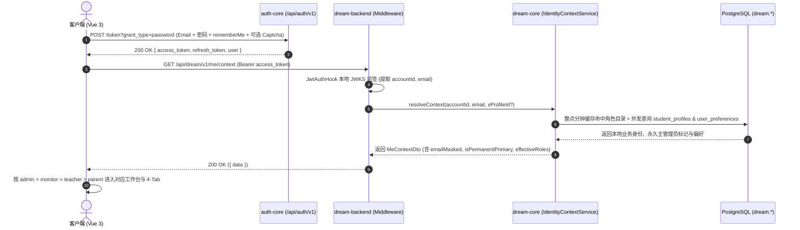
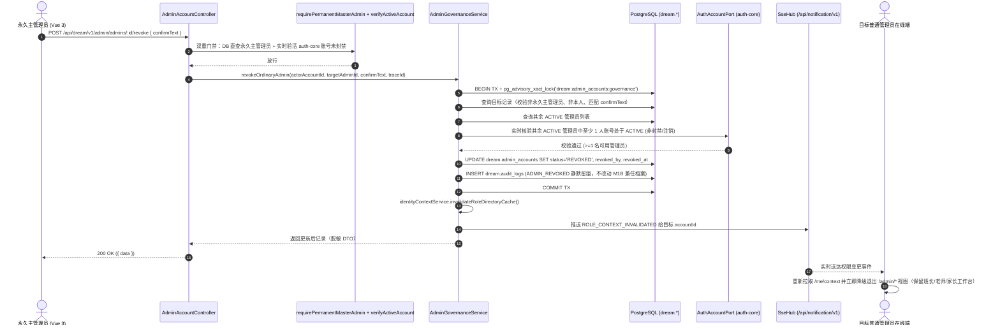
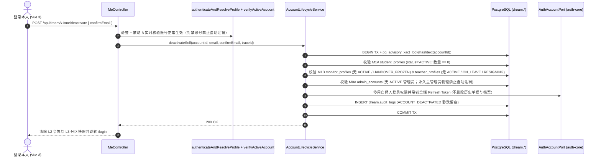

/** (c) 2024-2026 Topee (https://topee.top). All rights reserved. Proprietary and confidential. */

# 技术设计文档 (TDD) — M0A：账号认证、永久主管理员治理、四角色本地解耦与安全中心

| 元数据项 | 说明 / 内容 |
|---|---|
| **技术负责人 (Tech Lead)** | @Dream-Architecture |
| **关联需求 / PRD** | [m0a_auth_and_account.md](../prd/m0a_auth_and_account.md) / [m0_workspace_and_home.md](../prd/m0_workspace_and_home.md) / [m1a_student_profile.md](../prd/m1a_student_profile.md) / [m1b_teacher_profile.md](../prd/m1b_teacher_profile.md) / [m5a_transfer_collection.md](../prd/m5a_transfer_collection.md) / [m5b_weekly_settlement.md](../prd/m5b_weekly_settlement.md) |
| **文档状态** | V1.1 全栈代码与单测已落地 (Implemented & Verified) |
| **适用工程规范** | [GEMINI.md](../../GEMINI.md) / [TDD_STANDARDS.md](../TDD_STANDARDS.md) / [CODING_STANDARDS.md](../CODING_STANDARDS.md) / [GLOSSARY.md](../GLOSSARY.md) / [DESIGN.md](../../DESIGN.md) / [auth_integration_guide.md](../../../packages/docs/auth_integration_guide.md) |
| **创建与更新日期** | 2026-11-18 (创建) / 2026-11-19 (对齐 TDD_STANDARDS 与整点分钟缓存实现) / 2026-11-24 (同步最新 M0A PRD：补齐唯一「永久主管理员」与普通管理员增改撤全链路、`dream.audit_logs` 后台静默合规留痕、账号注销跨模块前置清零防线、防错码锁号与两步换绑参数对齐、Notification/TaskRelay 发信与 SSE 实时降级、S3 WebP 头像直传及统一前端外壳/二级页路由规范) |

---

## 1. 背景与上下文 (Context)

Dream 系统包含 **管理员 (`admin`，内含全平台唯一「永久主管理员」与普通「在任」管理员)、班长 (`monitor`)、授课老师 (`teacher`)、家长 (`parent`)** 四类业务角色，且普遍存在“班长兼家长”、“管理员兼班长与家长”的多重身份自然聚合场景。根据 `M0-T2` 架构决议与最新 [m0a_auth_and_account.md](../prd/m0a_auth_and_account.md)：
- 自然人账号注册、密码登录、防错码锁号、两步安全换绑邮箱、找回/修改密码、双 Token 轮换（Access Token + Refresh Token Rotation）统一由 `@topeetop/auth-core` 承载；
- **Dream 彻底不使用 `auth-core` 的角色权限体系**，四大业务身份完全由 Dream 本地平台管理员名单（`dream.admin_accounts`）与业务档案（`monitor_profiles` / `teacher_profiles` / `student_profiles`）天然驱动，按 `admin > monitor > teacher > parent` 自动聚合工作台与 4-Tab 导航；
- 全系统不采集、不存储、不展示个人账号手机号，不设“消息通知接收偏好”，严禁放置角色切换器，且前端任何页面均不展示安全审计日志。

V1 阶段已完成 JWKS 无状态验签、`IdentityContextService`（0–60 秒整点分钟角色目录缓存）、`GET /me/context`、`PUT /me/preferences` 与基础 `verifyActiveAccount` 落地；随着 2026-11-22 至 2026-11-24 M0A PRD 迭代封板，本方案在保留既有 V1 底座的前提下，同步补齐 **V1.1 唯一永久主管理员治理、普通管理员增改撤双防线与在线降级、账号注销跨模块前置清零、`auth-core` 生产发信与风控参数对齐、统一二级安全页路由与端侧缓存隔离**。

---

## 2. 问题陈述与动因 (Problem Statement & Motivation)

### 2.1 正在解决的核心痛点
- **安全与越权防线缺口（V1 已解决基础伪造，V1.1 补齐治理权责分层）**：
  - V1 已彻底替换早期信任 `x-account-id` / `x-roles` Header 且裸写 SQL 的占位中间件；
  - 但既有 `dream.admin_accounts` 仅含 `(id, account_id, status IN ('ACTIVE','DISABLED'), note)`，尚无法区分全平台唯一的**「永久主管理员（不可撤销）」**与普通「在任」管理员，导致无法在技术层阻断管理员互撤、自撤或越权放行 M5A 确认收款 / M5B 发薪打款 / M2B 72h 异议终审。
- **平台管理员维护与账号注销无后端闭环**：
  - 缺乏管理员名单查询、精准 Email 检索、增设/复用恢复、改名、并发安全撤销（确保剩余 $\ge 1$ 名账号正常的在任管理员）与撤销后实时降级目标在线管理端视图的 API；
  - 缺乏账号注销前的跨模块清零前置校验（M1A 正式在读数 `== 0`、M1B 无在职/交接冻结班长或待离职老师、M0A 无在任管理员身份）及静默合规留痕机制。
- **生产级发信、媒体直传与端侧体验断点**：
  - 既有 `authCore.plugin.ts` 的 `notificationAdapter.sendEmail` 仍为开发态 mock 占位（生产环境直接抛错），尚未接入 `@topeetop/notification-core` + `@topeetop/task-relay-client`；
  - 全角色统一【修改登录密码】/【安全换绑邮箱】独立二级页、管理员 `ⓘ` 折叠应急恢复说明、L3 缓存清理与登出隔离及防遮挡外壳规范需固化为可执行前端契约。

### 2.2 为什么必须现在解决？
- **业务驱动**：M5A/M5B/M2B/M1B 已全部对齐“唯一永久主管理员独占资金终审、老师发薪与管理员增撤”的治理模型，若 M0A 数据模型与中间件守卫不先行封板，下游财务与教务模块无法落地一致的权限门禁。
- **技术驱动**：统一收口 `requirePermanentMasterAdmin`、`verifyActiveAccount`、`dream.audit_logs`、账号精确查验端口与 `auth-core` TaskRelay 发信，避免下游模块重复造轮子或破坏 Mapper 隔离红线。

### 2.3 不解决的代价 (Impact of NOT Solving)
- 若缺乏数据库级唯一约束与并发撤销锁，多窗口并发操作可能导致全平台可用管理员归零（锁死系统）或出现多名主管理员互相撤销；
- 若账号注销未做跨模块前置清零拦截，将产生孤儿在读学员、未交接班长资金池或无人接管的在任管理员；
- 若 `authCore.plugin.ts` 发信未切至 Notification + TaskRelay，生产环境注册、找回密码与安全换绑验证码将全面不可用。

---

## 3. 范围边界 (Scope)

### ✅ 本期必须交付 (In Scope - V1 已落地 + V1.1 增量对齐)
1. **[V1 已落地] Auth 插件挂载与 JWKS 无状态验签 (`dream-backend`)**：挂载 `@topeetop/auth-core`（`/api/auth/v1/*`）与 JWKS（`/api/auth/.well-known/jwks.json`），仅开放 Email 注册与密码登录，通过 `@topeetop/shared-core` `JwtAuthHook` 提取 `accountId` 与 `email`；
2. **[V1 已落地 / V1.1 升级] 四角色与永久主管理员解析 (`dream-core` `IdentityContextService`)**：内置 **0–60 秒整点 `:00` 过期全量角色目录缓存**，升级携带 `adminAccount.displayName` 与 `adminAccount.isPermanentPrimary`，向下游提供 `requireRole` + **`requirePermanentMasterAdmin`** 守卫；
3. **[V1 已落地] `GET /api/dream/v1/me/context` & `PUT /api/dream/v1/me/preferences`**：聚合四角色、主身份、学员档案（含 `X-Profile-Id` 归属核验）及语言/时区偏好；
4. **[V1.1 新增] 平台管理员名单治理与唯一永久主管理员防线**：
   - 直接重构 `db-schema/schema.sql` 与 `db-schema/seed_dev.sql`（升级 `dream.admin_accounts` 唯一永久主管理员约束与授/撤审计字段，扩展 `monitor_profiles` / `teacher_profiles` 状态检查，新建 `dream.audit_logs` 后台静默合规日志表）；
   - 提供 `/api/dream/v1/admin/admins`（只读名单 + Mode A 客户端检索/排序）、`POST /lookup`（精准 Email 查验防枚举）、`POST /`（增设/复用恢复）、`PATCH /:id`（改名）、`POST /:id/revoke`（并发锁防清零撤销 + 立即失效缓存 + SSE 推送降级）；
   - 明确受控运维 CLI 初始化与极端失联应急恢复机制（无前端摘除/移交入口）；
5. **[V1.1 新增] 账号注销跨模块前置清零防线 (`POST /api/dream/v1/me/deactivate`)**：单事务校验 M1A/M1B/M0A 全清零后停用账号登录权限并长期保留历史单据与档案；
6. **[V1.1 新增] 生产级发信、头像直传与风控参数闭环**：`authCore.plugin.ts` 对接 `NotificationManager`（TaskRelay 异步投递）；明确登录/注册/验证码/换绑参数配置；头像经 S3 预签名 `PUT` 浏览器端转 WebP 直传；
7. **[V1.1 升级] 前端统一应用外壳、二级安全页与缓存隔离 (`dream-frontend`)**：HTTP `isRefreshing` + `failedQueue` 并发续期、全角色统一【修改登录密码】/【安全换绑邮箱】/【账号安全中心】独立二级页、管理员管理页（`ⓘ` 折叠说明、零审计日志外显）、L3 清理缓存不掉线与登出清空隔离、零技术词汇双语错误码映射。

### ❌ 本期明确不做 (Out of Scope)
- 不使用 `auth-core` 的 `roles` 表或全局角色授予/回收接口；
- 不实现手机号注册、短信免密登录、个人中心手机绑定/换绑、消息通知接收偏好开关、第三方 OAuth 快捷登录与后台代建账号；
- 不在前端任何页面展示【安全审计日志】列表、时间轴或独立审计页签；不在 Dream 管理员页集成普通用户封禁/解封台；
- 不支持多永久主管理员、前端转移永久保护标记或自定义细粒度管理员子角色组；
- 不引入 Redis 分布式黑名单缓存（常规接口依赖短效 Access Token + 整点分钟缓存 + SSE 主动降级，高危接口统一叠加策略 B `verifyActiveAccount` 实时验活与 DB 直查）。

### 🔮 未来规划与演进 (Future Considerations - V2+)
- 若后续业务规模扩大需多节点毫秒级强制踢下线，可在策略 B `verifyActiveAccount` 之上引入集中式封禁/撤销版本号校验或跨实例 Pub/Sub 缓存失效广播；
- 当《用户服务协议》与《隐私保护政策》发生重大版本迭代时，扩展登录态启动强制重签弹窗与历史协议版本追溯查询。

---

## 4. 技术方案与系统架构 (Technical Solution)

### 4.1 架构全景与分层职责（严格对齐 C-S-M 与 TDD_STANDARDS）

- **表现层 (`dream-frontend` · Vue 3 + Pinia + TDesign + 100% Tailwind CSS)**：
  - **`httpClient` 互斥续期拦截器**：请求拦截器注入 `Authorization: Bearer <access_token>` 与当前选中孩子 `X-Profile-Id`；响应拦截器维护全局单通道 `isRefreshing` 锁与 `failedQueue` 队列，防并发 401 触发 Refresh Token Rotation 误杀；收到 `401 INVALID_REFRESH_TOKEN` 或 `403 ACCOUNT_BANNED` 立即清空 L2 令牌与 L3 快照并带 `?redirect=` 跳转 `/login`。
  - **`authStore` 与端侧 PWA 四级缓存隔离**：
    - **L2 (`LocalStorage + Pinia`)**：存 `access_token`、`refresh_token`、`dream_context`（`/me/context` 响应）与 `dream_locale`（语言偏好）；
    - **L3 (`IndexedDB` `dream_pwa_l3_db`)**：仅存按 `[accountId, roleScope, storeKey]` 分区隔离的脱敏只读快照；**【清理缓存】**仅清 L3 IndexedDB 快照并回显版本号，严禁清除 L2 登录态；**【退出登录】**同步清除 L2 令牌/上下文与当前账号全量 L3 分区，仅保留 `dream_locale`；
    - **L4 (`NetworkOnly`)**：登录、注册、发码、改密、换绑、注销、管理员增改撤均严禁离线缓存与离线提交。
  - **统一应用外壳与双轨制路由守卫 (`router.beforeEach`)**：
    - 复用与 M0 一致的 `56–64px` 顶栏与 `pt-4`（$\ge 16\text{px}$）表单自然留白，严禁负边距上移层遮挡顶栏或首个 Email 输入框；
    - 登录、注册、找回密码路由：`/login`、`/signup`、`/forgot-password`；
    - 全角色（含三合一管理员 Tab 4 底部个人中心）统一独立二级页（底栏锁定 Tab 4，顶栏带 `< 返回`）：`/account/change-password`（修改登录密码）、`/account/change-email`（两步安全换绑邮箱）、`/account/security`（账号安全中心与注销引导）；
    - 平台管理员独立二级页：`/admin/admins`（`meta.allowedRoles: ['admin']`，底栏锁定 Tab 4 `/admin/settings`；页面仅展示管理员名单管理区，**零安全审计日志外显**；普通管理员只读隐藏写按钮；永久主管理员保护徽章旁提供可点击 `ⓘ` 折叠说明浮层）；
    - 收到 SSE `ROLE_CONTEXT_INVALIDATED` 事件时立即重新拉取 `/api/dream/v1/me/context`；若当前处于 `/admin/*` 且 `effectiveRoles` 不再包含 `admin`，立即路由降级至新 `primaryRole` 首页（如 `/monitor/home`、`/teacher/home` 或 `/parent/home`）。
  - **错误码双语与去技术词红线**：前端 `apiError.ts` 按 `errors.<CODE>` 映射 `vue-i18n` 自然业务文案（严禁露出 `Break-Glass`、`冷启动`、`种子`、`令牌`、`会话`、`枚举`、`TTL`、`认证底座`、`审计日志` 等工程词）。
- **中间件与控制器层 (`dream-backend` · Fastify + Zod Type Provider)**：
  - **`authCore.plugin.ts`**：挂载 `createAuthFastifyPlugin`（`/api/auth/v1`，含 Zod v4 `safeParse` 适配）与 `createJwksFastifyPlugin`（`/api/auth/.well-known`）；**`notificationAdapter.sendEmail` 接入 `@topeetop/notification-core` 的 `NotificationManager`（启用 `relay` 走 `@topeetop/task-relay-client` 异步投递邮件验证码）**，消除生产发信阻塞与 mock 报错；
  - **`authenticateAndResolveProfile`**：通过 `@topeetop/shared-core` `JwtAuthHook` 验签提取 `accountId`/`email`（测试占位 `LEGACY_TEST_MOCK_TOKENS` 仅限 `NODE_ENV === 'test'` 物理隔离），调用 `IdentityContextService` 注入 `request.identity`（常规走 `resolveRolesFromCache` 0 查库；携带 `X-Profile-Id` 走 `resolveContext` 校验归属）；
  - **`requireRole(allowedRoles)`**：基于 `request.identity.effectiveRoles` 拦截越权请求；
  - **`requirePermanentMasterAdmin`（V1.1 新增 · 跨模块复用）**：专用于 M0A 管理员增/改/撤、M2B `72h` 异议终审、M5A 转账单确认收款/驳回、M5B 老师周课酬单写与发薪确认；**强制绕过 60 秒内存缓存直查 `AdminAccountMapper.findActiveByAccountId` 验证 `isPermanentPrimary === true && status === 'ACTIVE'`**，并强制叠加 **`verifyActiveAccount`**（策略 B 调 `GET /api/auth/v1/user` 实时核验未被封禁/停用）；
  - **`verifyActiveAccount`**：策略 B 实时验活守卫，高危操作（M0A 管理员写/账号注销、M5A、M5B、M2B、M1B 离职交接）前调用 `GET /api/auth/v1/user` 实时核验账号处于 `ACTIVE` 且 `banned_until` / `deleted_at` 无效；
  - **控制器**：`MeController`（`/me/context`、`/me/preferences`、`/me/deactivate`、`/me/avatar/upload-url`）、`AdminAccountController`（`/admin/admins/*`），全量 Zod Fail-Fast 校验，严禁直调 Mapper 或写 SQL。
- **领域服务层 (`dream-core` · `@topeetop/dream-core`)**：
  - **`IdentityContextService`**：编排四大身份判定（`admin > monitor > teacher > parent`）、永久主管理员标识、`X-Profile-Id` 归属核验与默认语言策略（外教默认 `en-US`，家长/班长/管理员默认 `zh-CN`）；内置 **0–60 秒无定时器整点分钟角色目录缓存**（`minuteBucket = Math.floor(now() / 60_000)` + single-flight 并发防击穿锁 + `invalidateRoleDirectoryCache()`）；
  - **`AdminGovernanceService`（V1.1 新增）**：承接管理员名单组装（含兼任角色标签与 PII 邮箱脱敏）、精准 Email 查验、单事务增设/复用恢复（含防重锁）、改名、并发安全撤销（`pg_advisory_xact_lock` + 校验全平台剩余 $\ge 1$ 名账号正常的在任管理员 + 写静默 `dream.audit_logs` + 主动清缓存 + 触发 SSE 实时降级）；
  - **`AccountLifecycleService`（V1.1 新增）**：承接账号注销跨模块前置清零校验（M1A/M1B/M0A 原子检查）与经由 `AuthAccountPort` 调用 `auth-core` 停用账号、吊销全部 Refresh Token 及记录静默 `dream.audit_logs`；
  - **`AuthAccountPort`（端口接口，由 `dream-backend` 注入适配器）**：为 `dream-core` 提供与 `auth-core` 的松耦合能力（按精准 Email 查账号状态、批量按 `accountIds` 查脱敏邮箱与封禁态、停用账号并吊销全端 Refresh Token），保持 `dream-core` 纯净零上层框架依赖与 100% 语言中立（仅英文 `ApiError` + 大写 `errorCode`）。
- **数据访问层 (`dream-core/src/db/*Mapper.ts`)**：
  - 所有 SQL 100% 收敛至 `AdminAccountMapper`、`AuditLogMapper`（V1.1 新增）、`MonitorProfileMapper`、`TeacherProfileMapper`、`StudentProfileMapper`、`UserPreferenceMapper`，统一继承 `BaseMapper` 并通过构造函数 DI 注入 `DatabaseService`，显式声明 `dream.` 前缀，主键全部采用 12 位短 ID (`generateShortUuid()`)。
- **实时推送与异步投递层（对齐 `TDD_STANDARDS.md §2.2 & §2.3`）**：
  - 邮件验证码及安全通知经 `@topeetop/notification-core` `NotificationManager` 委托 `@topeetop/task-relay-client` 异步投递（Base64 Payload + `idempotencyKey` + `x-trace-id`）；
  - 撤销普通管理员后通过 `@topeetop/notification-core`（`DbPollerManager` + `SseHub` + `createNotificationRouter` `/api/notification/v1`）向目标 `accountId` 推送轻量 `ROLE_CONTEXT_INVALIDATED` 事件，驱动前端立即刷新 `/me/context` 降级工作台视图。

### 4.2 四角色与永久主管理员权限判定矩阵 (Role & Master Admin Matrix)

| 业务身份 | 判定数据源（唯一可信源） | 判定条件 | 兼任、优先级与导航映射 |
|---|---|---|---|
| **永久主管理员 (`admin` + `isPermanentPrimary: true`)** | `dream.admin_accounts` | `account_id = :id AND status = 'ACTIVE' AND is_permanent_primary = TRUE AND deleted_at IS NULL` | 优先级 **1（最高 · 全平台唯一 1 名，DB 部分唯一索引兜底）**；独占 M0A 管理员增改撤、M2B `72h` 异议终审、M5A 确认收款/驳回及 M5B 老师周课酬单写/发薪确认；不可撤销、不可自撤、不可自助注销 |
| **普通管理员 (`admin` + `isPermanentPrimary: false`)** | `dream.admin_accounts` | `account_id = :id AND status = 'ACTIVE' AND is_permanent_primary = FALSE AND deleted_at IS NULL` | 优先级 **1**；日常教务与运营与永久主管理员平权；M0A `/admin/admins`、M5A 审单与 M5B 看板呈只读视图；撤销时严格保留兼任班长/老师/家长身份 |
| **班长 (`monitor`)** | `dream.monitor_profiles` | `account_id = :id AND status IN ('ACTIVE', 'HANDOVER_FROZEN') AND deleted_at IS NULL` | 优先级 **2**；`ACTIVE` 正常执业，`HANDOVER_FROZEN`（交接冻结中）保留只读清算入口且阻断账号注销，仅离职转为 `RESIGNED` 后自然收回 |
| **老师 (`teacher`)** | `dream.teacher_profiles` | `account_id = :id AND status IN ('ACTIVE', 'ON_LEAVE', 'RESIGNING') AND deleted_at IS NULL` | 优先级 **3**；M1B 按本人管辖老师/管理员精准 Email 绑定生效；休假与待离职期间保留课表/结算查看且阻断账号注销，离职置 `RESIGNED` 收回；底部导航为老师 **4-Tab（首页 / 课表 / 我的学员 / 我的）** |
| **家长 (`parent`)** | 账号天然具备 + `dream.student_profiles` | 任意「正常生效」自然人账号默认具备 `parent` 基础身份；关联 `account_id = :id AND status = 'ACTIVE' AND deleted_at IS NULL` 的正式在读孩子档案（最多 10 个） | 优先级 **4（兜底）**；仅当纯老师无孩子档案时收拢展示老师 4-Tab，管理员/班长兼任家长自动垂直聚合首页与 Tab 2【自家课表】 |

> **关键设计说明**：为什么管理员名单收敛在本地 `dream.admin_accounts` 而非 `auth-core`？
> Access Token 载荷仅保证携带自然人 `userId / email / sessionId`。将平台管理员及 `is_permanent_primary` 标记收口至本地 `dream.admin_accounts` 后，95%+ 常规接口可依托 0–60 秒整点分钟缓存在零跨服务 RPC 下完成毫秒级鉴权；而针对管理员增撤、M5A/M5B/M2B 资金终审与账号注销等高敏感操作，则统一叠加 **`requirePermanentMasterAdmin`（DB 直查）+ `verifyActiveAccount`（实时调 `auth-core` 验活）** 双重硬门禁。

### 4.3 核心架构时序流向图 (Mermaid Sequence Diagrams)

#### 1. 登录认证与四角色上下文聚合时序



#### 2. 永久主管理员撤销普通管理员与在线视图实时降级时序



#### 3. 账号注销跨模块前置清零防线时序



### 4.4 核心 API 契约设计 (API Contracts)

> **路由镜像与选型声明**：
> - 所有管理端点统一挂在 `/api/dream/v1/admin/*`（镜像前端 `/admin/*`），个人端点挂在 `/api/dream/v1/me/*`；
> - **列表排序与搜索选型（对齐 `TDD_STANDARDS.md §2.1 模式 A`）**：全平台管理员总数极小（有界 $\ll 500$ 条），`GET /api/dream/v1/admin/admins` 返回按「永久主管理员置顶 → 普通在任 → 已撤销」基准序排好的全量脱敏名单，前端在 Pinia `computed` 内 0ms 完成姓名/邮箱搜索与状态过滤；
> - **PII 响应脱敏与零审计外显**：API 响应 DTO 对 Email 统一返回脱敏 `emailMasked`（如 `ab***@example.com`，绝不在列表接口吐出全量明文邮箱；个人中心 `/me/context` 仅对本人返回脱敏展示邮箱与最小必要字段），且**不提供任何面向前端的审计日志查询接口**。

| 接口端点 (Endpoint) | HTTP 方法 | 权限守卫 | 功能描述 | 请求 Schema (Zod) | 响应数据格式 |
|---|---|---|---|---|---|
| `/api/dream/v1/me/context` | `GET` | `authenticateAndResolveProfile` | 获取四角色上下文、永久主管理员标识、学员档案与偏好 | Header: `Authorization`, 可选 `X-Profile-Id` | `200 OK ({ data: MeContextDto })` |
| `/api/dream/v1/me/preferences` | `PUT` | `authenticateAndResolveProfile` | 更新当前账号语言与时区偏好（严禁含手机号或通知偏好） | `UpdatePreferencesSchema` | `200 OK ({ data: UserPreferenceDto })` |
| `/api/dream/v1/me/avatar/upload-url` | `POST` | `authenticateAndResolveProfile` | 申请头像 S3 预签名 `PUT` 直传链接（前端已裁切转 WebP） | `RequestAvatarUploadUrlSchema` | `200 OK ({ data: { uploadUrl, key, publicUrl } })` |
| `/api/dream/v1/me/deactivate` | `POST` | `authenticateAndResolveProfile` + `verifyActiveAccount` | 账号自助注销（校验 M1A/M1B/M0A 全清零后停用登录权限） | `DeactivateAccountSchema` | `200 OK ({ data: { deactivated: true } })` |
| `/api/dream/v1/admin/admins` | `GET` | `authenticateAndResolveProfile` + `requireRole('admin')` | 获取管理员名单（永久主管理员含写标志 `canManage: true`，普通管理员只读） | - | `200 OK ({ data: AdminListDto })` |
| `/api/dream/v1/admin/admins/lookup` | `POST` | `requirePermanentMasterAdmin` + `verifyActiveAccount` | 精准完整 Email 查验目标账号状态（防遍历枚举，供增设前确认） | `LookupAccountByEmailSchema` | `200 OK ({ data: AdminLookupDto })` |
| `/api/dream/v1/admin/admins` | `POST` | `requirePermanentMasterAdmin` + `verifyActiveAccount` | 增设普通管理员（或复用历史 `REVOKED` 记录恢复 `ACTIVE`） | `GrantAdminSchema` | `201 Created ({ data: AdminAccountDto })` |
| `/api/dream/v1/admin/admins/:id` | `PATCH` | `requirePermanentMasterAdmin` + `verifyActiveAccount` | 编辑普通在任管理员显示名称（1–50 字） | `UpdateAdminDisplayNameSchema` | `200 OK ({ data: AdminAccountDto })` |
| `/api/dream/v1/admin/admins/:id/revoke` | `POST` | `requirePermanentMasterAdmin` + `verifyActiveAccount` | 撤销普通在任管理员（并发防清零 + 保留兼任角色 + SSE 降级） | `RevokeAdminSchema` | `200 OK ({ data: AdminAccountDto })` |

```typescript
// packages/dream-core 入参校验与返回契约 (100% 语言中立，禁止硬编码中文)
import { z } from 'zod';

export const BusinessRoleSchema = z.enum(['admin', 'monitor', 'teacher', 'parent']);

export const UpdatePreferencesSchema = z.object({
  locale: z.enum(['zh-CN', 'en-US']).optional(),
  timezone: z.string().min(1).max(64).optional(),
});

export const RequestAvatarUploadUrlSchema = z.object({
  contentType: z.literal('image/webp').default('image/webp'),
  fileSizeBytes: z.number().int().positive().max(2 * 1024 * 1024), // compressed WebP <= 2MB
});

export const DeactivateAccountSchema = z.object({
  confirmEmail: z.string().trim().email('Invalid email format').transform((v) => v.toLowerCase()),
});

export const LookupAccountByEmailSchema = z.object({
  email: z.string().trim().email('Invalid email format').transform((v) => v.toLowerCase()),
});

export const GrantAdminSchema = z.object({
  email: z.string().trim().email('Invalid email format').transform((v) => v.toLowerCase()),
  displayName: z.string().trim().min(1, 'Display name is required').max(50, 'Display name max 50 chars'),
  confirmText: z.string().trim().min(1, 'Confirmation text is required').max(120),
});

export const UpdateAdminDisplayNameSchema = z.object({
  displayName: z.string().trim().min(1, 'Display name is required').max(50, 'Display name max 50 chars'),
});

export const RevokeAdminSchema = z.object({
  confirmText: z.string().trim().min(1, 'Confirmation text is required').max(120),
});

export interface MeContextDto {
  accountId: string; // 12-char Short UUID
  emailMasked: string; // e.g. ab***@example.com
  primaryRole: z.infer<typeof BusinessRoleSchema>;
  effectiveRoles: Array<z.infer<typeof BusinessRoleSchema>>;
  adminAccount: { id: string; displayName: string; isPermanentPrimary: boolean } | null;
  monitorProfile: { id: string; displayName: string; status: string } | null;
  teacherProfile: { id: string; displayName: string; status: string } | null;
  studentProfiles: Array<{ id: string; nickname: string; avatarKey: string | null }>;
  preferences: { locale: 'zh-CN' | 'en-US'; timezone: string };
  currentStudentProfileId?: string;
}

export interface AdminAccountDto {
  id: string;
  accountId: string;
  displayName: string;
  emailMasked: string;
  isPermanentPrimary: boolean;
  status: 'ACTIVE' | 'REVOKED';
  coRoles: Array<'monitor' | 'teacher' | 'parent'>;
  grantedByName: string | null;
  grantedAt: string;
  revokedByName: string | null;
  revokedAt: string | null;
}
```

#### 核心大写错误码字典（`dream-core` 英文 `ApiError` → 前端 `vue-i18n` 自然中文/英文映射）

| HTTP 状态码 | 大写错误码 (`code`) | 触发条件 |
|---|---|---|
| `403` | `PERMANENT_MASTER_ADMIN_REQUIRED` | 非永久主管理员越权调用管理员增改撤或资金终审写接口 |
| `403` | `PERMANENT_MASTER_ADMIN_PROTECTED` | 尝试撤销、删除、摘除永久主管理员保护，或永久主管理员尝试自助注销 |
| `403` | `ACCOUNT_BANNED` / `ACCOUNT_NOT_ACTIVE` | 操作人或目标账号已被封禁、未激活、锁定或已注销停用 |
| `400` | `CANNOT_REVOKE_SELF` / `CONFIRMATION_MISMATCH` | 尝试自撤或二次确认文本不匹配目标显示名称/邮箱 |
| `409` | `ADMIN_ALREADY_ACTIVE` | 目标账号已持有在任管理员身份（防多窗口并发重复授任） |
| `409` | `LAST_ACTIVE_ADMIN_REQUIRED` | 撤销后全平台可用（在任且账号正常生效）管理员数量将归零 |
| `409` | `DEACTIVATE_BLOCKED_ACTIVE_STUDENTS` | 注销账号前名下仍存在「正式在读」学员档案 |
| `409` | `DEACTIVATE_BLOCKED_ACTIVE_MONITOR` | 注销账号前仍存在在职/交接冻结中班长档案 |
| `409` | `DEACTIVATE_BLOCKED_ACTIVE_TEACHER` | 注销账号前仍存在在职/休假/待离职老师档案 |
| `409` | `DEACTIVATE_BLOCKED_ACTIVE_ADMIN` | 注销账号前仍持有在任普通平台管理员身份 |

### 4.5 数据存储与模型设计 (Database Modeling)

因系统尚处于预上线开发阶段（经确认 `dream` 表可直接重写，无需保留历史增量迁移 SQL），统一直接重构 `db-schema/schema.sql` 与 `db-schema/seed_dev.sql`（全库显式 `dream.` 前缀 + 12 位 `VARCHAR(12)` 短 ID + `deleted_at` 软删除规约）：
- **V1.1 表结构重写（直接落地 `db-schema/schema.sql`）**：
  1. 升级 `dream.admin_accounts`：补齐 `display_name`、`is_permanent_primary`、`granted_by`、`granted_at`、`revoked_by`、`revoked_at`；收紧状态检查约束为 `('ACTIVE', 'REVOKED')` 及永久主管理员防撤销/防软删约束 `chk_permanent_primary_active`；建立**部分唯一索引 `uq_admin_accounts_permanent_primary`** 在数据库物理层锁死全平台至多 `1` 名永久主管理员；
  2. 补齐 `dream.monitor_profiles`（含 `'ACTIVE', 'HANDOVER_FROZEN', 'RESIGNED'`）与 `dream.teacher_profiles`（含 `'PENDING_BIND', 'ACTIVE', 'ON_LEAVE', 'RESIGNING', 'RESIGNED'`）状态值检查，使注销清零防线与 M1B 状态机对齐；
  3. 新建后台静默合规留痕表 `dream.audit_logs`（Append-Only，严禁删除，且不向前端暴露查询接口）。

```sql
-- db-schema/schema.sql V1.1 核心表结构（节选）

-- 1. 平台管理员白名单（含唯一永久主管理员约束与授/撤元信息）
CREATE TABLE IF NOT EXISTS dream.admin_accounts (
    id VARCHAR(12) PRIMARY KEY,
    account_id VARCHAR(12) NOT NULL,
    display_name VARCHAR(50) NOT NULL DEFAULT '',
    status VARCHAR(16) NOT NULL DEFAULT 'ACTIVE',
    is_permanent_primary BOOLEAN NOT NULL DEFAULT FALSE,
    note VARCHAR(128) DEFAULT NULL,
    granted_by VARCHAR(12) DEFAULT NULL,
    granted_at TIMESTAMP WITH TIME ZONE NOT NULL DEFAULT NOW(),
    revoked_by VARCHAR(12) DEFAULT NULL,
    revoked_at TIMESTAMP WITH TIME ZONE DEFAULT NULL,
    created_at TIMESTAMP WITH TIME ZONE DEFAULT NOW(),
    updated_at TIMESTAMP WITH TIME ZONE DEFAULT NOW(),
    deleted_at TIMESTAMP WITH TIME ZONE DEFAULT NULL,
    CONSTRAINT chk_admin_account_status CHECK (status IN ('ACTIVE', 'REVOKED')),
    CONSTRAINT chk_permanent_primary_active CHECK (NOT is_permanent_primary OR (status = 'ACTIVE' AND deleted_at IS NULL))
);

CREATE UNIQUE INDEX IF NOT EXISTS uq_admin_accounts_account
ON dream.admin_accounts (account_id)
WHERE deleted_at IS NULL;

-- 物理约束：全平台有且仅有至多 1 名永久主管理员
CREATE UNIQUE INDEX IF NOT EXISTS uq_admin_accounts_permanent_primary
ON dream.admin_accounts (is_permanent_primary)
WHERE is_permanent_primary = TRUE AND deleted_at IS NULL;

-- 2. 存量角色表状态约束（对齐 M1B 交接冻结 / 待绑定 / 待离职状态）
-- dream.monitor_profiles: CONSTRAINT chk_monitor_status CHECK (status IN ('ACTIVE', 'HANDOVER_FROZEN', 'RESIGNED'))
-- dream.teacher_profiles: CONSTRAINT chk_teacher_status CHECK (status IN ('PENDING_BIND', 'ACTIVE', 'ON_LEAVE', 'RESIGNING', 'RESIGNED'))

-- 3. 后台静默合规操作留痕表（Append-Only，长期只读留存，前端不展示）
CREATE TABLE IF NOT EXISTS dream.audit_logs (
    id VARCHAR(12) PRIMARY KEY,
    actor_account_id VARCHAR(12) NOT NULL,
    module VARCHAR(32) NOT NULL,
    action VARCHAR(64) NOT NULL,
    target_type VARCHAR(32) NOT NULL,
    target_id VARCHAR(12) NOT NULL,
    before_state JSONB DEFAULT NULL,
    after_state JSONB DEFAULT NULL,
    trace_id VARCHAR(64) DEFAULT NULL,
    created_at TIMESTAMP WITH TIME ZONE NOT NULL DEFAULT NOW()
);

CREATE INDEX IF NOT EXISTS idx_audit_logs_module_created
ON dream.audit_logs (module, created_at DESC, id DESC);

CREATE INDEX IF NOT EXISTS idx_audit_logs_target
ON dream.audit_logs (target_type, target_id, created_at DESC);
```

### 4.6 `auth-core` 参数基线、媒体直传与应急恢复受控通道

1. **`auth-core` 风控与认证参数强对齐（覆盖 PRD `§8.2`）**：
   - 开放通道：`global.login_email = true`、`global.login_phone = false`、`global.allow_register = true/false`（全站维护返回 `503 MAINTENANCE_MODE`）；
   - 密码规则：$\ge 8$ 位，须同时含大写字母、小写字母、数字与特殊字符；注册前置校验 6 位邮箱验证码通过后账号直接置为 `ACTIVE`（历史存量 `ACCOUNT_NOT_CONFIRMED` 账号支持登录页就地重发激活验证，受 `60s` 冷却限制）；
   - 防错码与锁号：登录连续输错密码达 **`2` 次**返回 `CAPTCHA_REQUIRED` 触发图形验证码（单张有效 **`300s`**，刷新受限流保护）；连续输错达 **`5` 次**触发 `ACCOUNT_LOCKED` 锁定 **`24` 小时**（响应返回精确剩余解锁秒数，找回密码重设成功后自动解锁并吊销全端 Refresh Token）；
   - 邮箱验证码与换绑：6 位数字验证码有效 **`120s`**，重发冷却 **`60s`** + 每日限额，同邮箱同场景单码连错 **`5` 次**立即作废（`TOO_MANY_FAILED_ATTEMPTS`）；安全换绑第 1 步校验旧邮箱后签发单次消费 `securityToken`（TTL **`600s`**，超时返回 `SECURITY_TOKEN_INVALID` 退回第 1 步），第 2 步换绑成功后原旧邮箱即刻释放可供重注（**封禁账号永久保留原邮箱占位严禁释放**），下游 M4 邮件与 M1B/管理员展示统一实时读取最新账号邮箱；
   - 登录保持周期：`rememberMe = true` Refresh Token 有效期 **7 天**，`false` 仅本次会话有效。
2. **头像预签名直传（对齐 `TDD_STANDARDS.md §2.4` + `AC-M0A-11`）**：
   - 个人中心头像支持选取 JPG/PNG/WebP 原图（遵循 `TDD_STANDARDS.md §2.4`，浏览器选图阶段不拦截高清原图大小），在浏览器内经 Canvas 1:1 裁切并压缩统一导出为 `image/webp`（压缩后体积 $\le 2\text{MB}$），再调用 `POST /api/dream/v1/me/avatar/upload-url` 获取 300s 有效且 `ContentType` 锁定为 `image/webp` 的预签名 `PUT` 链接直传至公开头像前缀 `dream/accounts/avatars/{yyyy}/{mm}/{dd}/{uuid12}.webp`（DB 仅存相对 `key`），随后将公开访问路径归集写入 `PUT /api/auth/v1/user`。
3. **永久主管理员初始化与极端失联应急恢复（仅受控运维 CLI，无前端入口）**：
   - 平台初始化通过受控运维脚本 `scripts/bootstrap-master-admin.ts`（校验目标已注册账号为 `ACTIVE` 且全平台尚无 `is_permanent_primary = TRUE` 记录）落盘唯一永久主管理员；
   - 极端封禁或彻底失联情形下，通过双人审批的运维应急恢复脚本 `scripts/recover-master-admin.ts` 在单事务内将原主管理员解除保护并交接至新指定 `ACTIVE` 账号，同步写入 `dream.audit_logs (action = 'MASTER_ADMIN_RECOVERY')` 并触发角色缓存失效；前端仅在保护徽章旁通过可点击 **`ⓘ` 图标浮层**以纯自然语言说明此应急路径，绝不暴露任何操作按钮或工程术语。

---

## 5. 风险评估与规避措施 (Risks & Mitigation)

| 风险描述 | 影响级别 | 发生概率 | 规避与缓解手段 |
|---|---|---|---|
| **多端并发 401 换票导致 Refresh Token 轮换误杀踢下线** | 高 | 高 | 前端 `httpClient` 强制实现单通道 `isRefreshing` 互斥锁 + `failedQueue` 挂起队列，同时间全局仅允许 1 次刷新请求 |
| **并发撤销普通管理员或剩余管理员已被封禁导致全平台可用管理员归零** | 高 | 低 | `revokeOrdinaryAdmin` 在 `executeTx` 内加事务级咨询锁 `pg_advisory_xact_lock('dream:admin_accounts:governance')`，并结合 `AuthAccountPort` 实时核验其余 `ACTIVE` 管理员中至少 1 人处于未封禁 `ACTIVE` 态；数据库部分唯一索引与 CHECK 约束兜底永久主管理员不可撤销 |
| **管理员撤销后 0–60 秒整点分钟缓存窗口期内目标端继续持有管理视图** | 中 | 中 | 撤销成功后本实例立即 `invalidateRoleDirectoryCache()` + 经 `SseHub` 向目标推送 `ROLE_CONTEXT_INVALIDATED` 强制刷新降级；所有高危写接口（M0A/M2B/M5A/M5B）统一通过 `requirePermanentMasterAdmin` 绕过缓存直查 DB，彻底消除权限漂移窗口 |
| **账号被封禁后 15 分钟 Access Token 窗口期内执行高危财务或注销操作** | 高 | 低 | 所有高危操作（M0A 管理员写/注销、M5A、M5B、M2B、M1B 离职）统一叠加策略 B `verifyActiveAccount` 实时调用 `GET /api/auth/v1/user` 核验封禁与停用态 |
| **Email 查验接口被滥用枚举全平台已注册用户** | 中 | 中 | `/api/dream/v1/admin/admins/lookup` 仅对唯一永久主管理员开放且叠加策略 B 验活与频控，仅接受完整精准 Email，严禁模糊搜索或返回未绑定普通用户列表，响应统一脱敏 `emailMasked` |
| **生产环境 `auth-core` 邮件验证码发送阻塞或失败** | 高 | 中 | 将 `authCore.plugin.ts` 的 `notificationAdapter.sendEmail` 接入 `@topeetop/notification-core` `NotificationManager`（配置 `relay` 走 TaskRelay 异步投递 + 幂等键 + 重试），严禁同步阻塞 HTTP 线程或生产留存 mock |

---

## 6. 实施与交付计划 (Implementation Plan)

| 阶段 | 任务模块 | 交付成果与内容简述 | 负责人 | 状态 | 工时预估 |
|---|---|---|---|---|---|
| **Phase 1: V1 底座迁移** | `db-schema` | `migration_v005_auth_context_and_role_status.sql`（创建 `admin_accounts`/`user_preferences` 及角色 `status` 字段） | @Backend | ✅ 已完成 | 0.5 天 |
| **Phase 2: V1 身份核心** | `dream-core` | `AdminAccountMapper`、`UserPreferenceMapper`、`IdentityContextService`（0–60s 整点分钟缓存）及 DI 单测 | @Backend | ✅ 已完成 | 1.5 天 |
| **Phase 3: V1 鉴权与接口** | `dream-backend` | 挂载 `auth-core`、重构 `auth.middleware.ts`、`MeController`、`verifyActiveAccount` 守卫及集成测试 | @Backend | ✅ 已完成 | 1.5 天 |
| **Phase 4: V1 前端集成** | `dream-frontend` | 登录/注册/找回/换绑基础页、并发 401 队列、`/me/context` 初始化与路由守卫及单测 | @Frontend | ✅ 已完成 | 2.5 天 |
| **Phase 5: V1.1 治理表结构与核心服务** | `db-schema` + `dream-core` | 直接重写 `db-schema/schema.sql` 与 `seed_dev.sql`；升级 `AdminAccountMapper` / `IdentityContextService`（`isPermanentPrimary`）；新增 `AuditLogMapper`、`AdminGovernanceService`、`AccountLifecycleService` 及完整 DI 白盒单测 | @Backend | ✅ 已完成 | 2 天 |
| **Phase 6: V1.1 路由守卫、发信与 SSE** | `dream-backend` | 新增 `requirePermanentMasterAdmin`、`AdminAccountController`（`/admin/admins/*`）、`MeController` 注销与头像预签名接口；`authCore.plugin.ts` 对接 `NotificationManager`（TaskRelay）；撤销接入 `SseHub` 降级推送；编写初始化与应急恢复 CLI 脚本及集成测试 | @Backend | ✅ 已完成 | 2 天 |
| **Phase 7: V1.1 统一外壳与安全二级页** | `dream-frontend` | 统一全模块 `56–64px` 顶栏与 Email 顶部留白防遮挡；落地 `/account/change-password`、`/account/change-email`、`/account/security` 与 `/admin/admins`（Mode A 客户端搜索排序、普通管理员只读、`ⓘ` 应急说明浮层、零审计外显）；完善 L3 清理缓存不掉线、SSE 实时降级与零技术词双语错误码 | @Frontend | ✅ 已完成 | 2 天 |

---

## 7. 生产防线：安全、监控与回滚预案 (Production Readiness)

### 7.1 安全与合规设计（逐条对齐 `TDD_STANDARDS.md §3` 六项强制检查清单）
1. **IDOR 物理隔离**：所有 `/me/*` 与档案操作一律从已验签 JWT 提取 `request.user.id`，严禁信任前端传入 `accountId` / `roles`；`X-Profile-Id` 强制经 `StudentProfileMapper` 校验归属。
2. **高危操作二次验活 + 永久主管理员直查双门禁**：管理员增改撤、账号注销、M2B `72h` 核验、M5A 确认收款/驳回、M5B 发薪确认均强制叠加 `verifyActiveAccount`（策略 B 实时调 `/api/auth/v1/user`）与 DB 直查 `AdminAccountMapper`（绕过 60 秒内存缓存）。
3. **并发锁与防重放**：管理员增撤使用 `executeTx` + `pg_advisory_xact_lock` 防并发重复授任及管理员归零；注销使用按 `accountId` 咨询锁；前端刷新令牌实行 `isRefreshing` + `failedQueue` 单通道互斥。
4. **测试后门严控**：`LEGACY_TEST_MOCK_TOKENS` 物理限定于 `NODE_ENV === 'test'`，生产与预发环境无条件禁用。
5. **敏感信息 API 响应与日志双端脱敏**：API DTO 返回邮箱统一经脱敏函数处理为 `emailMasked`（如 `ab***@example.com`），不采集/存储/返回个人手机号；`@topeetop/telemetry-core` 输出前自动脱敏 `password`、`token`、`secret`、`authorization`、`cookie`、`securityToken`、`email`。
6. **文件存储权限隔离**：头像属于公开展示素材，经 S3 预签名 `PUT` 浏览器端转 `image/webp` 直传至公开头像前缀（`dream/accounts/avatars/...`），数据库仅存相对 Key 或受控公开路径；严禁在个人头像桶混放任何私密凭证文件。

### 7.2 监控、告警与可观测性 (Monitoring & Observability)
- **核心黄金指标**：
  - `401/403` 异常突增告警（排查 JWKS 验签、并发换票误杀或越权探测）；
  - `GET /api/dream/v1/me/context` P99 延迟 `> 200ms` 或错误率 `> 1%` 告警；
  - `verifyActiveAccount` 上游超时（`503 AUTH_SERVICE_UNAVAILABLE`）与 TaskRelay 邮件验证码投递失败率 `> 1%` 告警；
  - `ADMIN_REVOKED` / `MASTER_ADMIN_RECOVERY` / `ACCOUNT_DEACTIVATED` 触发内部运维安全通道告警（不面向前端展示）。
- **全链路追踪**：统一经 `@topeetop/telemetry-core` 向 `stdout` 输出 JSON 结构化日志，透传 W3C `trace_id` 并同步落盘至 `dream.audit_logs.trace_id`，严禁明文输出凭据或原始邮箱。

### 7.3 回滚与应急预案 (Rollback Plan)
- **触发红线**：发布后出现大面积 401 误踢、管理员鉴权误拒、验证码邮件发送失败率 `> 5%` 或 `GET /me/context` 错误率 `> 1%`。
- **分步回滚步骤**：
  1. 将 `dream-backend` 与 `dream-frontend` 快速回滚至上一稳定容器镜像；
  2. 验证 `/health`、`/api/auth/.well-known/jwks.json` 与 `/api/dream/v1/me/context` 恢复正常；
  3. `schema.sql` 新增列、索引与 `dream.audit_logs` 表均可安全保留，回滚旧版代码时严禁 `DROP TABLE` 销毁合规留痕；
  4. 若生产发生唯一永久主管理员账号被封禁或失联，按受控运维双人审批 SOP 执行 `scripts/recover-master-admin.ts` 完成主管理员交接并核验 `dream.audit_logs` 留痕。

---

## 8. 本地架构规范对齐自检表 (Local Compliance Checklist)

| 本地规范领域 | 审计红线与标准（`TDD_STANDARDS.md` & `CODING_STANDARDS.md`） | 本方案对位情况 | 判定 |
|---|---|---|---|
| **分层架构与 Mapper 隔离** | 严格执行 C-S-M，SQL 100% 收敛于 `dream-core` `*Mapper` 并通过 DI 注入 `DatabaseService` | 新增 `AuditLogMapper`、升级 `AdminAccountMapper`，服务层与控制器零裸 SQL，单测走 DI `mockDb` | **通过** |
| **实体 ID 与 Schema 规约** | 严禁 `SERIAL` 与 36 位 UUID，统一 `VARCHAR(12)` 短 ID + 显式 `dream.` 前缀 | `dream.admin_accounts`、`dream.user_preferences`、`dream.audit_logs` 主键均为 `VARCHAR(12)` + `generateShortUuid()` | **通过** |
| **服务端缓存选型** | 无定时器整点分钟内存缓存（`Math.floor(now() / 60_000)` + single-flight），Serverless 安全 | 角色目录缓存零 `setInterval`/`setTimeout`，含 `isPermanentPrimary` 字段，写操作后主动失效且高危守卫直查 DB | **通过** |
| **端侧 PWA 四级缓存** | L2 存身份/偏好、L3 分区脱敏快照、L4 禁离线写、清理缓存不掉线、登出全清 | 明确 L2/L3/L4 边界，【清理缓存】仅清 L3 IndexedDB 留登录态，【退出登录】清 L2+L3 仅留 `dream_locale` | **通过** |
| **列表排序与搜索选型** | 按 `TDD_STANDARDS.md §2.1` 四档选型 | 管理员名单总量极小，采用模式 A（服务端排好基准序、端侧 Pinia 0ms 检索筛选） | **通过** |
| **异步任务与实时推送** | 优先 TaskRelay 异步发信；浏览器实时推送走 `@topeetop/notification-core` SSE | `authCore.plugin.ts` 接入 `NotificationManager`（TaskRelay）；撤销管理员走 `SseHub` 推送 `ROLE_CONTEXT_INVALIDATED` | **通过** |
| **文件与媒体直传** | S3 预签名 `PUT` 浏览器端转 WebP 直传，公开/私密分桶 | 个人头像选图不限原图大小（JPG/PNG/WebP），前端 1:1 裁切转 WebP（$\le 2\text{MB}$）并锁定 `ContentType: image/webp` 直传公开头像前缀 | **通过** |
| **认证解耦与安全检查** | 零 `auth-core` 角色依赖、IDOR 隔离、策略 B 实时验活、PII 双端脱敏、测试后门限定 `test` | 全部 6 项强制安全检查闭环，唯一永久主管理员受 DB 唯一索引 + 双重守卫硬保护 | **通过** |
| **语言中立与 UI/文案规范** | `dream-core` 零硬编码中文、100% Tailwind CSS、去技术词、前端不展示审计日志 | 全量大写 `errorCode` + 英文 `ApiError`，前端 `vue-i18n` 自然表达、统一外壳防遮挡、`ⓘ` 折叠应急说明、零审计外显 | **通过** |
| **遥测与日志** | `@topeetop/telemetry-core` stdout JSON + `trace_id` + 敏感字段脱敏 | 透传 `trace_id` 至日志与 `dream.audit_logs`，自动脱敏密码/Token/securityToken/Email | **通过** |

---

## 9. 待定事项与假设清单 (Open Questions & Assumptions)

- **假设 1（`auth-core` 内部适配能力）**：`dream-backend` 在同进程挂载 `auth-core`（`MOUNT_AUTH_PLUGIN=true`）的前提下，`AuthAccountPort` 可直接复用同库或内部受控服务适配器按精准 Email 查询账号状态与停用账号；若未来 `auth-core` 拆分为独立部署服务，仅需替换 `AuthAccountPort` 实现为带服务间鉴权的内部 HTTP 客户端，`dream-core` 领域服务零改动。
- **假设 2（协议正文录入）**：《用户服务协议》与《隐私保护政策》由法务与产品定稿后写入 `cms.documents`（`status = 'published'`），`PolicyController` 自动下发最新中英文版本并在注册时固化版本号。
- **待定 1（开发库与生产初始化唯一永久主管理员）**：开发库直接重建/重跑 `db-schema/schema.sql` 与 `seed_dev.sql` 即可生效唯一永久主管理员；未采用开发种子的空白生产/预发库需运行一次 `scripts/bootstrap-master-admin.ts --email=<owner_email> --name=<display_name>` 确立唯一 `is_permanent_primary = TRUE` 记录，方可在前端解锁管理员增撤与 M5A/M5B 资金终审功能。
