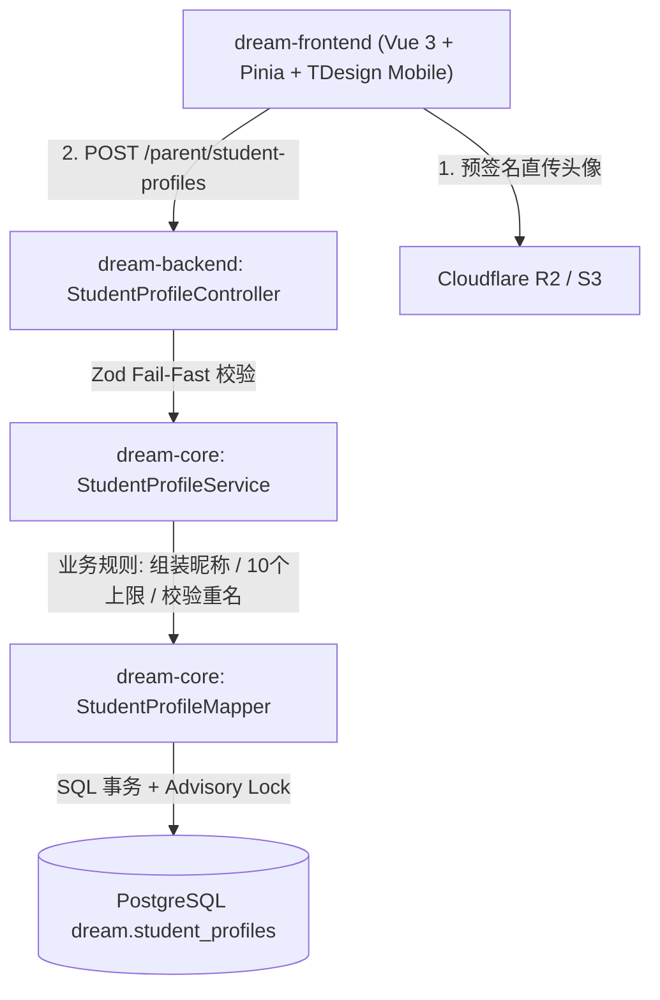
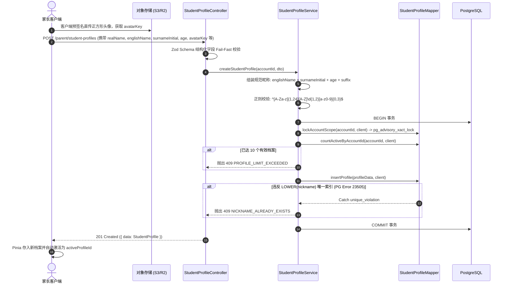

/** (c) 2024-2026 Topee (https://topee.top). All rights reserved. Proprietary and confidential. */

# 技术设计文档 (TDD) — 子模块 1A：学员与多孩档案中心 (Student Profile)

| 元数据项 | 说明 / 内容 |
|---|---|
| **子模块代号** | `m1a` |
| **关联 PRD** | [m1a_student_profile.md](../prd/m1a_student_profile.md) |
| **文档状态** | 草稿 (Draft) |
| **适用工程规范** | `GEMINI.md` + `DESIGN.md` + `docs/CODING_STANDARDS.md` + `docs/BUSINESS_RULES.md` |
| **创建与更新日期** | 2026-11-04 |

---

## 1. 背景与上下文 (Context)

`m1a`（学员与多孩档案中心）是 Dream 系统的学员数据基座。本子模块负责管理“实际上课与消耗课时的学员主体”，实现**自然人登录账号（Account）与学员档案（Student Profile）的物理级解耦**。

- **上游依赖**：`@topeetop/auth-core` 统一鉴权网关（提供自然人 `account_id` 与 JWT Token）；对象存储 S3/R2（承载学员正方形头像）。
- **下游消费方**：
  - `m1b`（教师卡片展示）：读取当前激活学员的选课偏好；
  - `m1d`（留言板）：挂载于指定 `student_profile_id`；
  - 模块二（购课单）：出资归属家长 `account_id`，但消费主体绑定 `student_profile_id`；
  - 模块三（日历与转让）：课表按 `activeProfileId` 独立加载；课程转让使用大小写不敏感规范昵称（如 `AliceZ12`）精确检索接收方。

---

## 2. 问题陈述与动因 (Problem Statement & Motivation)

### 2.1 正在解决的核心痛点
- **痛点 1：多孩家庭混排混退**：少儿教务中 1 个出资家长管理多个孩子。若账号与学员强绑定，多孩日程与剩余课时杂糅，极易造成误排、误挪和错退。
- **痛点 2：线下课程转让误充陌生人**：家长在线下交割未上课 TS 时，缺乏全平台唯一且格式规范的学员标识，模糊查询容易充错人导致资金客诉纠纷。
- **痛点 3：高频并发创建导致上限击穿与重名冲突**：脚本或网络抖动重复提交可能突破单账号 10 个档案上限，或产生重复昵称。

### 2.2 为什么必须现在解决？
`m1a` 是整个排课与购课链路的第一数据源。后续所有单据（购课单、TS 原子单元、转让记录）的外键字段 `student_profile_id` 与归属校验均以此为准。

---

## 3. 范围边界 (Scope)

### ✅ 本期必须交付 (In Scope)
1. **学员档案数据建模**：`dream.student_profiles` 表，主键统一为 12 位短 ID。
2. **规范昵称组装与全局唯一性**：
   - 客户端结构化输入（英文名 + 姓首字母 + 年龄 + 可选微调后缀）；
   - 服务端组装校验，匹配正则 `^[A-Za-z]{1,24}[A-Z]\d{1,2}[a-z0-9]{0,3}$`；
   - 数据库级 `LOWER(nickname)` 唯一部分索引，大小写不敏感防重。
3. **单账号上限控制**：事务内使用 PostgreSQL Advisory Lock（`pg_advisory_xact_lock`）串行化校验单账号 10 个档案上限。
4. **头像预签名直传集成**：通过通用 `/files/upload-url` 接口获取 `student_avatar` 凭证（限 2MB，正方形，JPG/PNG/WebP），落盘仅存储相对 Key。
5. **IDOR 物理隔离**：档案 CRUD 强绑定 `account_id`；转让精确检索接口仅暴露受限公开信息（ID、昵称、头像）。
6. **前端表现层**：
   - 家长工作台多孩全局切换器（Pinia + LocalStorage L2 缓存，切换无需全页刷新）；
   - 添加学员模态弹窗（实时昵称组装卡片预览、实时查重校验）。

### ❌ 本期明确不做 (Out of Scope)
- 档案跨家长共享或合并。
- 学员积分钱包（财课解耦，资金与课时仅挂钩购课单）。

---

## 4. 技术方案与系统架构 (Technical Solution)

### 4.1 架构全景与分层职责 (C-S-M)



- **表现层 (`dream-frontend`)**：
  - `stores/profile.ts`：管理当前家长名下的 `profiles: StudentProfile[]` 与 `activeProfileId: string`。
  - `components/ProfileSwitcher.vue`：顶部多孩切换器，配合 `activeProfileId` 提供响应式全局广播。
- **控制器层 (`dream-backend`)**：
  - 挂载路由前缀 `/api/dream/v1/parent/student-profiles`，挂载 `requireRole('user')`。
  - 从 JWT `request.user.id` 获取当前操作家长真实的 `accountId`。
- **领域服务层 (`dream-core`)**：
  - `StudentProfileService`：负责 10 个数量上限拦截、规范昵称生成逻辑与转让精确检索。
- **数据访问层 (`dream-core`)**：
  - `StudentProfileMapper`：继承 `BaseMapper`，所有 SQL 带 `dream.` 前缀。

---

### 4.2 核心业务时序图 (Mermaid Sequence)

#### 时序 1：学员建档与防重名流 (Happy Path & Conflicts)



---

### 4.3 核心 API 契约与 Zod Schema

所有接口挂载于 `/api/dream/v1`：

| Endpoint | 方法 | 权限角色 | 描述 | 请求 Schema | 响应格式 |
|---|---|---|---|---|---|
| `/parent/student-profiles` | GET | `user` (家长) | 获取名下所有有效学员列表 | - | `200 { data: StudentProfileDto[], meta: { total, limit: 10 } }` |
| `/parent/student-profiles` | POST | `user` (家长) | 创建新学员档案 | `CreateStudentProfileSchema` | `201 { data: StudentProfileDto }` |
| `/parent/student-profiles/:id` | PATCH | `user` (家长) | 编辑学员档案 | `UpdateStudentProfileSchema` | `200 { data: StudentProfileDto }` |
| `/parent/student-profiles/:id` | DELETE | `user` (家长) | 软删除学员档案 | - | `200 { data: { success: true } }` |
| `/parent/nicknames/availability` | GET | `user` (家长) | 实时查重（防抖查询） | `?nickname=` | `200 { data: { available: boolean } }` |
| `/parent/student-profiles/lookup` | GET | `user` (家长) | 跨家长转让精确检索学员 | `?nickname=` | `200 { data: StudentLookupDto \| null }` |

#### Zod 验证契约定义 (`dream-core/src/modules/profile/types.ts`)

```typescript
/** (c) 2024-2026 Topee (https://topee.top). All rights reserved. Proprietary and confidential. */
import { z } from 'zod';

const ShortId = z.string().length(12);
const AvatarKey = z.string().max(255).regex(/^dream\/students\/avatars\/\d{4}\/\d{2}\/\d{2}\/[A-Za-z0-9_-]{12}\.(jpg|jpeg|png|webp)$/);

export const CreateStudentProfileSchema = z.object({
  realName: z.string().trim().min(1).max(32),
  englishName: z.string().trim().regex(/^[A-Za-z]{1,24}$/, '英文名必须为1-24位英文字母'),
  surnameInitial: z.string().trim().length(1).regex(/^[A-Za-z]$/, '姓首字母必须为单个字母').transform(v => v.toUpperCase()),
  age: z.number().int().min(1).max(99),
  nicknameSuffix: z.string().trim().regex(/^[a-z0-9]{1,3}$/, '后缀限1-3位字母/数字').optional(),
  gender: z.enum(['male', 'female', 'undisclosed']).default('undisclosed'),
  birthDate: z.string().date().optional(),
  avatarKey: AvatarKey.optional(),
  preferredCourseTypeIds: z.array(ShortId).max(20).default([]),
});

export const UpdateStudentProfileSchema = z.object({
  realName: z.string().trim().min(1).max(32).optional(),
  age: z.number().int().min(1).max(99).optional(),
  nicknameSuffix: z.string().trim().regex(/^[a-z0-9]{1,3}$/).optional(),
  gender: z.enum(['male', 'female', 'undisclosed']).optional(),
  birthDate: z.string().date().optional(),
  avatarKey: AvatarKey.optional(),
  preferredCourseTypeIds: z.array(ShortId).max(20).optional(),
});

export const NICKNAME_REGEX = /^[A-Za-z]{1,24}[A-Z]\d{1,2}[a-z0-9]{0,3}$/;

export interface StudentProfileDto {
  id: string; // 12-char
  accountId: string;
  realName: string;
  englishName: string;
  surnameInitial: string;
  age: number;
  nickname: string;
  gender: 'male' | 'female' | 'undisclosed';
  birthDate: string | null;
  avatarKey: string | null;
  avatarUrl: string | null; // 后端动态拼接 CDN 域名
  preferredCourseTypeIds: string[];
  createdAt: string;
  updatedAt: string;
}

export interface StudentLookupDto {
  id: string;
  nickname: string;
  avatarUrl: string | null;
}
```

---

### 4.4 数据存储与模型设计 (Database Modeling)

```sql
-- (c) 2024-2026 Topee (https://topee.top). All rights reserved. Proprietary and confidential.
-- Database Migration: m1a 学员档案中心
CREATE SCHEMA IF NOT EXISTS dream;

CREATE TABLE IF NOT EXISTS dream.student_profiles (
    id VARCHAR(12) PRIMARY KEY,
    account_id VARCHAR(12) NOT NULL,
    real_name VARCHAR(32) NOT NULL,
    english_name VARCHAR(24) NOT NULL,
    surname_initial CHAR(1) NOT NULL,
    age SMALLINT NOT NULL,
    nickname VARCHAR(30) NOT NULL,
    gender VARCHAR(12) NOT NULL DEFAULT 'undisclosed',
    birth_date DATE DEFAULT NULL,
    avatar_key VARCHAR(255) DEFAULT NULL,
    preferred_course_type_ids JSONB NOT NULL DEFAULT '[]'::jsonb,
    created_at TIMESTAMP WITH TIME ZONE DEFAULT NOW(),
    updated_at TIMESTAMP WITH TIME ZONE DEFAULT NOW(),
    deleted_at TIMESTAMP WITH TIME ZONE DEFAULT NULL,
    CONSTRAINT chk_student_gender CHECK (gender IN ('male', 'female', 'undisclosed')),
    CONSTRAINT chk_student_age CHECK (age >= 1 AND age <= 99)
);

-- 索引 1：家长名下档案高效扫描
CREATE INDEX IF NOT EXISTS idx_student_profiles_account 
ON dream.student_profiles (account_id) 
WHERE deleted_at IS NULL;

-- 索引 2：规范昵称大小写不敏感全局唯一（跨家长转让精准定位与并发防重）
CREATE UNIQUE INDEX IF NOT EXISTS uq_student_profiles_nickname_lower 
ON dream.student_profiles (LOWER(nickname));
```

> [!IMPORTANT]
> 昵称唯一索引 `uq_student_profiles_nickname_lower` **不添加 `WHERE deleted_at IS NULL` 部分条件**。即使学员档案软删除，其历史昵称也永久保留防占，避免历史购课单与消课记录的昵称指代发生歧义。

---

### 4.5 前端端侧架构与缓存分级

- **组件划分**：
  - `ProfileSwitcher.vue`：多孩下拉选择器，采用 `tdesign-mobile-vue`，触控热区 $\ge 44px$。
  - `StudentCreateModal.vue`：添加学员弹窗，支持正方形头像裁剪、昵称实时拼装卡片、防抖查重。
- **样式规范**：100% Tailwind CSS，**严禁手写 CSS / `<style>` 块**。
- **端侧缓存分级**：
  - **L2 缓存 (LocalStorage + Pinia)**：`profiles` 列表与当前 `activeProfileId`。切换学员时仅刷新 Pinia 状态与本地存储，下层日历组件监听 `activeProfileId` 变化后自动执行增量请求。
  - **L4 绝对零离线 (NetworkOnly)**：创建档案、修改档案必须在线执行。断网时创建按钮置灰并 Toast 提示“离线模式不可用”。
- **全站双语 (vue-i18n)**：错误码（`NICKNAME_ALREADY_EXISTS`, `PROFILE_LIMIT_EXCEEDED`）及表单所有提示均在 `zh-CN.json` 与 `en-US.json` 中配置。

---

## 5. 风险评估与规避措施 (Risks & Mitigation)

| 风险描述 | 影响级别 | 发生概率 | 规避与缓解策略 |
|---|---|---|---|
| **并发高频提交导致昵称同名脏写** | 高 | 中 | 数据库级 `LOWER(nickname)` 唯一索引兜底；Service 层捕获 PG 23505 错误并优雅转译为友好错误码 `NICKNAME_ALREADY_EXISTS`。 |
| **单账号高频并发创建突破 10 个限制** | 中 | 低 | 事务内调用 PostgreSQL 咨询排他锁 `pg_advisory_xact_lock(hashtext(accountId))`，强行串行化单账号并发建档。 |
| **IDOR 越权修改他人学员信息** | 极高 | 低 | Service 层更新/删除时，强制拼接 `WHERE id = $1 AND account_id = $2`，非名下档案统一返回 404，杜绝 ID 试探。 |

---

## 6. 实施与交付计划 (Implementation Plan)

| 阶段 | 交付任务 | 关键产出物 | 预估工时 |
|---|---|---|---|
| **Phase 1: 数据库与 DAL** | DDL 与 `StudentProfileMapper` | 迁移脚本；`StudentProfileMapper.ts`（增删改查与 Advisory Lock） | 0.5 天 |
| **Phase 2: 领域服务与测试** | `StudentProfileService` 逻辑闭环 | 昵称生成引擎、数量上限校验、Jest 单元测试覆盖率 > 95% | 1 天 |
| **Phase 3: 接口与路由** | Fastify 控制器与 Zod 校验 | `StudentProfileController.ts`；E2E 接口集成测试 | 0.5 天 |
| **Phase 4: 前端组件与联调** | 多孩切换器与建档弹窗 | `ProfileSwitcher.vue`、`StudentCreateModal.vue`、i18n 多语言集成 | 1 天 |

---

## 7. 架构规范自检表 (Local Compliance Checklist)

| 本地规范领域 | 审计红线与标准 | 本方案对位情况 | 判定 |
| :--- | :--- | :--- | :--- |
| **分层架构** | C-S-M 架构，SQL 绝对收敛于 `*Mapper` | `StudentProfileMapper` 独立承载 SQL，Service 编排事务 | **通过** |
| **实体 ID 规约** | 严禁自增与 36 位 UUID，必须使用 12 位 Short UUID | 主键显式声明 `VARCHAR(12)`，由 `generateShortUuid()` 生成 | **通过** |
| **Schema 规范** | 单 Schema `dream.` 统一收敛，所有 SQL 带显式前缀 | 表属于 `dream.student_profiles`，所有 SQL 带显式前缀 | **通过** |
| **防越权 (IDOR)** | 归属权校验必须在 Service 层闭环 | 查询/更新/删除物理强制带 `account_id` 过滤 | **通过** |
| **前端开发规范** | 100% Tailwind CSS，零手写 CSS，PWA 分级与 i18n | 原子类控制布局，无手写样式，配置 L2/L4 缓存与双语 | **通过** |
| **Serverless 合规** | 严禁裸定时器，服务保持无状态 | 无定时器，状态机依托 DB 保证 | **通过** |
