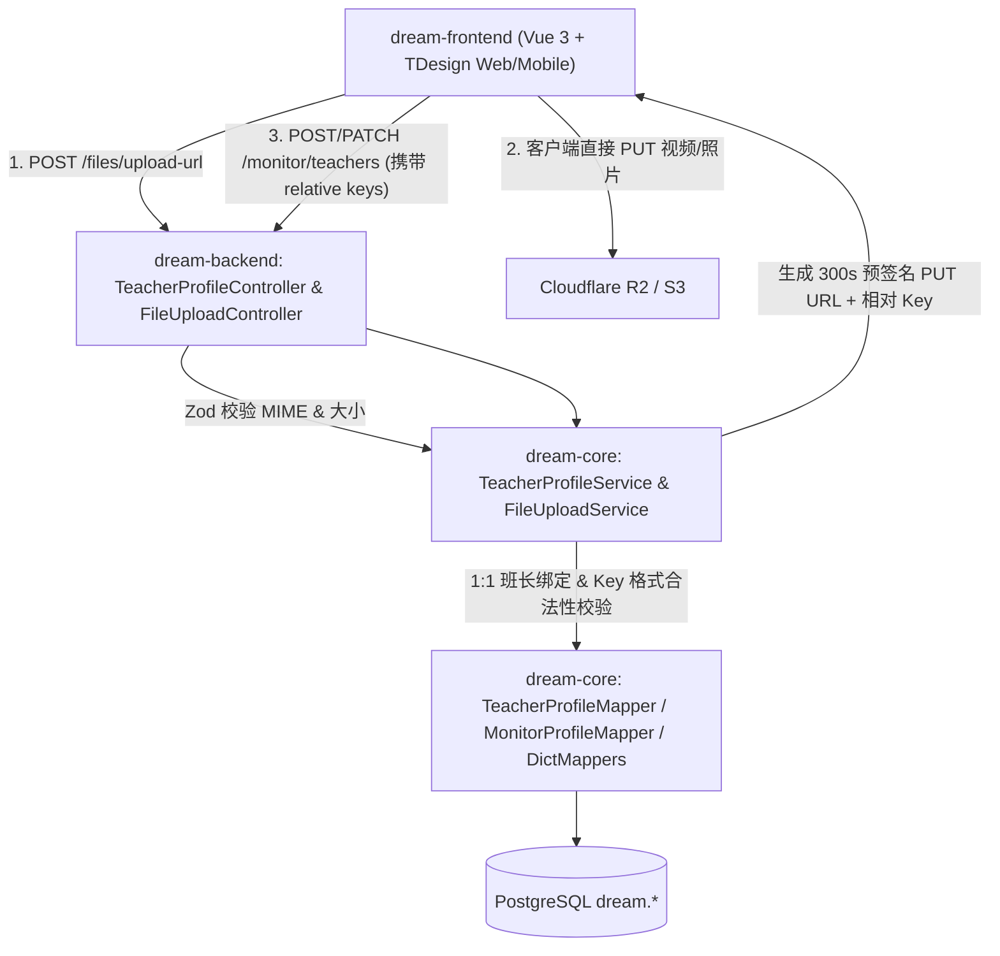
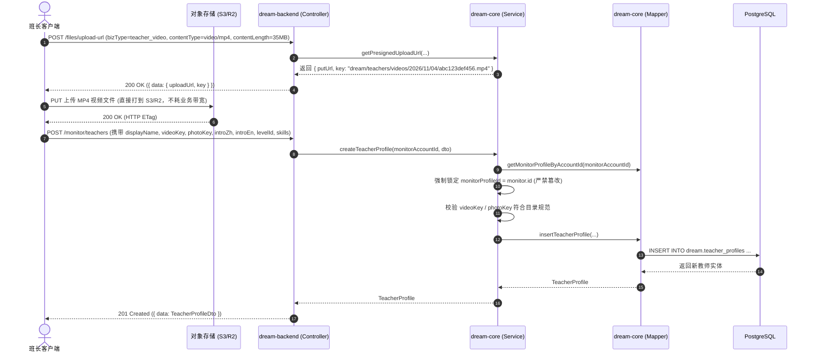

/** (c) 2024-2026 Topee (https://topee.top). All rights reserved. Proprietary and confidential. */

# 技术设计文档 (TDD) — 子模块 1B：教师团队与多媒体履历 (Teacher & Monitor Profiles)

| 元数据项 | 说明 / 内容 |
|---|---|
| **子模块代号** | `m1b` |
| **关联 PRD** | [m1b_teacher_profile.md](../prd/m1b_teacher_profile.md) |
| **文档状态** | 草稿 (Draft) |
| **适用工程规范** | `GEMINI.md` + `docs/conventions/*` |
| **创建与更新日期** | 2026-11-04 |

---

## 1. 背景与上下文 (Context)

`m1b`（教师团队与多媒体履历）承载教务系统的供给侧核心实体。它建立**“负责班长 1:1 强绑定责任制”**，打通中英文双语档案与视频直传链路，并维护全局课程类型字典与教师定级字典。

- **上游依赖**：`@topeetop/auth-core`（提供班长/管理员身份认证）；Cloudflare R2 / AWS S3（承载照片、MP4 介绍视频、ClassIn 二维码）。
- **下游消费方**：
  - `m1c`（班级实体）：创建 1v1 或小班课时校验教师与班长外键；
  - 模块三（日历排班）：以 `teacher_profile_id` 为网格维度编排排期日历；
  - 模块五（财务分账）：周结单时按负责班长与教师级别核算课酬与周转账单。

---

## 2. 问题陈述与动因 (Problem Statement & Motivation)

### 2.1 正在解决的核心痛点
- **痛点 1：教师履历展示单薄导致转化低**：缺乏直观的试讲视频与口音展示，导致家长在选外教时决策犹豫。
- **痛点 2：外教责任人脱节**：若无固定负责中方班长，外教临时缺课、迟到、请假时，无人快速对接家长。
- **痛点 3：多媒体上传对服务端带宽造成冲击**：视频体积可达 50MB，若经由应用服务器中转上传，极易耗尽 Node.js 内存与服务器上行带宽。

### 2.2 为什么必须现在解决？
教师与班长外键是后续所有排课 TS 单元、小班课班级实体及周结单的必填引用主键。

---

## 3. 范围边界 (Scope)

### ✅ 本期必须交付 (In Scope)
1. **数据实体建模**：
   - 字典表：`dream.course_types`、`dream.teacher_levels`；
   - 档案表：`dream.monitor_profiles`、`dream.teacher_profiles`（12 位短 ID，外键级联与软删除）。
2. **多媒体直传服务 (`FileUploadService`)**：
   - 通用预签名接口 `/api/dream/v1/files/upload-url`（300s 时效，校验 MIME 与大小）；
   - 照片与 ClassIn QR：**前端选择原图时不限制体积**，在浏览器本地（Canvas）执行裁剪与压缩，统一输出为几百 KB（通常 100KB-500KB）的标准 WebP 格式直传 S3/R2；
   - 介绍视频（≤ 50MB，MP4 格式）；
   - 数据库仅持久化相对 Key（如 `dream/teachers/photos/2026/11/04/{uuid12}.webp`）。
3. **班长 1:1 负责制隔离**：
   - 班长在 `/monitor/teachers` 只能查看和维护所辖外教，新增外教强制绑定当前班长；
   - 管理员在 `/admin/teachers` 可全局调配与改绑。
4. **前端卡片与就地视频播放**：
   - 原位展开 HTML5 播放器（右下角原生全屏控制，`preload="metadata"`）；
   - 中英双语切换器（无刷新瞬时切换）；
   - ClassIn 弹窗放大看图。
5. **端侧 L3 缓存**：教师公开脱敏列表缓存至 IndexedDB，支持弱网降级只读。

### ❌ 本期明确不做 (Out of Scope)
- 视频云端切片转码（HLS / DASH）。
- 视频防盗链动态防盗鉴权签名。
- 外教本人端自主修改简历权限。

---

## 4. 技术方案与系统架构 (Technical Solution)

### 4.1 架构全景与分层职责 (C-S-M)



---

### 4.2 核心业务时序图 (Mermaid Sequence)

#### 时序 1：班长录入教师多媒体档案全流程



---

### 4.3 核心 API 契约与 Zod Schema

所有接口挂载于 `/api/dream/v1`：

| Endpoint | 方法 | 权限角色 | 描述 | 请求 Schema | 响应格式 |
|---|---|---|---|---|---|
| `/files/upload-url` | POST | 任意登录角色 | 获取对象存储预签名上传凭据 | `UploadUrlSchema` | `200 { data: { uploadUrl, key, expiresIn } }` |
| `/public/teachers` | GET | 任意登录角色 | 家长端/公共只读教师公开卡片列表（物理脱敏） | `?courseTypeId=&levelId=` | `200 { data: TeacherCardDto[], meta }` |
| `/public/teachers/:id` | GET | 任意登录角色 | 教师公开卡片详情 | - | `200 { data: TeacherCardDto }` |
| `/public/dictionaries/course-types` | GET | 任意登录角色 | 课程类型字典列表 | - | `200 { data: CourseTypeDto[] }` |
| `/public/dictionaries/teacher-levels` | GET | 任意登录角色 | 教师定级字典列表 | - | `200 { data: TeacherLevelDto[] }` |
| `/monitor/teachers` | GET | `monitor` (班长) | 查询我负责的教师团队 | - | `200 { data: TeacherDetailDto[] }` |
| `/monitor/teachers` | POST | `monitor` (班长) | 新增教师档案（负责班长强制为当前班长） | `CreateTeacherProfileSchema` | `201 { data: TeacherDetailDto }` |
| `/monitor/teachers/:id` | PATCH | `monitor` (班长) | 更新所辖教师档案 | `UpdateTeacherProfileSchema` | `200 { data: TeacherDetailDto }` |
| `/admin/teachers` | GET / POST / PATCH | `admin` (管理员) | 全量教师管理（支持改绑负责班长） | `AdminUpsertTeacherSchema` | `200 / 201` |
| `/admin/monitors` | GET / POST / PATCH | `admin` (管理员) | 班长档案管理（绑定 `account_id`） | `AdminUpsertMonitorSchema` | `200 / 201` |
| `/admin/dictionaries/*` | POST / PATCH | `admin` (管理员) | 维护课程类型与定级字典 | `UpsertDictSchema` | `200 / 201` |

#### Zod 契约定义 (`dream-core/src/modules/profile/teacher.types.ts`)

```typescript
/** (c) 2024-2026 Topee (https://topee.top). All rights reserved. Proprietary and confidential. */
import { z } from 'zod';

const ShortId = z.string().length(12);
const TeacherPhotoKey = z.string().regex(/^dream\/teachers\/photos\/\d{4}\/\d{2}\/\d{2}\/[A-Za-z0-9_-]{12}\.(jpg|jpeg|png|webp)$/);
const TeacherVideoKey = z.string().regex(/^dream\/teachers\/videos\/\d{4}\/\d{2}\/\d{2}\/[A-Za-z0-9_-]{12}\.mp4$/);
const TeacherQrKey = z.string().regex(/^dream\/teachers\/classin_qr\/\d{4}\/\d{2}\/\d{2}\/[A-Za-z0-9_-]{12}\.(jpg|jpeg|png|webp)$/);

export const UploadUrlSchema = z.object({
  bizType: z.enum(['student_avatar', 'teacher_photo', 'teacher_video', 'teacher_classin_qr', 'transfer_proof']),
  contentType: z.enum(['image/webp', 'image/jpeg', 'image/png', 'video/mp4']),
  contentLength: z.number().int().positive(),
}).refine(data => {
  // 视频格式铁律：严格锁定为 MP4 (H.264+AAC)，杜绝 WebM 在 iOS 及部分安卓机型上的解码黑屏
  if (data.bizType === 'teacher_video') {
    return data.contentType === 'video/mp4' && data.contentLength <= 50 * 1024 * 1024;
  }
  // 照片与二维码由前端本地裁剪后生成几百K的 WebP 格式直传（放宽上限至 1MB）
  if (['teacher_photo', 'teacher_classin_qr', 'student_avatar'].includes(data.bizType)) {
    return data.contentType === 'image/webp' && data.contentLength <= 1 * 1024 * 1024;
  }
  return data.contentLength <= 2 * 1024 * 1024;
}, { message: '文件类型或体积超出业务限制 (裁剪后WebP<=1MB, 视频必须为MP4且<=50MB)' });

export const CreateTeacherProfileSchema = z.object({
  displayName: z.string().trim().min(1).max(64),
  email: z.string().email().max(254).optional(),
  levelId: ShortId,
  skillCourseTypeIds: z.array(ShortId).min(1, '至少选择一项擅长课程类型').max(20),
  introZh: z.string().trim().min(10, '中文简介至少10字').max(2000, '中文简介最多2000字'),
  introEn: z.string().trim().min(20, '英文简介至少20字').max(2000, '英文简介最多2000字'),
  photoKey: TeacherPhotoKey.optional(),
  videoKey: TeacherVideoKey.optional(),
  classinQrKey: TeacherQrKey.optional(),
});

export const UpdateTeacherProfileSchema = CreateTeacherProfileSchema.partial();

// 家长端教师公开卡片 DTO (物理脱敏)
export interface TeacherCardDto {
  id: string; // 12-char
  displayName: string;
  levelName: string;
  monitorDisplayName: string;
  skillCourseTypes: Array<{ id: string; name: string }>;
  introZh: string;
  introEn: string;
  photoUrl: string | null;     // CDN 完整加速地址
  videoUrl: string | null;     // CDN 完整加速地址
  classinQrUrl: string | null; // CDN 完整加速地址
}
```

---

### 4.4 数据存储与模型设计 (Database Modeling)

```sql
-- (c) 2024-2026 Topee (https://topee.top). All rights reserved. Proprietary and confidential.
-- Database Migration: m1b 教师团队与多媒体履历中心
CREATE SCHEMA IF NOT EXISTS dream;

-- 1. 字典：课程类型字典
CREATE TABLE IF NOT EXISTS dream.course_types (
    id VARCHAR(12) PRIMARY KEY,
    name VARCHAR(32) NOT NULL,
    sort_order INT NOT NULL DEFAULT 0,
    is_active BOOLEAN NOT NULL DEFAULT true,
    created_at TIMESTAMP WITH TIME ZONE DEFAULT NOW(),
    updated_at TIMESTAMP WITH TIME ZONE DEFAULT NOW()
);
CREATE UNIQUE INDEX IF NOT EXISTS uq_course_types_name ON dream.course_types (name);

-- 2. 字典：教师定级字典
CREATE TABLE IF NOT EXISTS dream.teacher_levels (
    id VARCHAR(12) PRIMARY KEY,
    name VARCHAR(32) NOT NULL,
    sort_order INT NOT NULL DEFAULT 0,
    is_active BOOLEAN NOT NULL DEFAULT true,
    created_at TIMESTAMP WITH TIME ZONE DEFAULT NOW(),
    updated_at TIMESTAMP WITH TIME ZONE DEFAULT NOW()
);
CREATE UNIQUE INDEX IF NOT EXISTS uq_teacher_levels_name ON dream.teacher_levels (name);

-- 3. 班长档案表 (教务经纪人)
CREATE TABLE IF NOT EXISTS dream.monitor_profiles (
    id VARCHAR(12) PRIMARY KEY,
    account_id VARCHAR(12) NOT NULL,
    display_name VARCHAR(64) NOT NULL,
    phone VARCHAR(32) DEFAULT NULL,
    created_at TIMESTAMP WITH TIME ZONE DEFAULT NOW(),
    updated_at TIMESTAMP WITH TIME ZONE DEFAULT NOW(),
    deleted_at TIMESTAMP WITH TIME ZONE DEFAULT NULL
);
CREATE UNIQUE INDEX IF NOT EXISTS uq_monitor_profiles_account 
ON dream.monitor_profiles (account_id) 
WHERE deleted_at IS NULL;

-- 4. 教师档案表 (1:1 强绑定负责班长)
CREATE TABLE IF NOT EXISTS dream.teacher_profiles (
    id VARCHAR(12) PRIMARY KEY,
    account_id VARCHAR(12) DEFAULT NULL,
    display_name VARCHAR(64) NOT NULL,
    level_id VARCHAR(12) NOT NULL REFERENCES dream.teacher_levels(id),
    monitor_profile_id VARCHAR(12) NOT NULL REFERENCES dream.monitor_profiles(id),
    skill_course_type_ids JSONB NOT NULL DEFAULT '[]'::jsonb,
    intro_zh TEXT NOT NULL,
    intro_en TEXT NOT NULL,
    photo_key VARCHAR(255) DEFAULT NULL,
    video_key VARCHAR(255) DEFAULT NULL,
    classin_qr_key VARCHAR(255) DEFAULT NULL,
    resigned_at TIMESTAMP WITH TIME ZONE DEFAULT NULL,
    created_at TIMESTAMP WITH TIME ZONE DEFAULT NOW(),
    updated_at TIMESTAMP WITH TIME ZONE DEFAULT NOW(),
    deleted_at TIMESTAMP WITH TIME ZONE DEFAULT NULL
);
CREATE INDEX IF NOT EXISTS idx_teacher_profiles_monitor 
ON dream.teacher_profiles (monitor_profile_id) 
WHERE deleted_at IS NULL;

CREATE INDEX IF NOT EXISTS idx_teacher_profiles_level 
ON dream.teacher_profiles (level_id) 
WHERE deleted_at IS NULL;
```

---

### 4.5 前端端侧架构与缓存分级

- **组件拓扑**：
  - `TeacherCard.vue`：移动端卡片，采用 `tdesign-mobile-vue`，内置视频原位播放器与中英简介切换控件；
  - `TeacherEditDrawer.vue`：班长端抽屉式录入表单，含视频与图片上传进度条；
  - `ClassInQrModal.vue`：点击二维码弹窗居中大图查看。
- **样式规范**：100% Tailwind CSS，**严禁手写 CSS / `<style>` 块**。
- **端侧缓存分级 (PWA L3)**：
  - **L3 只读快照 (IndexedDB)**：使用 `idb-keyval` 将 `/public/teachers` 响应结果序列化存入本地。弱网或离线模式下，优先展示本地快照，并向用户提示“弱网只读快照”黄色小徽标。

---

## 5. 风险评估与规避措施 (Risks & Mitigation)

| 风险描述 | 影响级别 | 发生概率 | 规避与缓解策略 |
|---|---|---|---|
| **恶意刷发大文件耗尽对象存储配额** | 高 | 低 | 预签名颁发接口严格校验登录态与角色权限；对 `videoKey` 施加 50MB 强制限制；Key 统一注入随机 12 位短 ID，无法覆盖现有文件。 |
| **视频格式不兼容导致移动端黑屏** | 中 | 中 | 严格锁定 MIME 为 `video/mp4`（H.264+AAC），坚决不采用 WebM 以防旧机型与 iOS 解码黑屏；播放器挂载 `playsinline` 属性防止 iOS 强行弹窗。 |
| **班长越权篡改其他班长名下的外教 (IDOR)** | 极高 | 低 | `/monitor/teachers/*` 控制器严格从 Token 提取班长 ID，Service 层物理校验 `monitor_profile_id` 归属，违规直接返回 404。 |

---

## 6. 实施与交付计划 (Implementation Plan)

| 阶段 | 交付任务 | 关键产出物 | 预估工时 |
|---|---|---|---|
| **Phase 1: 字典与表结构迁移** | DDL 与 Mapper 层实现 | 迁移脚本；4 张表对应 Mapper（含字典缓存） | 1 天 |
| **Phase 2: 直传服务与业务层** | `FileUploadService` 与 `TeacherProfileService` | S3 预签名直传服务、教师 CRUD、1:1 归属隔离校验；单元测试 | 1 天 |
| **Phase 3: 接口与权限挂载** | Fastify 路由、Zod 强校验 | 公开脱敏接口、班长专区接口、管理员维护接口；集成测试 | 0.5 天 |
| **Phase 4: 前端卡片与多媒体交互** | 教师卡片、就地视频播放、双语切换 | `TeacherCard.vue`、PWA L3 IndexedDB 快照、双语语言包 | 1 天 |

---

## 7. 架构规范自检表 (Local Compliance Checklist)

| 本地规范领域 | 审计红线与标准 | 本方案对位情况 | 判定 |
| :--- | :--- | :--- | :--- |
| **分层架构** | C-S-M 架构，SQL 绝对收敛于 `*Mapper` | 4 张表各建独立 Mapper，Service 统一处理业务逻辑 | **通过** |
| **实体 ID 规约** | 严禁自增与 36 位 UUID，必须使用 12 位 Short UUID | 所有新表主键均显式声明 `VARCHAR(12)` 短 ID | **通过** |
| **Schema 规范** | 单 Schema `dream.` 统一收敛，所有 SQL 带显式前缀 | 表均在 `dream.` 下，SQL 显式拼接前缀 | **通过** |
| **多媒体直传安全** | 严禁经过应用服务器中转大文件，数据库只存相对 Key | 采用 S3 预签名客户端直传，DB 仅存相对 Key，CDN 拼接输出 | **通过** |
| **防越权 (IDOR)** | 班长权限在 Service 层闭环 | 教师所属班长物理匹配 `monitor_profile_id` 过滤 | **通过** |
| **样式与前端** | 100% Tailwind CSS，PWA L3 弱网快照 | 零手写样式，IndexedDB 承载脱敏教师公开快照 | **通过** |
