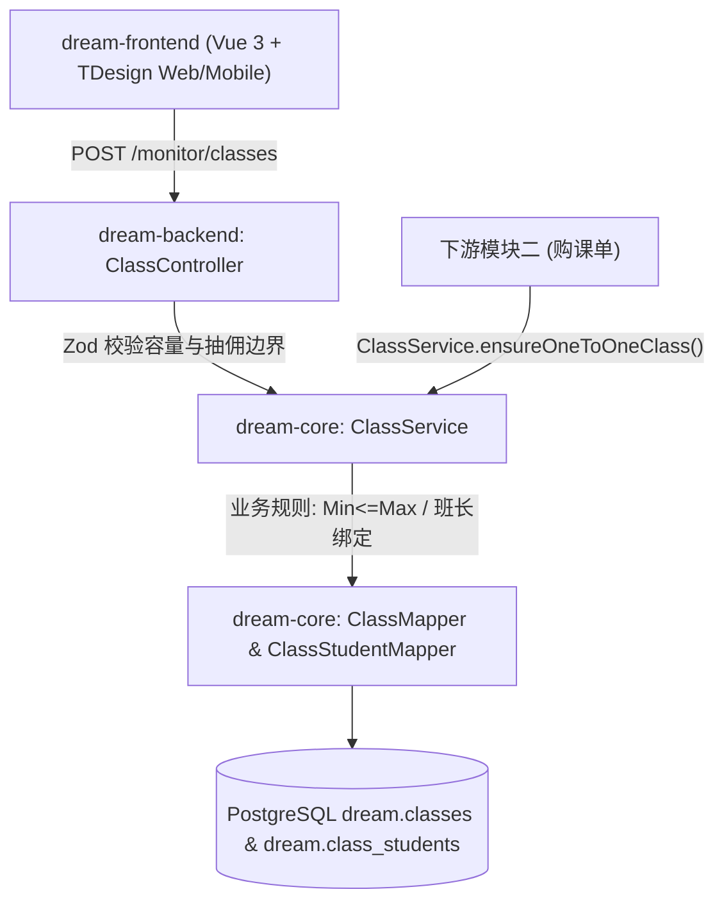
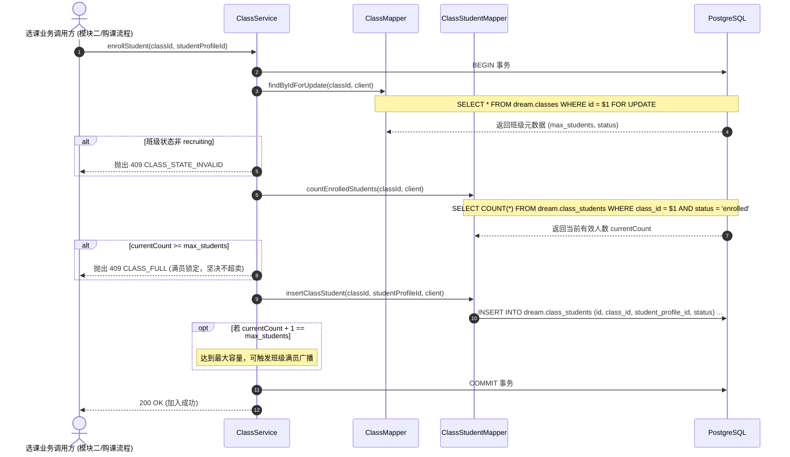

/** (c) 2024-2026 Topee (https://topee.top). All rights reserved. Proprietary and confidential. */

# 技术设计文档 (TDD) — 子模块 1C：统一班级与招生管控 (Classes & Capacity Engine)

| 元数据项 | 说明 / 内容 |
|---|---|
| **子模块代号** | `m1c` |
| **关联 PRD** | [m1c_classes.md](../prd/m1c_classes.md) |
| **文档状态** | 草稿 (Draft) |
| **适用工程规范** | `GEMINI.md` + `docs/conventions/*` |
| **创建与更新日期** | 2026-11-04 |

---

## 1. 背景与上下文 (Context)

`m1c`（统一班级与招生管控）是 Dream 系统的教学履约载体与容量约束引擎。它抹平了 1v1 个人课与小班课在底层数据模型上的差异，将授课组织形式统一抽象为 `dream.classes` 实体。

- **上游依赖**：`m1a`（提供学员实体 `student_profile_id`）；`m1b`（提供教师 `teacher_profile_id` 与班长 `monitor_profile_id`）；
- **下游消费方**：
  - 模块二（购课单）：购课时绑定 `class_id` 并调用选课加塞接口；
  - 模块三（日历排班）：所有排课 TS 单元物理归属于指定 `class_id`；
  - 模块五（财务分账）：小班课自负盈亏与周结单平台抽佣计算依据 `teacher_salary_points` 与 `platform_commission_rate`。

---

## 2. 问题陈述与动因 (Problem Statement & Motivation)

### 2.1 正在解决的核心痛点
- **痛点 1：业务模型分裂**：若 1v1 与小班课分别建表，后续排课 TS 的外键指向将变成多态引用，严重破坏数据库参照完整性。
- **痛点 2：高并发选课超卖**：小班课多人并发抢位时，若仅在应用内存中计数，极易击穿 $Max$ 上限破坏师生比。
- **痛点 3：未达最低人数时的非确定性运营风险**：若未达 Min 人数没有严格的状态机锁定与人工确认闭环，开课争议极易引发客诉。

### 2.2 为什么必须现在解决？
班级实体 `class_id` 是后续模块二（购课单裂变 TS）与模块三（7 色日历网格落盘）不可或缺的物理外键。

---

## 3. 范围边界 (Scope)

### ✅ 本期必须交付 (In Scope)
1. **数据实体建模**：`dream.classes` 与 `dream.class_students`（12 位短 ID，外键级联与软删除）。
2. **1v1 静默建班服务**：`ClassService.ensureOneToOneClass(...)`，在购课/首次排课时后台静默建班或获取现有班级，前端全流程屏蔽班级概念。
3. **小班课显式配置与状态机**：
   - 班长端录入小班课参数（$1 \le Min \le Max \le 20$，抽佣 $R\% \in [0.00, 100.00]$，单节课酬积分）；
   - 状态机流转：`recruiting` $\rightarrow$ `active` $\rightarrow$ `completed` / `cancelled`；
   - 开班日前未达 Min 人数支持负责班长二次确认【强制开班】与【取消班级】。
4. **并发防超卖行级排他锁**：学员报名选课事务内对 `dream.classes` 加 `SELECT ... FOR UPDATE` 锁，计算有效学员数，满额抛出 `CLASS_FULL`。
5. **权限与 IDOR 防御**：小班课负责人物理绑定当前班长，跨班长操作严格阻断。

### ❌ 本期明确不做 (Out of Scope)
- 候补排队队列（Waitlist）。
- 班级取消后的退款与课时冲退计算（交由模块二退款单处理）。

---

## 4. 技术方案与系统架构 (Technical Solution)

### 4.1 架构全景与分层职责 (C-S-M)



- **表现层 (`dream-frontend`)**：
  - 班长工作台：小班课看板卡片，支持展示当前报名人数进度、强制开班弹窗与取消班级表单；
  - 家长工作台：选班中心展示招募中小班列表，满员自动置灰。
- **控制器层 (`dream-backend`)**：
  - 路由分组：`/public/classes/*`、`/monitor/classes/*`、`/admin/classes/*`。
- **领域服务层 (`dream-core`)**：
  - `ClassService.ensureOneToOneClass(client, params)`：1v1 静默建班接口；
  - `ClassService.enrollStudent(client, classId, studentProfileId)`：行级排他锁报名控流；
  - `ClassService.forceStartClass(classId, monitorAccountId)`：强制开班；
  - `ClassService.cancelClass(classId, monitorAccountId, reason)`：取消班级。
- **数据访问层 (`dream-core`)**：
  - `ClassMapper` 与 `ClassStudentMapper` 承载单表 SQL。

---

### 4.2 核心业务时序图 (Mermaid Sequence)

#### 时序 1：学员选入小班课并发防超卖流程 (Concurrency Lock)



---

### 4.3 核心 API 契约与 Zod Schema

所有接口挂载于 `/api/dream/v1`：

| Endpoint | 方法 | 权限角色 | 描述 | 请求 Schema | 响应格式 |
|---|---|---|---|---|---|
| `/public/classes/small-group` | GET | 任意登录角色 | 招募中小班课公开列表（含已报人数与是否满员） | `?courseTypeId=` | `200 { data: PublicSmallGroupClassDto[] }` |
| `/monitor/classes` | GET | `monitor` (班长) | 查询我负责的小班课列表 | `?status=` | `200 { data: MonitorClassDto[] }` |
| `/monitor/classes` | POST | `monitor` (班长) | 创建小班课 | `CreateSmallGroupClassSchema` | `201 { data: MonitorClassDto }` |
| `/monitor/classes/:id/force-start` | POST | `monitor` (班长) | 强制开班（未达 Min 时） | `ConfirmActionSchema` | `200 { data: MonitorClassDto }` |
| `/monitor/classes/:id/cancel` | POST | `monitor` (班长) | 取消班级（录入原因） | `CancelClassSchema` | `200 { data: { success: true } }` |
| `/admin/classes` | GET / POST / PATCH | `admin` (管理员) | 全平台班级统一管理与调配 | `AdminClassSchema` | `200 / 201` |

#### Zod 契约定义 (`dream-core/src/modules/profile/class.types.ts`)

```typescript
/** (c) 2024-2026 Topee (https://topee.top). All rights reserved. Proprietary and confidential. */
import { z } from 'zod';

const ShortId = z.string().length(12);

export const CreateSmallGroupClassSchema = z.object({
  name: z.string().trim().min(2, '班级名称至少2字').max(64, '班级名称最多64字'),
  courseTypeId: ShortId,
  teacherProfileId: ShortId,
  minStudents: z.number().int().min(1, '最少开班人数不能小于1').default(2),
  maxStudents: z.number().int().min(1).max(20, '最大容纳人数不能超过20人').default(4),
  teacherSalaryPoints: z.number().int().nonnegative('教师单节课酬必须非负'),
  platformCommissionRate: z.number().min(0.00).max(100.00).multipleOf(0.01, '抽佣比例最多支持2位小数'),
  plannedStartDate: z.string().date('计划开课日期格式不正确 (YYYY-MM-DD)'),
}).refine(data => data.minStudents <= data.maxStudents, {
  message: '最少开班人数不能大于最大容纳人数',
  path: ['minStudents'],
});

export const ConfirmActionSchema = z.object({
  confirm: z.literal(true, { errorMap: () => ({ message: '必须显式确认操作' }) }),
});

export const CancelClassSchema = ConfirmActionSchema.extend({
  reason: z.string().trim().min(2, '取消原因至少2字').max(200, '取消原因最多200字'),
});

export interface PublicSmallGroupClassDto {
  id: string; // 12-char
  name: string;
  courseTypeName: string;
  teacherDisplayName: string;
  teacherPhotoUrl: string | null;
  minStudents: number;
  maxStudents: number;
  enrolledCount: number;
  isFull: boolean;
  plannedStartDate: string;
  status: 'recruiting' | 'active';
}

export interface MonitorClassDto extends PublicSmallGroupClassDto {
  ownerMonitorProfileId: string;
  teacherSalaryPoints: number;
  platformCommissionRate: number;
  forceStartedAt: string | null;
  createdAt: string;
  enrolledStudents: Array<{
    studentProfileId: string;
    nickname: string;
    avatarUrl: string | null;
    enrolledAt: string;
  }>;
}
```

---

### 4.4 数据存储与模型设计 (Database Modeling)

```sql
-- (c) 2024-2026 Topee (https://topee.top). All rights reserved. Proprietary and confidential.
-- Database Migration: m1c 统一班级与招生管控
CREATE SCHEMA IF NOT EXISTS dream;

-- 1. 统一班级表
CREATE TABLE IF NOT EXISTS dream.classes (
    id VARCHAR(12) PRIMARY KEY,
    name VARCHAR(64) NOT NULL,
    class_type VARCHAR(16) NOT NULL,
    course_type_id VARCHAR(12) NOT NULL REFERENCES dream.course_types(id),
    teacher_profile_id VARCHAR(12) NOT NULL REFERENCES dream.teacher_profiles(id),
    owner_monitor_profile_id VARCHAR(12) NOT NULL REFERENCES dream.monitor_profiles(id),
    min_students SMALLINT NOT NULL DEFAULT 1,
    max_students SMALLINT NOT NULL DEFAULT 1,
    teacher_salary_points INT NOT NULL DEFAULT 0,
    platform_commission_rate NUMERIC(5,2) NOT NULL DEFAULT 0.00,
    status VARCHAR(16) NOT NULL DEFAULT 'recruiting',
    planned_start_date DATE DEFAULT NULL,
    force_started_at TIMESTAMP WITH TIME ZONE DEFAULT NULL,
    created_at TIMESTAMP WITH TIME ZONE DEFAULT NOW(),
    updated_at TIMESTAMP WITH TIME ZONE DEFAULT NOW(),
    deleted_at TIMESTAMP WITH TIME ZONE DEFAULT NULL,
    CONSTRAINT chk_class_type CHECK (class_type IN ('1v1', 'small_group')),
    CONSTRAINT chk_class_capacity CHECK (min_students >= 1 AND min_students <= max_students AND max_students <= 20),
    CONSTRAINT chk_class_commission CHECK (platform_commission_rate >= 0.00 AND platform_commission_rate <= 100.00),
    CONSTRAINT chk_class_status CHECK (status IN ('recruiting', 'active', 'completed', 'cancelled'))
);

CREATE INDEX IF NOT EXISTS idx_classes_monitor 
ON dream.classes (owner_monitor_profile_id) 
WHERE deleted_at IS NULL;

CREATE INDEX IF NOT EXISTS idx_classes_teacher 
ON dream.classes (teacher_profile_id) 
WHERE deleted_at IS NULL;

CREATE INDEX IF NOT EXISTS idx_classes_status 
ON dream.classes (status) 
WHERE deleted_at IS NULL;

-- 2. 班级-学员报名关系表
CREATE TABLE IF NOT EXISTS dream.class_students (
    id VARCHAR(12) PRIMARY KEY,
    class_id VARCHAR(12) NOT NULL REFERENCES dream.classes(id),
    student_profile_id VARCHAR(12) NOT NULL REFERENCES dream.student_profiles(id),
    status VARCHAR(16) NOT NULL DEFAULT 'enrolled',
    enrolled_at TIMESTAMP WITH TIME ZONE DEFAULT NOW(),
    removed_at TIMESTAMP WITH TIME ZONE DEFAULT NULL,
    created_at TIMESTAMP WITH TIME ZONE DEFAULT NOW(),
    updated_at TIMESTAMP WITH TIME ZONE DEFAULT NOW(),
    CONSTRAINT chk_class_student_status CHECK (status IN ('enrolled', 'withdrawn'))
);

-- 单学员在单班级内有效在读关系唯一索引
CREATE UNIQUE INDEX IF NOT EXISTS uq_class_student_active 
ON dream.class_students (class_id, student_profile_id) 
WHERE (status = 'enrolled');

CREATE INDEX IF NOT EXISTS idx_class_students_student 
ON dream.class_students (student_profile_id);
```

---

### 4.5 前端端侧架构与零离线策略 (L4)

- **组件拓扑**：
  - `ClassRecruitCard.vue`：选班大厅小班课卡片，展示当前招募人数（`2/4人`），达到上限时标记“已满员”置灰；
  - `MonitorClassBoard.vue`：班长端小班课看板，带未达标高亮提示、强制开班二次确认弹窗与取消班级弹窗。
- **样式规范**：100% Tailwind CSS，**严禁手写 CSS / `<style>` 块**。
- **端侧缓存策略 (L4 绝对零离线)**：
  - 创建班级、学员报名选班、强制开班、取消班级严格执行 **NetworkOnly 策略**。离线状态下操作按钮强制置灰禁用，杜绝离线并发导致的超卖脏写。

---

## 5. 风险评估与规避措施 (Risks & Mitigation)

| 风险描述 | 影响级别 | 发生概率 | 规避与缓解策略 |
|---|---|---|---|
| **小班课并发抢位超卖** | 高 | 中 | 事务内使用 `SELECT ... FOR UPDATE` 锁住目标 `classes` 单行记录，计算有效学员数后写入，满员时直接返回 `CLASS_FULL`。 |
| **1v1 场景意外向家长/教师暴露班级概念** | 低 | 中 | 前端代码架构层物理隔离，所有面向家长与教师的视图仅消费教师与课程类型，严禁引入班级编号字段。 |
| **开班人数不足导致班级滞留未开** | 中 | 中 | 到达计划开课日时系统高亮提醒班长，赋予班长手动强制开班或取消班级的主动处置权。 |

---

## 6. 实施与交付计划 (Implementation Plan)

| 阶段 | 交付任务 | 关键产出物 | 预估工时 |
|---|---|---|---|
| **Phase 1: 班级与成员表迁移** | DDL 与 Mapper 层实现 | 迁移脚本；`ClassMapper.ts` 与 `ClassStudentMapper.ts`（行级排他锁查询） | 1 天 |
| **Phase 2: 领域服务与并发锁验证** | `ClassService` 逻辑闭环 | 1v1 静默建班、并发抢位选课测试用例、强制开班流转；Jest 测试 | 1.5 天 |
| **Phase 3: 接口与路由集成** | Fastify 路由与 Zod 校验 | 公开招募接口、班长看板接口、管理员统一接口；E2E 接口测试 | 0.5 天 |
| **Phase 4: 前端看板与状态流转** | 小班课卡片与二次确认弹窗 | `ClassRecruitCard.vue`、`MonitorClassBoard.vue`、双语集成 | 1 天 |

---

## 7. 架构规范自检表 (Local Compliance Checklist)

| 本地规范领域 | 审计红线与标准 | 本方案对位情况 | 判定 |
| :--- | :--- | :--- | :--- |
| **分层架构** | C-S-M 架构，SQL 绝对收敛于 `*Mapper` | `ClassMapper` 与 `ClassStudentMapper` 承载 SQL，Service 编排事务 | **通过** |
| **实体 ID 规约** | 严禁自增与 36 位 UUID，必须使用 12 位 Short UUID | 所有新表主键均使用 `VARCHAR(12)`，由 `generateShortUuid()` 生成 | **通过** |
| **Schema 规范** | 单 Schema `dream.` 统一收敛，所有 SQL 带显式前缀 | 表均定义在 `dream.` 下，SQL 显式拼接前缀 | **通过** |
| **并发防超卖** | 数据库事务与原生行级锁 (`SELECT FOR UPDATE`) 控流 | 报名入库强制加排他行级锁，确保原子性零超卖 | **通过** |
| **防越权 (IDOR)** | 班长权限在 Service 层闭环 | 班级管理强制校验 `owner_monitor_profile_id` 物理归属 | **通过** |
| **样式与前端** | 100% Tailwind CSS，L4 强制在线 | 原子类布局，无手写样式，选班操作严格 NetworkOnly | **通过** |
