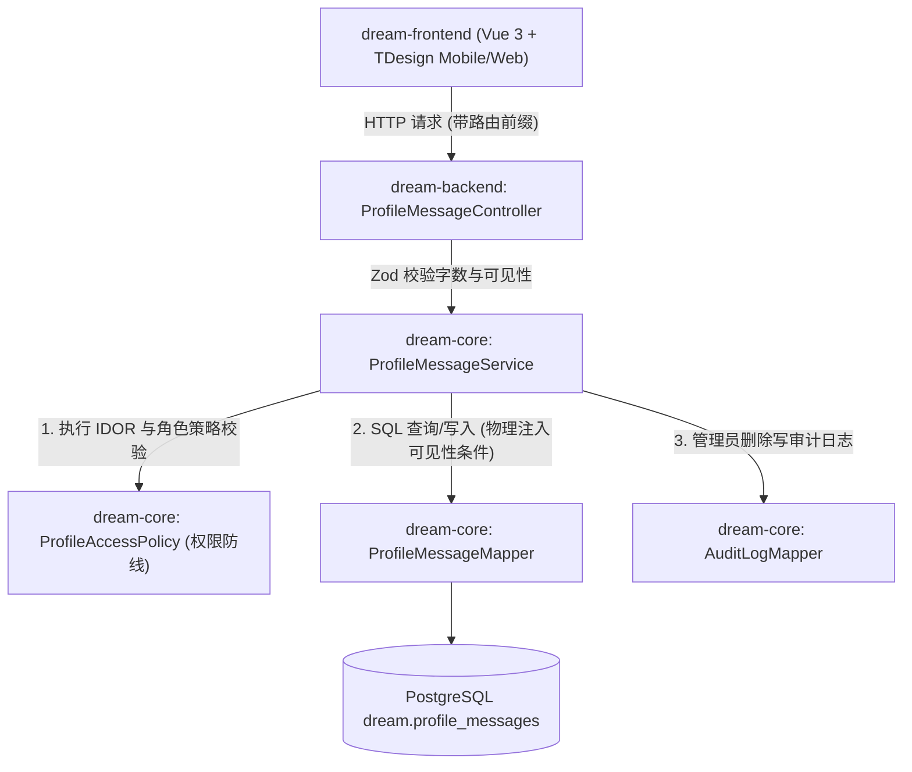
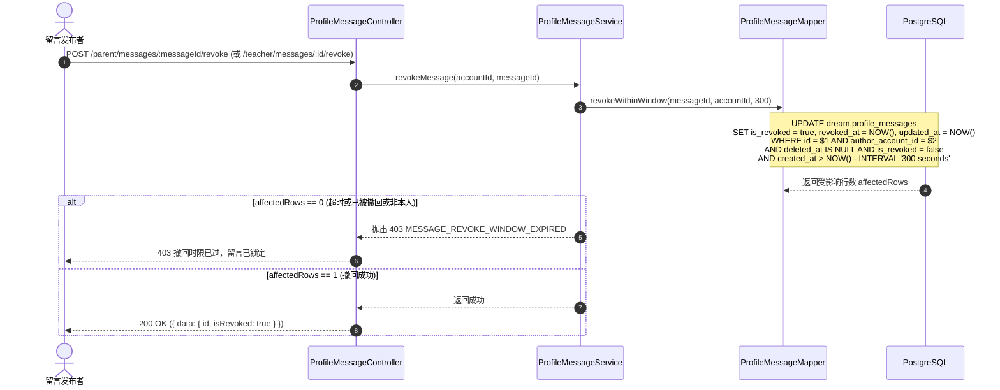

/** (c) 2024-2026 Topee (https://topee.top). All rights reserved. Proprietary and confidential. */

# 技术设计文档 (TDD) — 子模块 1D：双权限教学留言板 (Profile Messages & Feedback)

| 元数据项 | 说明 / 内容 |
|---|---|
| **子模块代号** | `m1d` |
| **关联 PRD** | [m1d_profile_messages.md](../prd/m1d_profile_messages.md) |
| **文档状态** | 草稿 (Draft) |
| **适用工程规范** | `GEMINI.md` + `docs/conventions/*` |
| **创建与更新日期** | 2026-11-04 |

---

## 1. 背景与上下文 (Context)

`m1d`（双权限教学留言板）是 Dream 系统挂载于学员档案上的家校沟通与内部教学交接子模块。它通过**“师生公开”与“仅内部教学可见”两级物理隔离**，解决外教代课交接备忘与家长正面教学反馈的分流呈现问题。

- **上游依赖**：`m1a`（提供学员实体 `student_profile_id`）；`@topeetop/auth-core`（提供发布人 `account_id` 与角色标签）。
- **下游消费方**：
  - 模块三（日历排班）：代课教师进入学员课表时，读取该学员的内部教学留言以了解性格特点与上节课教学备忘；
  - 审计系统：管理员执行终极软删除时写 `dream.audit_logs`。

---

## 2. 问题陈述与动因 (Problem Statement & Motivation)

### 2.1 正在解决的核心痛点
- **痛点 1：内部备忘泄露给家长引发客诉 (IDOR)**：若仅仅在前端通过 CSS 或参数过滤内部留言，一旦接口被越权爬取，将直接导致教学内部争议曝光给家长。
- **痛点 2：误发与选错标签缺乏补救机制**：匆忙录入时容易发生错别字或选错公开/内部标签，需要受控的短时撤回窗口。
- **痛点 3：无状态/Serverless 架构下的定时器陷阱**：严禁在 Node.js 中使用裸 `setTimeout` 维持 300 秒倒计时，必须依托数据库时间戳进行原子判定。

### 2.2 为什么必须现在解决？
留言板是师生课后反馈的第一阵地，且直接关联学员档案的隐私合规红线。

---

## 3. 范围边界 (Scope)

### ✅ 本期必须交付 (In Scope)
1. **数据实体建模**：`dream.profile_messages` 与 `dream.audit_logs`（主键为 12 位短 ID）。
2. **双权限可见性与物理路由隔离**：
   - 路由按工作台划分：`/parent/*`、`/teacher/*`、`/monitor/*`、`/admin/*`；
   - 家长端发帖强制锁定为 `public_teacher_student`；
   - 家长端查询时，SQL **硬编码过滤 `WHERE visibility = 'public_teacher_student'`**，绝对不透传内部留言。
3. **300 秒原子撤回服务**：
   - 依托 SQL `created_at > NOW() - INTERVAL '300 seconds'` 进行原子更新，无裸定时器；
   - 超时后接口坚决抛出 `403 MESSAGE_REVOKE_WINDOW_EXPIRED`。
4. **管理员审计软删除**：必须附带操作原因，完整记录被删除留言快照至 `audit_logs`。
5. **前端线性时间倒序流**：游标分页、倒计时友好提示（如 `撤回 (240s)`）。

### ❌ 本期明确不做 (Out of Scope)
- 图片/视频附件直传。
- Markdown 富文本渲染与表情包。
- 树状嵌套楼中楼评论回复。

---

## 4. 技术方案与系统架构 (Technical Solution)

### 4.1 架构全景与分层职责 (C-S-M)



---

### 4.2 核心业务时序图 (Mermaid Sequence)

#### 时序 1：300 秒原子撤回时序流 (Serverless 合规，无裸定时器)



---

### 4.3 核心 API 契约与 Zod Schema

所有接口挂载于 `/api/dream/v1`：

| Endpoint | 方法 | 权限角色 | 描述 | 请求 Schema | 响应格式 |
|---|---|---|---|---|---|
| `/parent/student-profiles/:id/messages` | GET | `user` (家长) | 家长查询孩子留言（**SQL 物理隔离公开评语**） | `?cursor=&limit=` | `200 { data: MessageDto[], meta: { nextCursor } }` |
| `/parent/student-profiles/:id/messages` | POST | `user` (家长) | 家长发帖（**服务端强制覆盖为公开**） | `ParentMessageSchema` | `201 { data: MessageDto }` |
| `/parent/messages/:id/revoke` | POST | `user` (家长) | 家长撤回本人留言（300秒内） | - | `200 { data: { success: true } }` |
| `/teacher/student-profiles/:id/messages`| GET / POST | `teacher` (教师) | 教师读写留言（支持选择公开或内部） | `StaffMessageSchema` | `200 / 201` |
| `/teacher/messages/:id/revoke` | POST | `teacher` (教师) | 教师撤回本人留言（300秒内） | - | `200` |
| `/monitor/student-profiles/:id/messages`| GET / POST | `monitor` (班长) | 班长读写留言 | `StaffMessageSchema` | `200 / 201` |
| `/admin/student-profiles/:id/messages`  | GET / POST | `admin` (管理员) | 管理员读写全量留言 | `StaffMessageSchema` | `200 / 201` |
| `/admin/messages/:id` | DELETE | `admin` (管理员) | 管理员终极软删除留言（写审计日志） | `AdminDeleteMessageSchema`| `200 { data: { success: true } }` |

#### Zod 契约定义 (`dream-core/src/modules/profile/message.types.ts`)

```typescript
/** (c) 2024-2026 Topee (https://topee.top). All rights reserved. Proprietary and confidential. */
import { z } from 'zod';

export const ParentMessageSchema = z.object({
  content: z.string().trim().min(1, '留言内容不能为空').max(1000, '留言最多1000字'),
});

export const StaffMessageSchema = ParentMessageSchema.extend({
  visibility: z.enum(['public_teacher_student', 'internal_teaching_only'], {
    errorMap: () => ({ message: '可见性标签无效' }),
  }),
});

export const AdminDeleteMessageSchema = z.object({
  reason: z.string().trim().min(2, '删除理由至少2字').max(200, '删除理由最多200字'),
});

export interface MessageDto {
  id: string; // 12-char
  studentProfileId: string;
  authorAccountId: string;
  authorDisplayName: string;
  authorRole: 'admin' | 'monitor' | 'teacher' | 'user';
  visibility: 'public_teacher_student' | 'internal_teaching_only';
  content: string;
  isRevoked: boolean;
  canRevoke: boolean; // 服务端根据 created_at <= 300s 动态推导给发布者
  remainingRevokeSeconds: number; // 剩余秒数
  createdAt: string;
}
```

---

### 4.4 数据存储与模型设计 (Database Modeling)

```sql
-- (c) 2024-2026 Topee (https://topee.top). All rights reserved. Proprietary and confidential.
-- Database Migration: m1d 双权限教学留言板
CREATE SCHEMA IF NOT EXISTS dream;

-- 1. 档案留言表
CREATE TABLE IF NOT EXISTS dream.profile_messages (
    id VARCHAR(12) PRIMARY KEY,
    student_profile_id VARCHAR(12) NOT NULL REFERENCES dream.student_profiles(id),
    author_account_id VARCHAR(12) NOT NULL,
    author_role VARCHAR(16) NOT NULL,
    visibility VARCHAR(32) NOT NULL,
    content VARCHAR(1000) NOT NULL,
    is_revoked BOOLEAN NOT NULL DEFAULT false,
    revoked_at TIMESTAMP WITH TIME ZONE DEFAULT NULL,
    created_at TIMESTAMP WITH TIME ZONE DEFAULT NOW(),
    updated_at TIMESTAMP WITH TIME ZONE DEFAULT NOW(),
    deleted_at TIMESTAMP WITH TIME ZONE DEFAULT NULL,
    CONSTRAINT chk_message_visibility CHECK (visibility IN ('public_teacher_student', 'internal_teaching_only')),
    CONSTRAINT chk_message_author_role CHECK (author_role IN ('admin', 'monitor', 'teacher', 'user'))
);

-- 专用部分索引 1：家长端公开流高效扫描
CREATE INDEX IF NOT EXISTS idx_messages_student_public 
ON dream.profile_messages (student_profile_id, created_at DESC)
WHERE deleted_at IS NULL AND is_revoked = false AND visibility = 'public_teacher_student';

-- 专用部分索引 2：内部教务全量流高效扫描
CREATE INDEX IF NOT EXISTS idx_messages_student_all 
ON dream.profile_messages (student_profile_id, created_at DESC)
WHERE deleted_at IS NULL AND is_revoked = false;

-- 2. 操作审计日志表 (留存敏感下架快照)
CREATE TABLE IF NOT EXISTS dream.audit_logs (
    id VARCHAR(12) PRIMARY KEY,
    operator_id VARCHAR(12) NOT NULL,
    target_entity VARCHAR(32) NOT NULL,
    target_id VARCHAR(12) NOT NULL,
    action VARCHAR(32) NOT NULL,
    reason TEXT DEFAULT NULL,
    changes JSONB DEFAULT NULL,
    created_at TIMESTAMP WITH TIME ZONE DEFAULT NOW()
);

CREATE INDEX IF NOT EXISTS idx_audit_logs_target 
ON dream.audit_logs (target_entity, target_id);
```

---

### 4.5 前端端侧架构与实时撤回组件

- **组件拓扑**：
  - `ProfileMessageBoard.vue`：留言流组件，根据工作台角色自动渲染权限单选钮；
  - `MessageRevokeButton.vue`：倒计时撤回按钮，前端 `setInterval` 仅用于界面倒计时提示，**撤回成功与否以数据库真实时间为准**。
- **样式规范**：100% Tailwind CSS，**严禁手写 CSS / `<style>` 块**。
- **端侧缓存分级**：
  - **L4 绝对零离线 (NetworkOnly)**：留言发布与撤回强制在线。断网时禁止输入并提示。

---

## 5. 风险评估与规避措施 (Risks & Mitigation)

| 风险描述 | 影响级别 | 发生概率 | 规避与缓解策略 |
|---|---|---|---|
| **内部评语越权透传给家长 (IDOR)** | 极高 | 低 | 家长路由对应的 Mapper 查询方法中硬编码 `WHERE visibility = 'public_teacher_student'`，绝对不给前端传参过滤的机会。 |
| **客户端篡改系统时间绕过 300 秒撤回** | 中 | 低 | 撤回时限完全以数据库 `NOW() - INTERVAL '300 seconds'` 为准，杜绝任何客户端时间伪造。 |
| **高频灌水垃圾留言攻击** | 中 | 低 | Fastify 路由级限流（单账号每分钟最多发布 10 条留言）；字符数上限 1000 强校验。 |

---

## 6. 实施与交付计划 (Implementation Plan)

| 阶段 | 交付任务 | 关键产出物 | 预估工时 |
|---|---|---|---|
| **Phase 1: 留言与审计表迁移** | DDL 与 Mapper 层实现 | 迁移脚本；`ProfileMessageMapper.ts` 与 `AuditLogMapper.ts` | 0.5 天 |
| **Phase 2: 领域服务与撤回闭环** | `ProfileMessageService` 业务编排 | 物理隔离过滤、300秒原子撤回、审计日志入库；Jest 单元测试 | 1 天 |
| **Phase 3: 路由与工作台挂载** | Fastify 路由、Zod 强校验 | 4 大工作台对应控制器；E2E 接口测试 | 0.5 天 |
| **Phase 4: 前端流式组件与联调** | 留言板与倒计时撤回按钮 | `ProfileMessageBoard.vue`、双语国际化文案 | 1 天 |

---

## 7. 架构规范自检表 (Local Compliance Checklist)

| 本地规范领域 | 审计红线与标准 | 本方案对位情况 | 判定 |
| :--- | :--- | :--- | :--- |
| **分层架构** | C-S-M 架构，SQL 绝对收敛于 `*Mapper` | `ProfileMessageMapper` 承载 SQL，Service 编排事务 | **通过** |
| **实体 ID 规约** | 严禁自增与 36 位 UUID，必须使用 12 位 Short UUID | 所有新表主键均显式声明 `VARCHAR(12)`，由 `generateShortUuid()` 生成 | **通过** |
| **Schema 规范** | 单 Schema `dream.` 统一收敛，所有 SQL 带显式前缀 | 表定义在 `dream.` 下，SQL 显式拼接前缀 | **通过** |
| **防越权 (IDOR)** | 家长端绝对物理阻断内部留言 | SQL 层强行过滤 `visibility = 'public_teacher_student'` | **通过** |
| **Serverless 合规** | 严禁业务逻辑中使用裸定时器 | 依托 SQL 时间戳进行原子撤回，无 `setTimeout` | **通过** |
| **样式与前端** | 100% Tailwind CSS，L4 强制在线 | 原子类控制布局，无手写样式，发帖操作严格 NetworkOnly | **通过** |
